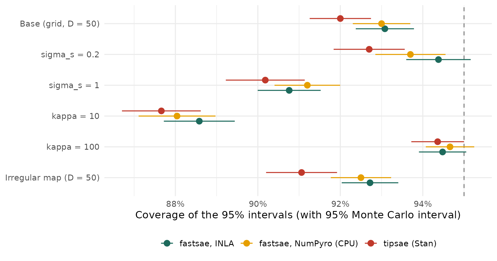
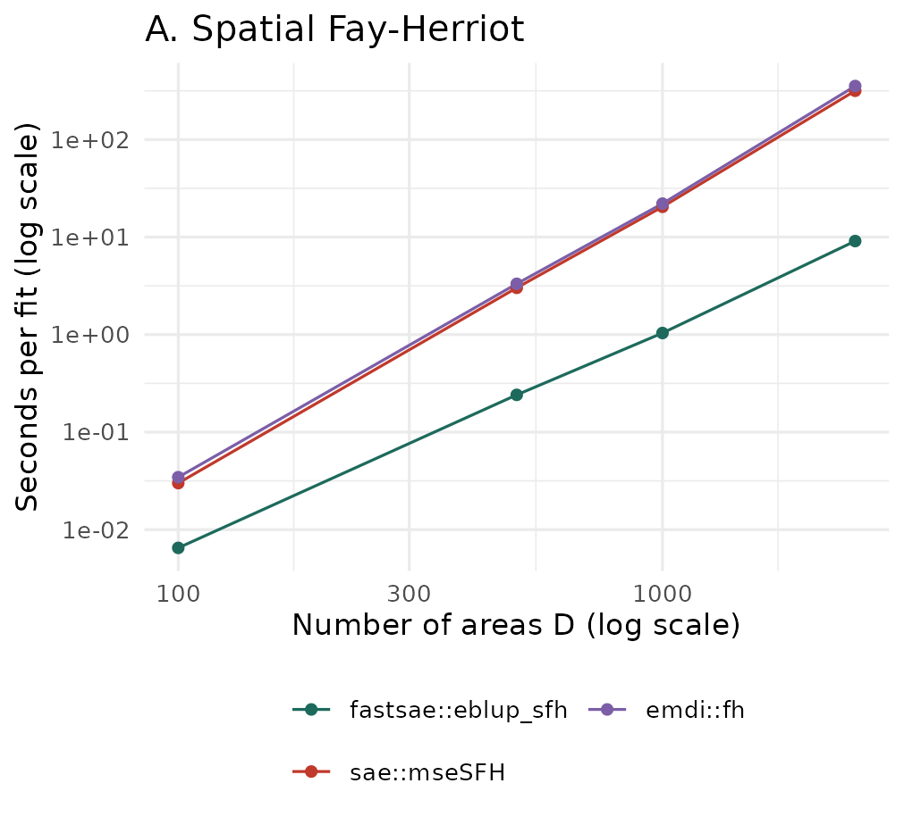
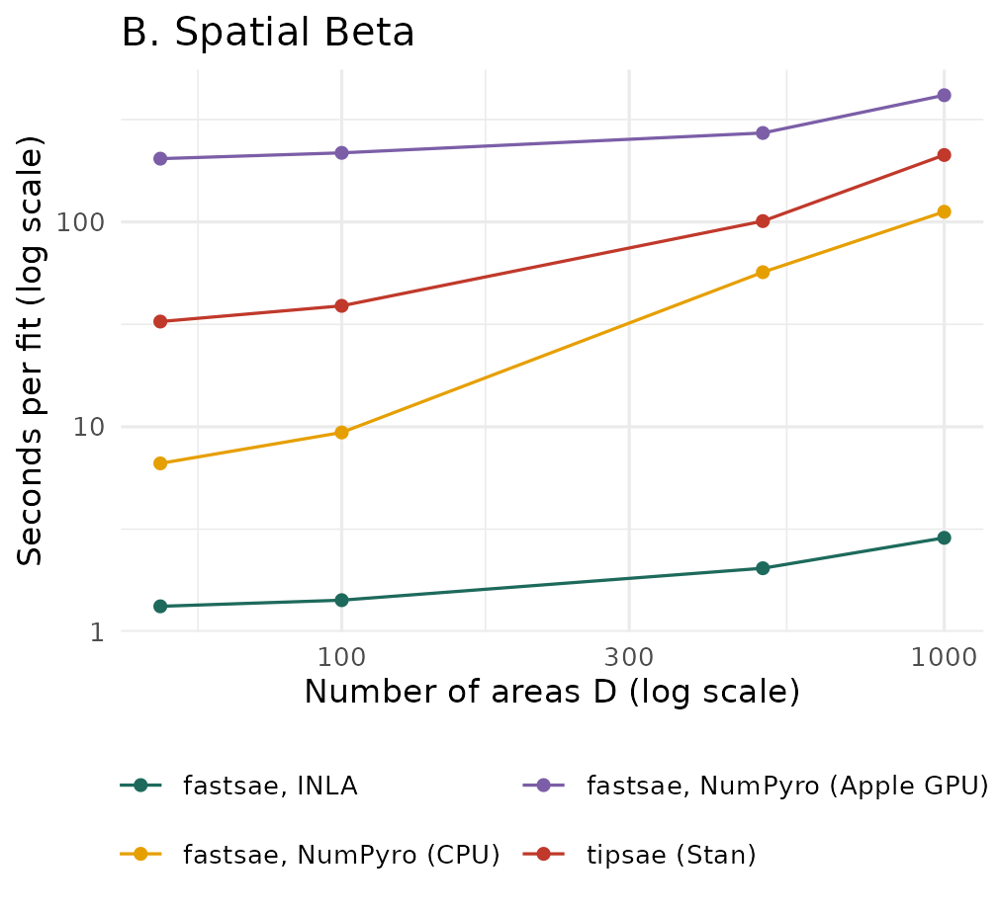

# Is fastsae Better? Accuracy, Speed and Memory against sae, emdi and tipsae

This article asks whether **fastsae** is better than the packages it is
usually compared with, for two models and in three respects: accuracy of
the estimates, speed and memory. The answer is given separately for each
respect. Where fastsae is not better, the article says so.

- **A. Spatial Fay-Herriot model (SAR random effects, frequentist).**
  [`fastsae::eblup_sfh()`](https://ridsonap.is-a.dev/fastsae/reference/eblup_sfh.md)
  against [`sae::mseSFH()`](https://rdrr.io/pkg/sae/man/mseSFH.html)
  (Molina and Marhuenda, 2015) and `emdi::fh(correlation = "spatial")`
  (Kreutzmann et al., 2019).
- **B. Spatial Beta model (Bayesian).**
  `fastsae::hb_area(family = "beta")` with INLA
  ([`inla_engine()`](https://ridsonap.is-a.dev/fastsae/reference/hb_engine.md),
  an approximation; Rue et al., 2009) and with MCMC in NumPyro
  ([`jax_engine()`](https://ridsonap.is-a.dev/fastsae/reference/hb_engine.md)),
  against
  [`tipsae::fit_sae()`](https://rdrr.io/pkg/tipsae/man/fit_sae.html)
  (MCMC in Stan; De Nicolò and Gardini, 2024).

## Summary

| Respect | Spatial Fay-Herriot | Spatial Beta |
|:---|:---|:---|
| **Accuracy** | **The same.** The three packages fit the same model by the same REML criterion and give the same estimates, except in a few data sets near the boundary of $`\rho`$; on the data sets where all fitted, their RMSEs differ by at most 4e-05. fastsae fitted every data set (0 failures out of 4500); `sae` and `emdi` stopped with an error 45 and 24 times. | **About the same, not uniformly better.** INLA and NumPyro agree closely; tipsae is as accurate in most scenarios, less accurate with a strong spatial effect (where its chains often did not converge) and slightly more accurate with a low Beta precision. All three under-cover in the hardest scenarios. |
| **Speed** | **Faster.** At $`D = 2,500`$: 9.10 s against 316 s (`sae`) and 354 s (`emdi`). | **INLA is much faster** (2.87 s at $`D = 1,000`$ against 212 s for tipsae). NumPyro on the CPU is 2 to 5 times faster than tipsae per fit, and up to 3 times per effective draw. NumPyro on the Apple GPU was the slowest at every size measured. |
| **Memory** | **Lower or about the same, by a much smaller margin than the time.** At $`D = 2,500`$: 745 MB against 886 MB and 770 MB. | **Mixed.** At $`D = 50`$ tipsae used the least memory (69 MB, INLA 112 MB); at $`D = 1,000`$ INLA used the least (268 MB against 1.40 GB). NumPyro needs 700-900 MB at every size, mostly for Python and JAX. |

All results come from one machine (Apple M4, 10 cores, 16 GB RAM, no
NVIDIA GPU); see [Machine and versions](#machine-and-versions).

------------------------------------------------------------------------

## Design of the study

The study follows the ADEMP structure of Morris, White and Crowther
(2019): aims, data-generating mechanisms, estimands, methods and
performance measures.

**Aims.** To compare, on data with known truth, the accuracy of the area
estimates and of the model parameters, and to measure the time and
memory of one fit.

### Data-generating mechanisms

Both studies are model-based: the covariates and the sampling variances
are fixed within a scenario, and the random effects and the sampling
errors are drawn anew in each replicate. Each scenario changes one
factor of a base scenario. The parameter values were chosen for this
study; the model forms follow the literature cited.

**A. Spatial Fay-Herriot** (SAR random effects; Petrucci and Salvati,
2006; Pratesi and Salvati, 2008):

``` math
y_d = x_d^\top\beta + u_d + e_d,\quad u = (I - \rho W)^{-1}\varepsilon,\quad
\varepsilon \sim N(0, \sigma^2 I),\quad e_d \sim N(0, \psi_d),
```

with $`\beta = (1, 0.8, -0.5)`$, $`x_{1d} \sim N(0, 1)`$,
$`x_{2d} \sim U(0, 1)`$, $`\sigma^2 = 1`$, $`\psi_d = r\,\sigma^2 u_d`$,
$`u_d \sim U(0.5, 1.5)`$, and $`W`$ the row-standardised queen
contiguity matrix of a regular grid, or of the 42 districts of the
`mys_proxmat` data. Base scenario: $`D = 100`$, $`\rho = 0.5`$,
$`r = 1`$. Others: $`\rho \in \{0.2, 0.8, 0.95\}`$,
$`r \in \{0.5, 2\}`$, $`D \in \{50, 500\}`$ and the real map. **500
replicates** per scenario.

**B. Spatial Beta** (Beta regression for proportions, Ferrari and
Cribari-Neto, 2004; Beta area-level model, Janicki, 2020; random effect
of Besag, York and Mollié, 1991, scaled as in Riebler et al., 2016):

``` math
y_d \sim \mathrm{Beta}\big(\mu_d\kappa_d,\,(1 - \mu_d)\kappa_d\big),\quad
\mathrm{logit}(\mu_d) = x_d^\top\beta + v_d + s_d,\quad v_d \sim N(0, \sigma_v^2),\quad
s = \sigma_s\,\tilde s,
```

where $`\tilde s`$ is an intrinsic CAR (ICAR) field on the queen
adjacency graph, scaled to a geometric mean marginal variance of 1.
$`\beta = (-1, 0.5, -0.4)`$, $`x_{1d} \sim N(0, 1)`$,
$`x_{2d} \sim U(-1, 1)`$, $`\sigma_v = 0.2`$,
$`\kappa_d = \kappa\,e^{a_d}`$ with $`a_d \sim U(-0.5, 0.5)`$. The
sampling variance is estimated from the direct estimate,
$`\hat V_d = y_d(1 - y_d)/(\kappa_d + 1)`$, as a survey would. Base
scenario: a $`5 \times 10`$ grid ($`D = 50`$), $`\sigma_s = 0.5`$,
$`\kappa = 25`$. Others: $`\sigma_s \in \{0.2, 1\}`$,
$`\kappa \in \{10, 100\}`$ and an irregular map (Voronoi tessellation of
50 random points). The real map of `mys_proxmat` is not used here:
tipsae needs polygons, and `mys_proxmat` is only a matrix. **100
replicates** per scenario.

**Why $`D = 50`$ and 100 replicates for the Beta model.** The MCMC fits
take about a minute each (tipsae) under parallel load, so a larger $`D`$
or more replicates would not fit in one overnight run; the speed and
memory measurements go up to $`D = 1,000`$. With 100 replicates of 50
areas, the Monte Carlo standard error (MCSE) of a coverage rate is shown
next to every estimate.

### Estimands and methods

The estimands are the area quantities
($`\theta_d = x_d^\top\beta + u_d`$ for the SFH model, $`\mu_d`$ for the
Beta model) and the model parameters.

**Spatial Fay-Herriot.** All three packages use REML and the analytical
MSE of Prasad-Rao type. In a pilot on one data set, the three gave the
same coefficients, variance, $`\rho`$, EBLUPs and MSEs up to about
$`10^{-15}`$. The documented differences of fastsae (an estimate
$`|\hat\rho| \ge 0.999`$ is treated as fixed in the MSE; see
[`?eblup_sfh`](https://ridsonap.is-a.dev/fastsae/reference/eblup_sfh.md)
and `NEWS.md`) apply only on the boundary. The 95% intervals are
$`\hat\theta_d \pm 1.96\sqrt{\mathrm{mse}_d}`$.

**Spatial Beta.** tipsae’s `spatial_error = TRUE` adds an unstructured
and a scaled ICAR effect (read from its Stan code: `reffs = v + s` with
`s = sigma_s * s_raw / scales_ICAR`). The same structure in fastsae is
`spatial = "bym"` (iid + scaled Besag), which is used here, with the
defaults of each package otherwise. The differences that remain cannot
be removed through the user interfaces:

|  | fastsae (INLA and NumPyro) | tipsae |
|:---|:---|:---|
| Inference | INLA: Laplace approximation. NumPyro: NUTS, 2 chains of 1,000 draws after 500 warm-up | NUTS in Stan, 4 chains of 1,000 draws after 1,000 warm-up |
| SD of the area effects | half-normal(1) on each SD | half-normal(2.5) on each SD |
| Coefficients | $`N(0, 1000)`$, intercept flat (INLA) or nearly flat (NumPyro) | $`N(0, 2.5^2)`$ on standardised covariates (tipsae scales them; its coefficients are converted back for this article) |
| Beta precision | fixed per area at $`\hat\mu_d(1 - \hat\mu_d)/\hat V_d - 1`$, with $`\hat\mu_d`$ from a first fit (the model is fitted twice) | inside the model: $`\phi_d = (\mu_d(1 - \mu_d) - \hat V_d)/\hat V_d`$ |

So the comparison is between what a user gets from each package with its
defaults, not between two approximations of one posterior.

### Performance measures

- Per replicate, averaged over the areas: bias, mean squared error,
  coverage of the 95% intervals and their width. The tables report the
  mean over replicates, with its MCSE (standard deviation over
  replicates divided by $`\sqrt{R}`$), and RMSE as the square root of
  the mean squared error.
- Per area, over replicates: the relative RMSE
  $`\mathrm{RMSE}_d / \bar\theta_d`$ (Beta model only, where the truth
  is positive).
- Model parameters: estimates against the true values; for the SFH
  model, the share of estimates of $`\rho`$ on the boundary.
- MCMC: the largest R-hat and the smallest effective sample size over
  the reported parameters, and divergent transitions (Vehtari et al.,
  2021). A fit with R-hat \> 1.05, an ESS below 100 per chain, or a
  divergence is counted as not converged; **it is kept in all accuracy
  measures**.
- Failed fits are counted. Accuracy is compared on the replicates where
  every method returned a fit, so that all methods see the same data
  sets.
- Time and memory are measured separately, one fit per R process on an
  idle machine (see [Speed](#speed) and [Memory](#memory)).

### Simulation procedure

For each scenario $`k`$:

1.  **Fix the design** (seed $`1000 + k`$): the map and its adjacency
    matrix, the covariates $`x_{1d}, x_{2d}`$, and the sampling
    variances $`\psi_d`$ (SFH) or the Beta precisions $`\kappa_d`$.
    These stay the same in all replicates of the scenario.
2.  **For each replicate** $`r = 1, \dots, R`$ (seed $`10^5 k + r`$):
    1.  Draw the random effects ($`u`$ for the SFH model; $`v`$ and
        $`s`$ for the Beta model) and compute the true area quantities
        $`\theta_{dr}`$ ($`x_d^\top\beta + u_d`$, or $`\mu_d`$).
    2.  Draw the direct estimates: $`y_d = \theta_{dr} + e_d`$ with
        $`e_d \sim N(0, \psi_d)`$, or
        $`y_d \sim \mathrm{Beta}(\mu_d\kappa_d, (1 - \mu_d)\kappa_d)`$
        with the sampling variance
        $`\hat V_d = y_d(1 - y_d)/(\kappa_d + 1)`$ computed from
        $`y_d`$.
    3.  Fit every method to this same data set. The SFH packages get the
        row-standardised $`W`$; for the Beta model fastsae gets the
        binary adjacency matrix and tipsae the polygons of the same map.
        The MCMC methods use seed $`r`$.
    4.  Keep, per area, the estimate $`\hat\theta_{dr}`$ and its 95%
        interval, and, per fit, the model parameters, the convergence
        diagnostics, the warnings and the time. A fit that stops with an
        error is kept as a failure with its error message.
3.  **Summarise** on the replicates where every method returned a fit:
    $`\mathrm{Bias}_d = R^{-1}\sum_r(\hat\theta_{dr} - \theta_{dr})`$,
    $`\mathrm{RMSE}_d = \{R^{-1}\sum_r(\hat\theta_{dr} - \theta_{dr})^2\}^{1/2}`$,
    and the share of replicates whose interval contains $`\theta_{dr}`$,
    plus the per-replicate averages over the areas described above.

**Intervals.** For the SFH model,
$`\hat\theta_d \pm 1.96\sqrt{\mathrm{mse}_d}`$ with the analytical MSE
of each package. For the Beta model, the equal-tailed 95% posterior
interval of $`\mu_d`$ (the 2.5% and 97.5% posterior quantiles): from
INLA’s posterior marginals, from the NumPyro draws, and from the Stan
summary of tipsae.

**What varies between replicates.** The true values change from one
replicate to the next, since the random effects are redrawn: bias, RMSE
and coverage are averages over realisations of the model, for a fixed
design. This is a model-based simulation; the [finite population
article](https://ridsonap.is-a.dev/fastsae/articles/finite-population-validation.md)
shows a design-based one, in which a fixed population is sampled
repeatedly.

**How it was run.** The replicates were split into tasks of one
scenario, one method and a block of 100 (SFH) or 25 (Beta) replicates,
and six tasks ran at a time. Every replicate was saved to its own file,
so an interrupted run resumes where it stopped. The times recorded in
this stage were measured under that parallel load and are not used in
[Speed](#speed).

------------------------------------------------------------------------

## A. Spatial Fay-Herriot

### Accuracy of the area estimates

| Scenario | Replicates (common) | RMSE (MCSE) | Coverage (MCSE) | Width | Max. RMSE diff. sae / emdi | Coverage sae / emdi | Failed fits fastsae / sae / emdi |
|:---|---:|---:|---:|---:|---:|---:|---:|
| Base (grid, D = 100, rho = 0.5) | 500 | 0.724 (0.002) | 94.6% (0.1%) | 2.810 | 1.2e-07 / 1.2e-07 | 94.6% / 94.6% | 0 / 0 / 0 |
| rho = 0.2 | 499 | 0.730 (0.003) | 94.2% (0.2%) | 2.809 | 6.7e-07 / 6.7e-07 | 94.2% / 94.2% | 0 / 1 / 0 |
| rho = 0.8 | 500 | 0.735 (0.003) | 94.7% (0.1%) | 2.862 | 2.7e-12 / 2.7e-12 | 94.7% / 94.7% | 0 / 0 / 0 |
| rho = 0.95 | 487 | 0.721 (0.003) | 94.9% (0.1%) | 2.815 | 3.2e-08 / 3.2e-08 | 94.9% / 94.9% | 0 / 13 / 12 |
| psi / sigma2 = 0.5 | 500 | 0.584 (0.002) | 94.9% (0.1%) | 2.267 | 1.3e-08 / 1.3e-08 | 94.9% / 94.9% | 0 / 0 / 0 |
| psi / sigma2 = 2 | 481 | 0.868 (0.003) | 94.0% (0.2%) | 3.351 | 1.6e-05 / 1.6e-05 | 94.2% / 94.2% | 0 / 19 / 8 |
| D = 50 | 497 | 0.739 (0.004) | 94.4% (0.2%) | 2.885 | 2.1e-07 / 2.1e-07 | 94.4% / 94.4% | 0 / 3 / 2 |
| D = 500 | 500 | 0.706 (0.001) | 94.9% (0.1%) | 2.750 | 0.0e+00 / 0.0e+00 | 94.9% / 94.9% | 0 / 0 / 0 |
| Real map (mys_proxmat, D = 42) | 491 | 0.744 (0.004) | 94.7% (0.2%) | 2.925 | 4.0e-05 / 4.0e-05 | 94.8% / 94.8% | 0 / 9 / 2 |

The RMSE, coverage and width are those of fastsae; the other two columns
show how far `sae` and `emdi` are from them on the same data sets. Every
package keeps close to the nominal 95% in every scenario, and the
estimates are the same in all but a few data sets:

- Away from the boundary of $`\rho`$, the EBLUPs and MSEs of fastsae and
  `sae` differed by at most about $`2 \times 10^{-4}`$, the size of the
  convergence tolerance of the two algorithms.
- In 20 of the 4455 common data sets, the coverage differed. In 14 of
  them both packages gave the same estimate $`\hat\rho = -1`$; fastsae
  then treats $`\rho`$ as fixed in the MSE (a documented difference, see
  [`?eblup_sfh`](https://ridsonap.is-a.dev/fastsae/reference/eblup_sfh.md)),
  which gives narrower intervals. In the other 6, the two packages ended
  at different estimates of $`\rho`$ (for example $`-1`$ in `sae` and
  $`0.999`$ in fastsae): the restricted likelihood has more than one
  local maximum near the boundary, and fastsae maximises it under the
  constraints $`\sigma^2 \ge 0`$, $`|\rho| \le 0.999`$. Which of the two
  maxima is higher was not checked.

**Failed fits.**

|  | fastsae | sae | emdi |
|:---|---:|---:|---:|
| diff \>= PRECISION: comparison is possible only for atomic and list types | 0 | 21 | 0 |
| singular system (solve() or LAPACK dgesv) | 0 | 24 | 24 |

Most failures came from solving a singular system. The others are an
error in the convergence check of the Fisher-scoring loop of
[`sae::eblupSFH()`](https://rdrr.io/pkg/sae/man/eblupSFH.html)
(`diff >= PRECISION`), raised by `sae` itself, not by the code of this
study. The failures are concentrated in the scenarios that push
$`\hat\rho`$ or $`\hat\sigma^2`$ towards a boundary: large sampling
variances, a strong correlation, few areas, and the real map. fastsae
maximises the restricted likelihood under the constraints
$`\sigma^2 \ge 0`$, $`|\rho| \le 0.999`$ and returned an estimate every
time.

### Model parameters

| Scenario | Package | True rho | Mean rho-hat (MCSE) | Mean sigma2-hat (true 1) | rho-hat on boundary | Mean beta1-hat (true 0.8) |
|:---|:---|---:|---:|---:|---:|---:|
| Base (grid, D = 100, rho = 0.5) | fastsae | 0.50 | 0.435 (0.012) | 0.986 | 0.2% | 0.796 |
| Base (grid, D = 100, rho = 0.5) | sae | 0.50 | 0.435 (0.012) | 0.986 | 0.2% | 0.796 |
| rho = 0.2 | fastsae | 0.20 | 0.123 (0.015) | 0.946 | 1.2% | 0.800 |
| rho = 0.2 | sae | 0.20 | 0.125 (0.015) | 0.947 | 1.2% | 0.800 |
| rho = 0.8 | fastsae | 0.80 | 0.762 (0.006) | 1.010 | 0.0% | 0.789 |
| rho = 0.8 | sae | 0.80 | 0.762 (0.006) | 1.010 | 0.0% | 0.789 |
| rho = 0.95 | fastsae | 0.95 | 0.925 (0.003) | 1.020 | 2.8% | 0.812 |
| rho = 0.95 | sae | 0.95 | 0.923 (0.003) | 1.029 | 0.2% | 0.812 |
| psi / sigma2 = 0.5 | fastsae | 0.50 | 0.453 (0.009) | 0.980 | 0.0% | 0.798 |
| psi / sigma2 = 0.5 | sae | 0.50 | 0.453 (0.009) | 0.980 | 0.0% | 0.798 |
| psi / sigma2 = 2 | fastsae | 0.50 | 0.381 (0.018) | 0.950 | 3.0% | 0.801 |
| psi / sigma2 = 2 | sae | 0.50 | 0.384 (0.018) | 0.978 | 2.3% | 0.802 |
| D = 50 | fastsae | 0.50 | 0.392 (0.018) | 0.950 | 1.8% | 0.800 |
| D = 50 | sae | 0.50 | 0.395 (0.017) | 0.954 | 1.6% | 0.799 |
| D = 500 | fastsae | 0.50 | 0.489 (0.004) | 0.994 | 0.0% | 0.801 |
| D = 500 | sae | 0.50 | 0.489 (0.004) | 0.994 | 0.0% | 0.801 |
| Real map (mys_proxmat, D = 42) | fastsae | 0.50 | 0.386 (0.016) | 0.992 | 1.6% | 0.800 |
| Real map (mys_proxmat, D = 42) | sae | 0.50 | 0.383 (0.016) | 1.008 | 1.4% | 0.799 |

`emdi` gave the same parameters as `sae` and is left out of the table.
REML underestimates $`\rho`$, most strongly with few areas or large
sampling variances, and the bias shrinks as $`D`$ grows: this is a
property of the estimator, shared by all three packages, not of an
implementation. The averages of `sae` leave out its failed fits. In the
45 data sets where `sae` failed, fastsae’s $`\hat\rho`$ was on the
boundary in 20, and $`\hat\sigma^2`$ was often small (median 0.41
against a true 1).

------------------------------------------------------------------------

## B. Spatial Beta

### Accuracy of the area estimates

| Scenario | Method | RMSE (MCSE) | Mean relative RMSE | Mean abs. bias | Coverage (MCSE) | Width |
|:---|:---|---:|---:|---:|---:|---:|
| Base (grid, D = 50) | fastsae, INLA | 0.0662 (0.0007) | 23.8% | 0.0067 | 93.1% (0.4%) | 0.246 |
| Base (grid, D = 50) | fastsae, NumPyro (CPU) | 0.0667 (0.0007) | 24.0% | 0.0082 | 93.0% (0.4%) | 0.251 |
| Base (grid, D = 50) | tipsae (Stan) | 0.0664 (0.0008) | 23.7% | 0.0113 | 92.0% (0.4%) | 0.257 |
| sigma_s = 0.2 | fastsae, INLA | 0.0527 (0.0007) | 19.0% | 0.0092 | 94.4% (0.4%) | 0.204 |
| sigma_s = 0.2 | fastsae, NumPyro (CPU) | 0.0531 (0.0007) | 19.2% | 0.0104 | 93.7% (0.4%) | 0.205 |
| sigma_s = 0.2 | tipsae (Stan) | 0.0530 (0.0007) | 19.1% | 0.0129 | 92.7% (0.4%) | 0.204 |
| sigma_s = 1 | fastsae, INLA | 0.0731 (0.0009) | 25.4% | 0.0065 | 90.8% (0.4%) | 0.251 |
| sigma_s = 1 | fastsae, NumPyro (CPU) | 0.0733 (0.0009) | 25.4% | 0.0073 | 91.2% (0.4%) | 0.258 |
| sigma_s = 1 | tipsae (Stan) | 0.0895 (0.0061) | 30.0% | 0.0170 | 90.2% (0.5%) | 0.284 |
| kappa = 10 | fastsae, INLA | 0.0962 (0.0012) | 34.4% | 0.0116 | 88.6% (0.4%) | 0.334 |
| kappa = 10 | fastsae, NumPyro (CPU) | 0.0980 (0.0012) | 34.9% | 0.0151 | 88.0% (0.5%) | 0.347 |
| kappa = 10 | tipsae (Stan) | 0.0916 (0.0011) | 32.6% | 0.0171 | 87.7% (0.5%) | 0.338 |
| kappa = 100 | fastsae, INLA | 0.0394 (0.0004) | 14.0% | 0.0026 | 94.5% (0.3%) | 0.147 |
| kappa = 100 | fastsae, NumPyro (CPU) | 0.0394 (0.0004) | 14.1% | 0.0027 | 94.7% (0.3%) | 0.148 |
| kappa = 100 | tipsae (Stan) | 0.0418 (0.0016) | 15.0% | 0.0049 | 94.4% (0.3%) | 0.154 |
| Irregular map (D = 50) | fastsae, INLA | 0.0671 (0.0009) | 24.6% | 0.0082 | 92.7% (0.3%) | 0.248 |
| Irregular map (D = 50) | fastsae, NumPyro (CPU) | 0.0677 (0.0009) | 24.8% | 0.0102 | 92.5% (0.4%) | 0.253 |
| Irregular map (D = 50) | tipsae (Stan) | 0.0682 (0.0009) | 25.2% | 0.0157 | 91.1% (0.4%) | 0.258 |



- **INLA and NumPyro** give nearly the same accuracy in every scenario:
  the approximation of INLA costs nothing measurable here.
- **tipsae** is as accurate as fastsae in most scenarios. With a strong
  spatial effect ($`\sigma_s = 1`$) its RMSE is clearly larger; this is
  also the scenario where its chains most often did not converge (next
  section). With a low Beta precision ($`\kappa = 10`$) its RMSE is
  slightly smaller than that of fastsae, possibly because it models the
  precision inside the model instead of fixing it from a first fit; this
  study cannot separate that from the prior.
- tipsae’s intervals covered the truth less often than those of fastsae
  with INLA in every scenario, by 0.1 to 1.7 percentage points (the
  Monte Carlo intervals overlap in some).
- tipsae has the largest mean absolute bias of the area estimates in
  every scenario, although the bias is small next to the RMSE for all
  methods.
- **All methods under-cover** when the precision is low or the spatial
  effect strong, by a similar amount: with $`D = 50`$, the
  hyperparameters are poorly determined by the data.

### Model parameters

| Scenario | Method | beta1 (0.5) | beta2 (-0.4) | sigma_v (true) | sigma_s (true) |
|:---|:---|---:|---:|---:|---:|
| Base (grid, D = 50) | fastsae, INLA | 0.543 | -0.443 | 0.332 (0.2) | 0.531 (0.5) |
| Base (grid, D = 50) | fastsae, NumPyro (CPU) | 0.543 | -0.450 | 0.315 (0.2) | 0.533 (0.5) |
| Base (grid, D = 50) | tipsae (Stan) | 0.545 | -0.452 | 0.294 (0.2) | 0.550 (0.5) |
| sigma_s = 0.2 | fastsae, INLA | 0.525 | -0.447 | 0.258 (0.2) | 0.206 (0.2) |
| sigma_s = 0.2 | fastsae, NumPyro (CPU) | 0.522 | -0.447 | 0.236 (0.2) | 0.210 (0.2) |
| sigma_s = 0.2 | tipsae (Stan) | 0.531 | -0.460 | 0.216 (0.2) | 0.215 (0.2) |
| sigma_s = 1 | fastsae, INLA | 0.555 | -0.381 | 0.506 (0.2) | 0.916 (1) |
| sigma_s = 1 | fastsae, NumPyro (CPU) | 0.556 | -0.386 | 0.483 (0.2) | 0.931 (1) |
| sigma_s = 1 | tipsae (Stan) | 0.570 | -0.367 | 0.485 (0.2) | 0.979 (1) |
| kappa = 10 | fastsae, INLA | 0.594 | -0.495 | 0.591 (0.2) | 0.624 (0.5) |
| kappa = 10 | fastsae, NumPyro (CPU) | 0.601 | -0.501 | 0.586 (0.2) | 0.633 (0.5) |
| kappa = 10 | tipsae (Stan) | 0.561 | -0.472 | 0.486 (0.2) | 0.606 (0.5) |
| kappa = 100 | fastsae, INLA | 0.512 | -0.404 | 0.242 (0.2) | 0.473 (0.5) |
| kappa = 100 | fastsae, NumPyro (CPU) | 0.511 | -0.404 | 0.227 (0.2) | 0.476 (0.5) |
| kappa = 100 | tipsae (Stan) | 0.523 | -0.414 | 0.232 (0.2) | 0.512 (0.5) |
| Irregular map (D = 50) | fastsae, INLA | 0.546 | -0.466 | 0.395 (0.2) | 0.491 (0.5) |
| Irregular map (D = 50) | fastsae, NumPyro (CPU) | 0.548 | -0.468 | 0.386 (0.2) | 0.499 (0.5) |
| Irregular map (D = 50) | tipsae (Stan) | 0.554 | -0.466 | 0.362 (0.2) | 0.512 (0.5) |

Medians over the replicates of the posterior medians. The three methods
recover the coefficients equally well. The unstructured SD $`\sigma_v`$
is overestimated by all three, more when the precision is low: with 50
areas, it is hard to tell from the spatial effect and from the sampling
noise, and its posterior is pulled towards the prior.

### Convergence of the MCMC fits

| Scenario | Method | Fits | R-hat \> 1.05 | ESS \< 100 per chain | Any divergence | Not converged (any) | Median smallest ESS |
|:---|:---|---:|---:|---:|---:|---:|---:|
| Base (grid, D = 50) | fastsae, NumPyro (CPU) | 100 | 2 | 57 | 26 | 67 | 187 |
| Base (grid, D = 50) | tipsae (Stan) | 100 | 1 | 62 | 4 | 62 | 342 |
| sigma_s = 0.2 | fastsae, NumPyro (CPU) | 100 | 1 | 23 | 7 | 25 | 293 |
| sigma_s = 0.2 | tipsae (Stan) | 100 | 0 | 32 | 0 | 32 | 487 |
| sigma_s = 1 | fastsae, NumPyro (CPU) | 100 | 2 | 77 | 49 | 86 | 152 |
| sigma_s = 1 | tipsae (Stan) | 100 | 33 | 84 | 56 | 91 | 235 |
| kappa = 10 | fastsae, NumPyro (CPU) | 100 | 2 | 60 | 13 | 65 | 180 |
| kappa = 10 | tipsae (Stan) | 100 | 2 | 76 | 75 | 88 | 303 |
| kappa = 100 | fastsae, NumPyro (CPU) | 100 | 6 | 91 | 59 | 95 | 138 |
| kappa = 100 | tipsae (Stan) | 100 | 6 | 93 | 1 | 93 | 274 |
| Irregular map (D = 50) | fastsae, NumPyro (CPU) | 100 | 3 | 61 | 24 | 70 | 181 |
| Irregular map (D = 50) | tipsae (Stan) | 100 | 0 | 79 | 7 | 79 | 317 |

With their default settings, **neither MCMC method converged reliably**
by these criteria: in every scenario between a quarter and nearly all of
the fits had a too small ESS for some parameter, both had divergent
transitions in many fits (NumPyro most often with $`\kappa = 100`$ and
$`\sigma_s = 1`$, tipsae with $`\kappa = 10`$ and $`\sigma_s = 1`$), and
tipsae had an R-hat above 1.05 in a third of the fits with a strong
spatial effect. NumPyro’s default of 2 chains of 1,000 draws gives fewer
draws than tipsae’s 4 chains of 1,000, so its ESS is lower for that
reason alone. The defaults of both are meant for a first look; for
reported results, longer chains (for NumPyro,
`jax_engine(warmup = , samples = )`) and a check of the diagnostics are
needed. INLA has no such diagnostics; its accuracy above is the check.

The two smallest ESS values are not computed in the same way: for
NumPyro it is the smallest rank-normalised bulk or tail ESS over the
hyperparameters, coefficients and area means (as reported by fastsae);
for tipsae it is the smallest `n_eff` of `rstan` over all parameters of
the Stan summary. They are comparable in size, not exactly.

------------------------------------------------------------------------

## Speed

Each cell below is one R process that fits the same data set several
times (two for the slowest cells, three otherwise); the first fit
includes start-up costs (compilation of the JAX model, the first call of
Stan), and the table shows the median of the later ones. The processes
ran one after another on an otherwise idle machine. The SFH data are the
base scenario on a grid of $`D`$ cells; the Beta data are the base
scenario of the accuracy study.

|     D | fastsae::eblup_sfh | sae::mseSFH | emdi::fh |
|------:|-------------------:|------------:|---------:|
|   100 |             0.01 s |      0.03 s |   0.03 s |
|   500 |             0.24 s |      3.02 s |   3.32 s |
| 1,000 |             1.04 s |        20 s |     22 s |
| 2,500 |             9.10 s |       316 s |    354 s |

Spatial Fay-Herriot: REML fit and analytical MSE (warm time) {.table}

| D | fastsae, INLA | fastsae, NumPyro (CPU) | fastsae, NumPyro (Apple GPU) | tipsae (Stan) |
|---:|---:|---:|---:|---:|
| 50 | 1.33 s | 6.63 s | 204 s | 33 s |
| 100 | 1.42 s | 9.38 s | 217 s | 39 s |
| 500 | 2.04 s | 57 s | 272 s | 101 s |
| 1,000 | 2.87 s | 112 s | 416 s | 212 s |

Spatial Beta (warm time) {.table}



For the MCMC methods, the time per fit depends on the number of draws,
so the time per effective draw (warm time divided by the smallest ESS of
that fit) is the fairer comparison:

|     D | NumPyro (CPU) | NumPyro (Apple GPU) |  tipsae |
|------:|--------------:|--------------------:|--------:|
|    50 |       0.026 s |             0.922 s | 0.082 s |
|   100 |       0.053 s |             1.431 s | 0.134 s |
|   500 |       2.032 s |             9.812 s | 2.072 s |
| 1,000 |       3.011 s |            14.399 s | 6.975 s |

- **Spatial Fay-Herriot:** fastsae is faster at every size, and the gap
  grows with $`D`$ (sparse Cholesky factorisations instead of dense
  $`D \times D`$ inverses). With a few dozen areas all three take a
  fraction of a second, and the difference does not matter in practice.
- **Spatial Beta:** INLA takes a few seconds up to $`D = 1,000`$.
  NumPyro on the CPU is faster than tipsae per fit, and per effective
  draw at all sizes but $`D = 500`$, where the two were about equal. On
  this machine the Apple GPU (Metal) was slower than the CPU at every
  size measured. No NVIDIA GPU was available, so CUDA was not measured.
- At $`D \ge 500`$, the smallest ESS of both MCMC methods with default
  settings was only a few dozen, so their per-fit times understate the
  time needed for a reliable fit.

## Memory

The memory of a fit is the peak resident set size (RSS) of the R process
**and all its child processes** (INLA runs as a separate program),
sampled every 0.1 s, minus the peak of a process that loads the same
packages and data without fitting. `bench::mark()`’s `mem_alloc` is not
used: it counts only memory allocated by R, so it misses INLA, Stan and
JAX.

|     D | fastsae::eblup_sfh | sae::mseSFH | emdi::fh |
|------:|-------------------:|------------:|---------:|
|   100 |              38 MB |       50 MB |    50 MB |
|   500 |              80 MB |      153 MB |   141 MB |
| 1,000 |             140 MB |      284 MB |   231 MB |
| 2,500 |             745 MB |      886 MB |   770 MB |

Spatial Fay-Herriot: increase of the peak memory {.table}

| D | fastsae, INLA | fastsae, NumPyro (CPU) | fastsae, NumPyro (Apple GPU) | tipsae (Stan) |
|---:|---:|---:|---:|---:|
| 50 | 112 MB | 907 MB | 726 MB | 69 MB |
| 100 | 123 MB | 837 MB | 676 MB | 181 MB |
| 500 | 168 MB | 781 MB | 722 MB | 932 MB |
| 1,000 | 268 MB | 854 MB | 730 MB | 1.40 GB |

Spatial Beta: increase of the peak memory {.table}

- **Spatial Fay-Herriot:** fastsae needs less memory than `sae` and
  `emdi` at $`D = 500`$ and 1,000; at $`D = 100`$ the differences are
  within run-to-run noise, and at the largest $`D`$ its margin over
  `emdi` is small.
- **Spatial Beta:** no method is best at every size. INLA’s memory grows
  slowly with $`D`$; tipsae needs little memory for small $`D`$ and the
  most at $`D = 1,000`$; NumPyro’s 700-900 MB are mostly the Python
  interpreter and JAX, which is counted here because a user pays for it
  too.

**Limits of the method.** Peaks shorter than the 0.1 s sampling interval
can be missed. Differences of a few tens of MB vary from run to run. On
Apple silicon the GPU uses the same (unified) memory, which RSS does not
fully show, so the Metal figures are lower bounds.

------------------------------------------------------------------------

## Conclusions

- **Spatial Fay-Herriot.** fastsae is not more accurate than `sae` or
  `emdi`: it fits the same estimator and gives the same numbers. It is
  **faster** (12 to 35 times here for $`D \ge 500`$), uses **less or
  about the same memory**, and returned a fit for every data set, where
  `sae` and `emdi` stopped with an error in about 1% of all data sets
  (up to 4% in the hardest scenario). In a few data sets near the
  boundary of $`\rho`$ its estimate or its MSE differs from that of
  `sae`, as documented.
- **Spatial Beta.** fastsae with INLA is **about as accurate** as
  tipsae, better with a strong spatial effect and slightly worse with a
  low Beta precision, and **25 to 75 times faster** here ($`D = 50`$ to
  1,000). Its memory is not lower than tipsae’s for small $`D`$. The
  MCMC engine of fastsae gives the same estimates as INLA and is faster
  than tipsae, but with default settings neither MCMC method converged
  reliably.
- Every conclusion holds for these scenarios, these defaults and this
  machine. The accuracy study uses $`D \le 500`$ (SFH) and $`D = 50`$
  (Beta), and the parameter values were chosen for this study.

## Reproduce

From the package root, after `R CMD INSTALL . --preclean` (the scripts
use the installed fastsae):

``` sh
sh benchmarks/eval/run_overnight.sh          # accuracy (6 parallel processes), then speed and memory
WORKERS=4 sh benchmarks/eval/run_overnight.sh 00:00   # same, starting at midnight
```

The scripts are in
[`benchmarks/eval/`](https://github.com/ridsonap/fastsae/tree/main/benchmarks/eval):
`eval_common.R` (scenarios, data and fits), `sim_accuracy.R` (one task
per scenario, method and block of replicates, resumable) and
`bench_resources.R` (one process per cell). The run behind this page
took about 2.7 hours for the accuracy study and 1.7 hours for speed and
memory. Seeds are fixed: the design of scenario $`k`$ uses seed
$`1000 + k`$, replicate $`r`$ seed $`10^5 k + r`$.

## Machine and versions

| Item | Value |
|:---|:---|
| Date | 2026-10-28 |
| Machine | Apple M4, 10 cores |
| RAM | 16 GB |
| OS | macOS Tahoe 26.6.2 |
| R | R version 4.6.1 (2026-06-24) |
| Packages | fastsae 1.0.0, sae 1.3, emdi 2.2.3, tipsae 1.0.3, INLA 26.8.7, rstan 2.32.7 |
| Python | jax 0.5.0, jaxlib 0.5.0, jax-metal 0.1.1, numpyro 0.19.0 |
| Threads | OMP_NUM_THREADS unset; INLA single-threaded (hb_area); tipsae chains one after another; NumPyro chains on the CPU |
| Settings | jax_engine() defaults: 2 chains x 1000 draws, 500 warmup; fit_sae() defaults: 4 chains x 2000 iterations (1000 warmup), chains run one after another; inla_engine() defaults; hb_area() runs INLA single-threaded; REML, analytical MSE, fastsae n_threads = 1 |

## References

- Besag, J., York, J. and Mollié, A. (1991). Bayesian image restoration,
  with two applications in spatial statistics. *Annals of the Institute
  of Statistical Mathematics*, 43, 1–20.
  [doi:10.1007/BF00116466](https://doi.org/10.1007/BF00116466)
- De Nicolò, S. and Gardini, A. (2024). The R package tipsae: Tools for
  mapping proportions and indicators on the unit interval. *Journal of
  Statistical Software*, 108, 1–36.
  [doi:10.18637/jss.v108.i01](https://doi.org/10.18637/jss.v108.i01)
- Ferrari, S. L. P. and Cribari-Neto, F. (2004). Beta regression for
  modelling rates and proportions. *Journal of Applied Statistics*, 31,
  799–815.
  [doi:10.1080/0266476042000214501](https://doi.org/10.1080/0266476042000214501)
- Janicki, R. (2020). Properties of the beta regression model for small
  area estimation of proportions and application to estimation of
  poverty rates. *Communications in Statistics – Theory and Methods*,
  49, 2264–2284.
  [doi:10.1080/03610926.2019.1570266](https://doi.org/10.1080/03610926.2019.1570266)
- Kreutzmann, A.-K., Pannier, S., Rojas-Perilla, N., Schmid, T.,
  Templ, M. and Tzavidis, N. (2019). The R package emdi for estimating
  and mapping regionally disaggregated indicators. *Journal of
  Statistical Software*, 91, 1–33.
  [doi:10.18637/jss.v091.i07](https://doi.org/10.18637/jss.v091.i07)
- Molina, I. and Marhuenda, Y. (2015). sae: An R package for small area
  estimation. *The R Journal*, 7, 81–98.
  [doi:10.32614/RJ-2015-007](https://doi.org/10.32614/RJ-2015-007)
- Morris, T. P., White, I. R. and Crowther, M. J. (2019). Using
  simulation studies to evaluate statistical methods. *Statistics in
  Medicine*, 38, 2074–2102.
  [doi:10.1002/sim.8086](https://doi.org/10.1002/sim.8086)
- Petrucci, A. and Salvati, N. (2006). Small area estimation for spatial
  correlation in watershed erosion assessment. *Journal of Agricultural,
  Biological, and Environmental Statistics*, 11, 169–182.
  [doi:10.1198/108571106X110531](https://doi.org/10.1198/108571106X110531)
- Pratesi, M. and Salvati, N. (2008). Small area estimation: the EBLUP
  estimator based on spatially correlated random area effects.
  *Statistical Methods and Applications*, 17, 113–141.
  [doi:10.1007/s10260-007-0061-9](https://doi.org/10.1007/s10260-007-0061-9)
- Riebler, A., Sørbye, S. H., Simpson, D. and Rue, H. (2016). An
  intuitive Bayesian spatial model for disease mapping that accounts for
  scaling. *Statistical Methods in Medical Research*, 25, 1145–1165.
  [doi:10.1177/0962280216660421](https://doi.org/10.1177/0962280216660421)
- Rue, H., Martino, S. and Chopin, N. (2009). Approximate Bayesian
  inference for latent Gaussian models by using integrated nested
  Laplace approximations. *Journal of the Royal Statistical Society
  Series B*, 71, 319–392.
  [doi:10.1111/j.1467-9868.2008.00700.x](https://doi.org/10.1111/j.1467-9868.2008.00700.x)
- Vehtari, A., Gelman, A., Simpson, D., Carpenter, B. and Bürkner, P.-C.
  (2021). Rank-normalization, folding, and localization: An improved
  $`\widehat{R}`$ for assessing convergence of MCMC (with discussion).
  *Bayesian Analysis*, 16, 667–718.
  [doi:10.1214/20-BA1221](https://doi.org/10.1214/20-BA1221)
