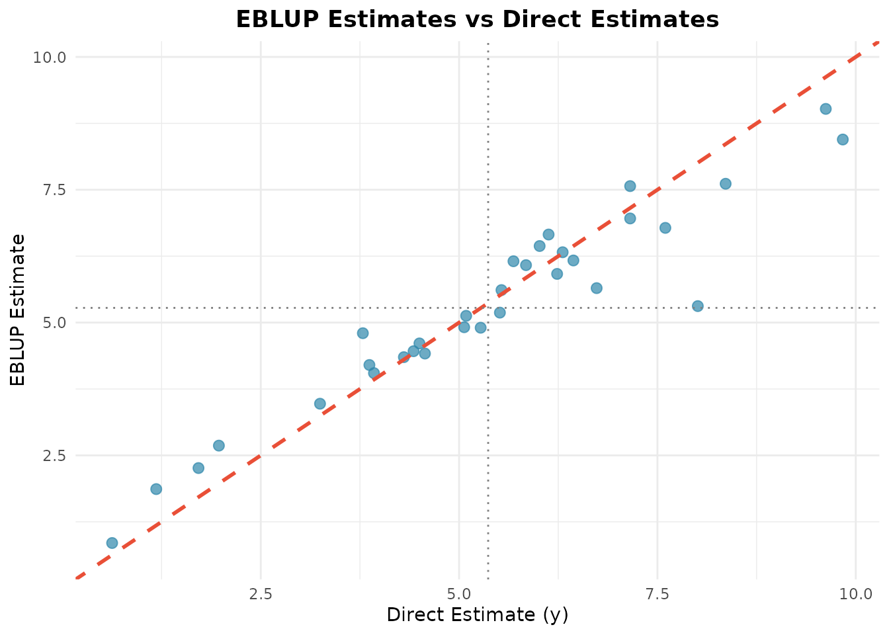

# Getting Started with fastsae

## Introduction

Small Area Estimation (SAE) encompasses statistical techniques designed
to produce reliable estimates for sub-populations or geographical
domains where sample sizes are too small for direct survey estimators to
achieve acceptable precision.

The **fastsae** package fits frequentist EBLUP models in compiled C++
(via `Rcpp`, `RcppArmadillo` and `RcppEigen`) and hierarchical Bayes
models with INLA. It offers:

- **Fast computation**: Fisher scoring and the MSE computations in
  compiled C++, with sparse linear algebra for the spatial models.
- **Agreement with `sae`**: where both packages use the same method, the
  estimates, variance components and analytical MSEs agree with `sae` to
  rounding error (shown below for the Fay-Herriot model). The documented
  exceptions concern the spatial model: a spatial correlation estimated
  on the boundary, and the MSE of ML fits (see
  [`?eblup_sfh`](https://ridsonap.is-a.dev/fastsae/reference/eblup_sfh.md)).
- **Modern S3 interface**: Seamless integration with standard R methods
  ([`summary()`](https://rdrr.io/r/base/summary.html),
  [`coef()`](https://rdrr.io/r/stats/coef.html),
  [`fitted()`](https://rdrr.io/r/stats/fitted.values.html),
  [`residuals()`](https://rdrr.io/r/stats/residuals.html),
  [`autoplot()`](https://ggplot2.tidyverse.org/reference/autoplot.html)).

## The Fay-Herriot Model

The area-level model introduced by Fay and Herriot (1979) links the
direct survey estimates $`y_d`$ of the area parameters $`\theta_d`$ with
auxiliary variables $`x_d`$:

``` math
y_d = x_d^\top \beta + u_d + e_d, \quad d = 1, \dots, D
```

where: - $`u_d \sim \text{i.i.d. } N(0, \sigma_u^2)`$ represents
domain-specific random effects. - $`e_d \sim \text{ind. } N(0, \psi_d)`$
represents sampling errors with known sampling variance $`\psi_d`$
(`vardir`).

The Empirical Best Linear Unbiased Predictor (EBLUP) is a weighted
combination of the direct estimator and the regression-synthetic
estimator:

``` math
\hat{\theta}_d = \gamma_d y_d + (1 - \gamma_d) x_d^\top \hat{\beta}
```

where $`\gamma_d = \frac{\hat{\sigma}_u^2}{\hat{\sigma}_u^2 + \psi_d}`$
is the shrinkage factor ($`0 \le \gamma_d \le 1`$) and $`\hat\beta`$ is
the generalized least squares estimator. Areas without a direct estimate
($`y_d`$ missing) get the synthetic estimate $`x_d^\top \hat{\beta}`$.

The MSE of the EBLUP is estimated by the second-order approximation
$`g_{1d} + g_{2d} + 2 g_{3d}`$ (Prasad and Rao, 1990; Datta and Lahiri,
2000), where $`g_{1d} = \gamma_d \psi_d`$ is the MSE with known
parameters, $`g_{2d}`$ accounts for the estimation of $`\beta`$ and
$`g_{3d}`$ for that of $`\sigma_u^2`$. For ML fits a bias term is
subtracted. The relative standard error is
$`\mathrm{RSE}_d = 100 \sqrt{\mathrm{MSE}_d} / \hat{\theta}_d`$.

## Step-by-Step Example

### 1. Load Package and Dataset

We use the built-in `mys` dataset (mean years of schooling of people
with disabilities in 42 areas, 10 of them not sampled):

``` r

library(fastsae)
library(ggplot2)

data("mys")
head(mys)
#> # A tibble: 6 × 9
#>    area     y vardir   rse    x1    x2    x3      n  weight
#>   <int> <dbl>  <dbl> <dbl> <dbl> <dbl> <dbl>  <dbl>   <dbl>
#> 1     1  8.36  0.662  9.73   124    24    14  7280. 0.0326 
#> 2     2  7.60  0.837 12.0     89    18     9  2743. 0.0123 
#> 3     3  5.51  0.882 17.0     57    19     5  1706. 0.00764
#> 4     4  3.87  0.658 21.0     88    35    19  3073. 0.0138 
#> 5     5  6.31  1.28  17.9    141    46    29 13400. 0.0600 
#> 6     6  3.93  0.388 15.9     96    29    10  2004. 0.00897
```

### 2. Fit Fay-Herriot Model (`eblup_fh`)

To fit an area-level Fay-Herriot model using Restricted Maximum
Likelihood (REML):

``` r

# Fit Fay-Herriot model
fit_fh <- eblup_fh(
  formula = y ~ x1 + x2 + x3,
  vardir = ~vardir,
  data = mys,
  method = "REML",
  print_result = FALSE
)
```

### 3. Model Summary and Coefficients

The standard S3 [`summary()`](https://rdrr.io/r/base/summary.html)
method provides comprehensive model diagnostics, variance components,
and coefficient tests:

``` r

summary(fit_fh)
#> 
#> ── Summary of fastsae Fit ──────────────────────────────────────────────────────
#> Call :
#> eblup_fh(formula = y ~ x1 + x2 + x3, vardir = ~vardir, data = mys, method =
#> "REML", print_result = FALSE)
#> 
#> ✔ Convergence: Yes (in 6 iterations)
#> Model: Fay-Herriot (Area-level)
#> Method: REML
#> 
#> Variance Components:
#> sigma2_u: 2.608103 
#> 
#> Coefficients:
#>                   beta  std.error     zvalue pvalue
#> (Intercept)  3.1077510  0.7697687  4.0372527 0.0001
#> x1          -0.0019323  0.0098886 -0.1954019 0.8451
#> x2           0.0555184  0.0614129  0.9040187 0.3660
#> x3           0.0335344  0.0580013  0.5781663 0.5632
#> 
#> Goodness of Fit:
#> loglikelihood           AIC           BIC 
#>     -65.14251     140.28502     147.61370 
#> 
#> EBLUP Summary Statistics:
#>       mse              rse        
#>  Min.   :0.2037   Min.   : 9.844  
#>  1st Qu.:0.6886   1st Qu.:14.889  
#>  Median :1.0156   Median :22.157  
#>  Mean   :1.5434   Mean   :26.275  
#>  3rd Qu.:2.4886   3rd Qu.:35.020  
#>  Max.   :3.7074   Max.   :53.065
```

You can extract fixed-effects coefficients using
[`coef()`](https://rdrr.io/r/stats/coef.html):

``` r

coef(fit_fh)
#>  (Intercept)           x1           x2           x3 
#>  3.107750953 -0.001932259  0.055518370  0.033534410
```

Fitted EBLUP estimates and residuals can be extracted using standard
generics:

``` r

# Fitted values (EBLUP)
head(fitted(fit_fh))
#> [1] 7.612738 6.782316 5.187060 4.201545 6.323679 4.048590

# Residuals (direct estimate - EBLUP)
head(residuals(fit_fh))
#> [1]  0.74678890  0.81733383  0.32707611 -0.33221827 -0.01861583 -0.12178363
```

### 4. Diagnostic Plots (`autoplot`)

`fastsae` extends
[`ggplot2::autoplot()`](https://ggplot2.tidyverse.org/reference/autoplot.html)
to provide convenient diagnostic and comparison plots.

#### Direct Estimates vs EBLUP

Comparing the direct estimates against EBLUP demonstrates shrinkage
towards the regression synthetic line:

``` r

autoplot(fit_fh, type = "estimates")
```



#### Mean Squared Error (MSE) Across Domains

Inspect domain-level uncertainty with MSE plots:

``` r

autoplot(fit_fh, type = "mse")
```


## Agreement with `sae`

On the same data, `fastsae` reproduces
[`sae::mseFH()`](https://rdrr.io/pkg/sae/man/mseFH.html), which returns
the EBLUPs and their analytical MSE.

[`sae::mseFH()`](https://rdrr.io/pkg/sae/man/mseFH.html) needs complete
data, so we compare the fits on the 32 sampled areas:

``` r

if (requireNamespace("sae", quietly = TRUE)) {
  mys_sampled <- as.data.frame(mys[!is.na(mys$y), ])
  fit_fast <- eblup_fh(y ~ x1 + x2 + x3, vardir = ~vardir, data = mys_sampled,
                       print_result = FALSE)
  fit_sae <- sae::mseFH(y ~ x1 + x2 + x3, vardir = vardir, data = mys_sampled)

  # EBLUPs, coefficients, variance component and analytical MSE
  print(c(
    eblup = all.equal(fit_fast$df_eblup$eblup, as.vector(fit_sae$est$eblup)),
    beta = all.equal(as.vector(coef(fit_fast)), as.vector(fit_sae$est$fit$estcoef$beta)),
    sigma2_u = all.equal(fit_fast$random_effect_var, fit_sae$est$fit$refvar),
    mse = all.equal(fit_fast$df_eblup$mse, as.vector(fit_sae$mse))
  ))
}
#>    eblup     beta sigma2_u      mse 
#>     TRUE     TRUE     TRUE     TRUE
```

Each comparison returns `TRUE`: the two packages agree to the tolerance
of [`all.equal()`](https://rdrr.io/r/base/all.equal.html).

## Next Steps

Explore advanced modeling capabilities in **fastsae**: - **Spatial &
Spatio-Temporal Models (EBLUP)**:
[spatial-temporal.html](https://ridsonap.is-a.dev/fastsae/articles/spatial-temporal.md)
(SAR and AR(1) dynamics). - **Bayesian Area-Level SAE with INLA
(`hb_area`)**:
[hb-area-inla.html](https://ridsonap.is-a.dev/fastsae/articles/hb-area-inla.md)
(Non-Gaussian families: Beta, Poisson, Negative Binomial, Gamma,
Binomial, and spatio-temporal interactions). - **Model Diagnostics and
Residual Analysis (`diagnose`)**:
[model-diagnostics.html](https://ridsonap.is-a.dev/fastsae/articles/model-diagnostics.md)
(Calibration tests, RSE reduction, and Moran’s I). - **Unit-Level
Estimation**:
[unit-level-bhf.html](https://ridsonap.is-a.dev/fastsae/articles/unit-level-bhf.md)
(Battese-Harter-Fuller model and its HB counterpart). - **Sub-Area Level
Two-Fold Models**:
[twofold-subarea.html](https://ridsonap.is-a.dev/fastsae/articles/twofold-subarea.md)
([`eblup_twofold()`](https://ridsonap.is-a.dev/fastsae/reference/eblup_twofold.md),
[`hb_twofold()`](https://ridsonap.is-a.dev/fastsae/reference/hb_twofold.md)). -
**Default Priors of the HB Models**:
[hb-priors.html](https://ridsonap.is-a.dev/fastsae/articles/hb-priors.md).

## References

- Datta, G. S., & Lahiri, P. (2000). A unified measure of uncertainty of
  estimated best linear unbiased predictors in small area estimation
  problems. *Statistica Sinica*, 10(2), 613–627.
- Fay, R. E., & Herriot, R. A. (1979). Estimates of income for small
  places: An application of James-Stein procedures to Census data.
  *Journal of the American Statistical Association*, 74(366), 269–277.
- Prasad, N. G. N., & Rao, J. N. K. (1990). The estimation of the mean
  squared error of small-area estimators. *Journal of the American
  Statistical Association*, 85(409), 163–171.
- Rao, J. N. K., & Molina, I. (2015). *Small Area Estimation* (2nd ed.).
  John Wiley & Sons.
