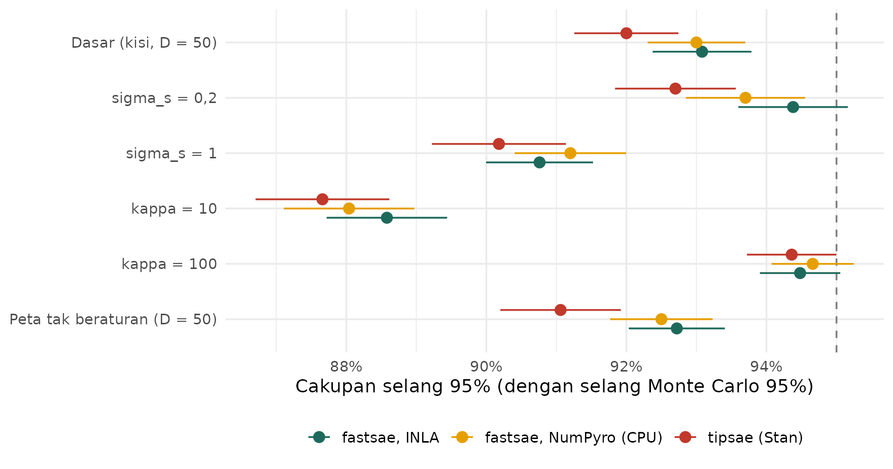
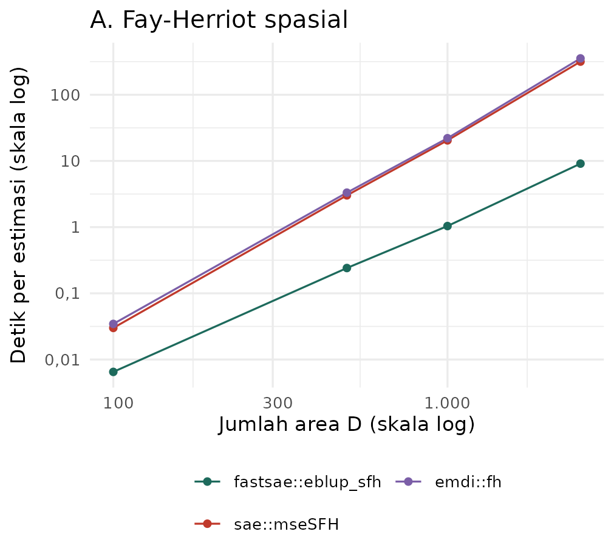
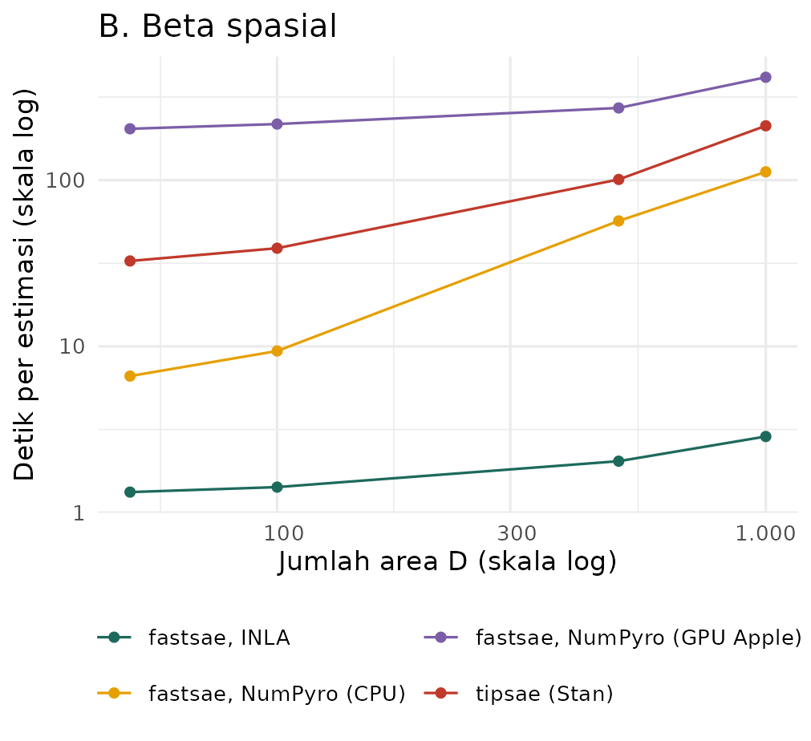

# Apakah fastsae Lebih Baik? Akurasi, Kecepatan, dan Memori dibandingkan sae, emdi, dan tipsae

Artikel ini menjawab pertanyaan apakah **fastsae** lebih baik daripada
paket-paket yang biasa dibandingkan dengannya, untuk dua model dan dari
tiga sisi: akurasi estimasi, kecepatan, dan memori. Jawabannya diberikan
terpisah untuk setiap sisi. Bila fastsae tidak lebih baik, artikel ini
menyatakannya.

- **A. Model Fay-Herriot spasial (efek acak SAR, frekuentis).**
  [`fastsae::eblup_sfh()`](https://ridsonap.is-a.dev/fastsae/reference/eblup_sfh.md)
  dibandingkan dengan
  [`sae::mseSFH()`](https://rdrr.io/pkg/sae/man/mseSFH.html) (Molina dan
  Marhuenda, 2015) dan `emdi::fh(correlation = "spatial")` (Kreutzmann
  dkk., 2019).
- **B. Model Beta spasial (Bayesian).**
  `fastsae::hb_area(family = "beta")` dengan INLA
  ([`inla_engine()`](https://ridsonap.is-a.dev/fastsae/reference/hb_engine.md),
  sebuah aproksimasi; Rue dkk., 2009) dan dengan MCMC di NumPyro
  ([`jax_engine()`](https://ridsonap.is-a.dev/fastsae/reference/hb_engine.md)),
  dibandingkan dengan
  [`tipsae::fit_sae()`](https://rdrr.io/pkg/tipsae/man/fit_sae.html)
  (MCMC di Stan; De Nicolò dan Gardini, 2024).

## Ringkasan

| Sisi | Fay-Herriot spasial | Beta spasial |
|:---|:---|:---|
| **Akurasi** | **Sama.** Ketiga paket mengestimasi model yang sama dengan kriteria REML yang sama dan memberikan estimasi yang sama, kecuali pada beberapa himpunan data di dekat batas $`\rho`$; pada himpunan data yang berhasil diestimasi semua paket, RMSE-nya berselisih paling banyak 4e-05. fastsae berhasil mengestimasi semua himpunan data (0 kegagalan dari 4500); `sae` dan `emdi` berhenti dengan galat sebanyak 45 dan 24 kali. | **Kurang lebih sama, tidak selalu lebih baik.** INLA dan NumPyro sangat sejalan; tipsae sama akuratnya di sebagian besar skenario, kurang akurat bila efek spasialnya kuat (saat rantainya sering tidak konvergen), dan sedikit lebih akurat bila presisi Beta-nya rendah. Ketiganya mencapai cakupan di bawah nominal pada skenario yang paling sulit. |
| **Kecepatan** | **Lebih cepat.** Pada $`D = 2.500`$: 9,10 detik, dibandingkan 316 detik (`sae`) dan 354 detik (`emdi`). | **INLA jauh lebih cepat** (2,87 detik pada $`D = 1.000`$, dibandingkan 212 detik untuk tipsae). NumPyro di CPU 2 hingga 5 kali lebih cepat daripada tipsae per estimasi, dan hingga 3 kali per tarikan efektif. NumPyro di GPU Apple paling lambat pada semua ukuran yang diukur. |
| **Memori** | **Lebih rendah atau kurang lebih sama, dengan selisih yang jauh lebih kecil daripada selisih waktunya.** Pada $`D = 2.500`$: 745 MB, dibandingkan 886 MB dan 770 MB. | **Bervariasi.** Pada $`D = 50`$, tipsae memakai memori paling sedikit (69 MB, INLA 112 MB); pada $`D = 1.000`$, INLA yang paling sedikit (268 MB, dibandingkan 1,40 GB). NumPyro memerlukan 700–900 MB pada semua ukuran, sebagian besar untuk Python dan JAX. |

Semua hasil berasal dari satu mesin (Apple M4, 10 inti, RAM 16 GB, tanpa
GPU NVIDIA); lihat [Mesin dan versi](#mesin-dan-versi).

------------------------------------------------------------------------

## Rancangan studi

Studi ini mengikuti struktur ADEMP dari Morris, White, dan Crowther
(2019): tujuan (*aims*), mekanisme pembangkitan data, estimand, metode,
dan ukuran kinerja.

**Tujuan.** Membandingkan, pada data yang nilai sebenarnya diketahui,
akurasi estimasi area dan akurasi parameter model, serta mengukur waktu
dan memori untuk satu kali estimasi.

### Mekanisme pembangkitan data

Kedua studi berbasis model: kovariat dan varians sampling ditetapkan
tetap di dalam satu skenario, sedangkan efek acak dan galat sampling
ditarik ulang di setiap ulangan. Setiap skenario mengubah satu faktor
dari skenario dasar. Nilai-nilai parameternya dipilih khusus untuk studi
ini; bentuk modelnya mengikuti literatur yang dikutip.

**A. Fay-Herriot spasial** (efek acak SAR; Petrucci dan Salvati, 2006;
Pratesi dan Salvati, 2008):

``` math
y_d = x_d^\top\beta + u_d + e_d,\quad u = (I - \rho W)^{-1}\varepsilon,\quad
\varepsilon \sim N(0, \sigma^2 I),\quad e_d \sim N(0, \psi_d),
```

dengan $`\beta = (1, 0.8, -0.5)`$, $`x_{1d} \sim N(0, 1)`$,
$`x_{2d} \sim U(0, 1)`$, $`\sigma^2 = 1`$, $`\psi_d = r\,\sigma^2 u_d`$,
$`u_d \sim U(0.5, 1.5)`$, dan $`W`$ adalah matriks persinggungan *queen*
yang distandardisasi per baris dari sebuah kisi teratur, atau dari 42
kabupaten pada data `mys_proxmat`. Skenario dasar: $`D = 100`$,
$`\rho = 0{,}5`$, $`r = 1`$. Skenario lainnya:
$`\rho \in \{0.2, 0.8, 0.95\}`$, $`r \in \{0.5, 2\}`$,
$`D \in \{50, 500\}`$, dan peta nyata. **500 ulangan** per skenario.

**B. Beta spasial** (regresi Beta untuk proporsi, Ferrari dan
Cribari-Neto, 2004; model Beta tingkat area, Janicki, 2020; efek acak
Besag, York, dan Mollié, 1991, yang diskalakan seperti pada Riebler
dkk., 2016):

``` math
y_d \sim \mathrm{Beta}\big(\mu_d\kappa_d,\,(1 - \mu_d)\kappa_d\big),\quad
\mathrm{logit}(\mu_d) = x_d^\top\beta + v_d + s_d,\quad v_d \sim N(0, \sigma_v^2),\quad
s = \sigma_s\,\tilde s,
```

dengan $`\tilde s`$ sebagai medan CAR intrinsik (ICAR) pada graf
ketetanggaan *queen*, yang diskalakan sehingga rata-rata geometrik
varians marginalnya 1. $`\beta = (-1, 0.5, -0.4)`$,
$`x_{1d} \sim N(0, 1)`$, $`x_{2d} \sim U(-1, 1)`$, $`\sigma_v = 0{,}2`$,
$`\kappa_d = \kappa\,e^{a_d}`$ dengan $`a_d \sim U(-0.5, 0.5)`$. Varians
sampling diestimasi dari estimasi langsung,
$`\hat V_d = y_d(1 - y_d)/(\kappa_d + 1)`$, seperti yang dilakukan dalam
survei. Skenario dasar: kisi $`5 \times 10`$ ($`D = 50`$),
$`\sigma_s = 0{,}5`$, $`\kappa = 25`$. Skenario lainnya:
$`\sigma_s \in \{0.2, 1\}`$, $`\kappa \in \{10, 100\}`$, dan peta tak
beraturan (teselasi Voronoi dari 50 titik acak). Peta nyata
`mys_proxmat` tidak dipakai di sini: tipsae memerlukan poligon,
sedangkan `mys_proxmat` hanya berupa matriks. **100 ulangan** per
skenario.

**Mengapa $`D = 50`$ dan 100 ulangan untuk model Beta.** Setiap estimasi
MCMC (tipsae) memerlukan sekitar satu menit di bawah beban paralel,
sehingga $`D`$ yang lebih besar atau ulangan yang lebih banyak tidak
akan selesai dalam satu malam; pengukuran kecepatan dan memori dilakukan
hingga $`D = 1.000`$. Dengan 100 ulangan untuk 50 area, galat baku Monte
Carlo (MCSE) dari tingkat cakupan ditampilkan di samping setiap
estimasi.

### Estimand dan metode

Estimandnya adalah besaran area ($`\theta_d = x_d^\top\beta + u_d`$
untuk model SFH, $`\mu_d`$ untuk model Beta) dan parameter model.

**Fay-Herriot spasial.** Ketiga paket memakai REML dan MSE analitik tipe
Prasad-Rao. Dalam uji pendahuluan pada satu himpunan data, ketiganya
memberikan koefisien, varians, $`\rho`$, EBLUP, dan MSE yang sama hingga
sekitar $`10^{-15}`$. Perbedaan fastsae yang terdokumentasi (estimasi
$`|\hat\rho| \ge 0{,}999`$ diperlakukan sebagai nilai tetap dalam MSE;
lihat
[`?eblup_sfh`](https://ridsonap.is-a.dev/fastsae/reference/eblup_sfh.md)
dan `NEWS.md`) hanya berlaku di batas ruang parameter. Selang 95%-nya
adalah $`\hat\theta_d \pm 1{,}96\sqrt{\mathrm{mse}_d}`$.

**Beta spasial.** `spatial_error = TRUE` pada tipsae menambahkan efek
tak terstruktur dan efek ICAR yang terskala (dibaca dari kode Stan-nya:
`reffs = v + s` dengan `s = sigma_s * s_raw / scales_ICAR`). Struktur
yang sama di fastsae adalah `spatial = "bym"` (iid + Besag terskala),
yang dipakai di sini; selebihnya dipakai pengaturan bawaan masing-masing
paket. Perbedaan yang tersisa tidak dapat dihilangkan melalui antarmuka
pengguna:

|  | fastsae (INLA dan NumPyro) | tipsae |
|:---|:---|:---|
| Inferensi | INLA: aproksimasi Laplace. NumPyro: NUTS, 2 rantai masing-masing 1.000 tarikan setelah 500 *warm-up* | NUTS di Stan, 4 rantai masing-masing 1.000 tarikan setelah 1.000 *warm-up* |
| Simpangan baku efek area | half-normal(1) untuk setiap simpangan baku | half-normal(2.5) untuk setiap simpangan baku |
| Koefisien | $`N(0, 1000)`$, *intercept* datar (INLA) atau hampir datar (NumPyro) | $`N(0, 2.5^2)`$ pada kovariat yang distandardisasi (tipsae menskalakannya; koefisiennya dikembalikan ke skala asal untuk artikel ini) |
| Presisi Beta | tetap per area pada $`\hat\mu_d(1 - \hat\mu_d)/\hat V_d - 1`$, dengan $`\hat\mu_d`$ dari estimasi tahap pertama (model diestimasi dua kali) | di dalam model: $`\phi_d = (\mu_d(1 - \mu_d) - \hat V_d)/\hat V_d`$ |

Jadi, yang dibandingkan adalah hasil yang diperoleh pengguna dari setiap
paket dengan pengaturan bawaannya, bukan dua aproksimasi dari satu
posterior yang sama.

### Ukuran kinerja

- Per ulangan, dirata-ratakan atas area: bias, *mean squared error*,
  cakupan selang 95%, dan lebarnya. Tabel melaporkan rata-rata atas
  ulangan beserta MCSE-nya (simpangan baku atas ulangan dibagi
  $`\sqrt{R}`$), dan RMSE sebagai akar dari rata-rata *mean squared
  error*.
- Per area, atas ulangan: RMSE relatif
  $`\mathrm{RMSE}_d / \bar\theta_d`$ (hanya untuk model Beta, yang nilai
  sebenarnya positif).
- Parameter model: estimasi dibandingkan dengan nilai sebenarnya; untuk
  model SFH, juga proporsi estimasi $`\rho`$ yang berada di batas.
- MCMC: R-hat terbesar dan ukuran sampel efektif terkecil di antara
  parameter yang dilaporkan, serta transisi divergen (Vehtari dkk.,
  2021). Estimasi dengan R-hat \> 1,05, ESS di bawah 100 per rantai,
  atau ada divergensi dihitung sebagai tidak konvergen; **estimasi
  tersebut tetap disertakan dalam semua ukuran akurasi**.
- Estimasi yang gagal dihitung. Akurasi dibandingkan pada ulangan yang
  semua metodenya berhasil memberikan estimasi, agar semua metode
  dinilai pada himpunan data yang sama.
- Waktu dan memori diukur terpisah, satu estimasi per proses R pada
  mesin yang sedang tidak menjalankan pekerjaan lain (lihat
  [Kecepatan](#kecepatan) dan [Memori](#memori)).

### Prosedur simulasi

Untuk setiap skenario $`k`$:

1.  **Tetapkan rancangannya** (*seed* $`1000 + k`$): peta dan matriks
    ketetanggaannya, kovariat $`x_{1d}, x_{2d}`$, serta varians sampling
    $`\psi_d`$ (SFH) atau presisi Beta $`\kappa_d`$. Semuanya tetap sama
    di seluruh ulangan dalam skenario tersebut.
2.  **Untuk setiap ulangan** $`r = 1, \dots, R`$ (*seed*
    $`10^5 k + r`$):
    1.  Tarik efek acaknya ($`u`$ untuk model SFH; $`v`$ dan $`s`$ untuk
        model Beta) dan hitung besaran area yang sebenarnya,
        $`\theta_{dr}`$ ($`x_d^\top\beta + u_d`$, atau $`\mu_d`$).
    2.  Tarik estimasi langsungnya: $`y_d = \theta_{dr} + e_d`$ dengan
        $`e_d \sim N(0, \psi_d)`$, atau
        $`y_d \sim \mathrm{Beta}(\mu_d\kappa_d, (1 - \mu_d)\kappa_d)`$
        dengan varians sampling
        $`\hat V_d = y_d(1 - y_d)/(\kappa_d + 1)`$ yang dihitung dari
        $`y_d`$.
    3.  Estimasi setiap metode pada himpunan data yang sama ini.
        Paket-paket SFH menerima $`W`$ yang distandardisasi per baris;
        untuk model Beta, fastsae menerima matriks ketetanggaan biner
        dan tipsae menerima poligon dari peta yang sama. Metode MCMC
        memakai *seed* $`r`$.
    4.  Simpan, per area, estimasi $`\hat\theta_{dr}`$ dan selang
        95%-nya, serta, per estimasi, parameter model, diagnostik
        konvergensi, peringatan, dan waktunya. Estimasi yang berhenti
        dengan galat dicatat sebagai kegagalan beserta pesan galatnya.
3.  **Rangkum** pada ulangan yang semua metodenya berhasil memberikan
    estimasi:
    $`\mathrm{Bias}_d = R^{-1}\sum_r(\hat\theta_{dr} - \theta_{dr})`$,
    $`\mathrm{RMSE}_d = \{R^{-1}\sum_r(\hat\theta_{dr} - \theta_{dr})^2\}^{1/2}`$,
    dan proporsi ulangan yang selangnya mencakup $`\theta_{dr}`$,
    ditambah rata-rata per ulangan atas area seperti dijelaskan di atas.

**Selang.** Untuk model SFH,
$`\hat\theta_d \pm 1{,}96\sqrt{\mathrm{mse}_d}`$ dengan MSE analitik
dari masing-masing paket. Untuk model Beta, selang posterior 95% berekor
sama dari $`\mu_d`$ (kuantil posterior 2,5% dan 97,5%): dari distribusi
marginal posterior INLA, dari tarikan NumPyro, dan dari ringkasan Stan
pada tipsae.

**Apa yang berubah antarulangan.** Nilai sebenarnya berubah dari satu
ulangan ke ulangan berikutnya karena efek acaknya ditarik ulang: bias,
RMSE, dan cakupan merupakan rata-rata atas realisasi model untuk
rancangan yang tetap. Ini adalah simulasi berbasis model; [artikel
populasi
terhingga](https://ridsonap.is-a.dev/fastsae/articles/id/finite-population-validation.md)
memperlihatkan simulasi berbasis desain, yang menarik sampel berulang
kali dari satu populasi yang tetap.

**Cara menjalankannya.** Ulangan-ulangan dibagi menjadi tugas-tugas yang
masing-masing terdiri atas satu skenario, satu metode, dan satu blok
berisi 100 (SFH) atau 25 (Beta) ulangan, dan enam tugas dijalankan
bersamaan. Setiap ulangan disimpan dalam berkasnya sendiri, sehingga
proses yang terhenti dapat dilanjutkan dari titik terakhirnya. Waktu
yang tercatat pada tahap ini diukur di bawah beban paralel tersebut dan
tidak dipakai di bagian [Kecepatan](#kecepatan).

------------------------------------------------------------------------

## A. Fay-Herriot Spasial

### Akurasi estimasi area

| Skenario | Ulangan (bersama) | RMSE (MCSE) | Cakupan (MCSE) | Lebar | Selisih RMSE maks. sae / emdi | Cakupan sae / emdi | Estimasi gagal fastsae / sae / emdi |
|:---|---:|---:|---:|---:|---:|---:|---:|
| Dasar (kisi, D = 100, rho = 0,5) | 500 | 0,724 (0,002) | 94,6% (0,1%) | 2,810 | 1,2e-07 / 1,2e-07 | 94,6% / 94,6% | 0 / 0 / 0 |
| rho = 0,2 | 499 | 0,730 (0,003) | 94,2% (0,2%) | 2,809 | 6,7e-07 / 6,7e-07 | 94,2% / 94,2% | 0 / 1 / 0 |
| rho = 0,8 | 500 | 0,735 (0,003) | 94,7% (0,1%) | 2,862 | 2,7e-12 / 2,7e-12 | 94,7% / 94,7% | 0 / 0 / 0 |
| rho = 0,95 | 487 | 0,721 (0,003) | 94,9% (0,1%) | 2,815 | 3,2e-08 / 3,2e-08 | 94,9% / 94,9% | 0 / 13 / 12 |
| psi / sigma2 = 0,5 | 500 | 0,584 (0,002) | 94,9% (0,1%) | 2,267 | 1,3e-08 / 1,3e-08 | 94,9% / 94,9% | 0 / 0 / 0 |
| psi / sigma2 = 2 | 481 | 0,868 (0,003) | 94,0% (0,2%) | 3,351 | 1,6e-05 / 1,6e-05 | 94,2% / 94,2% | 0 / 19 / 8 |
| D = 50 | 497 | 0,739 (0,004) | 94,4% (0,2%) | 2,885 | 2,1e-07 / 2,1e-07 | 94,4% / 94,4% | 0 / 3 / 2 |
| D = 500 | 500 | 0,706 (0,001) | 94,9% (0,1%) | 2,750 | 0,0e+00 / 0,0e+00 | 94,9% / 94,9% | 0 / 0 / 0 |
| Peta nyata (mys_proxmat, D = 42) | 491 | 0,744 (0,004) | 94,7% (0,2%) | 2,925 | 4,0e-05 / 4,0e-05 | 94,8% / 94,8% | 0 / 9 / 2 |

RMSE, cakupan, dan lebar di tabel adalah milik fastsae; dua kolom
lainnya menunjukkan seberapa jauh `sae` dan `emdi` dari nilai tersebut
pada himpunan data yang sama. Semua paket mencapai cakupan yang
mendekati nominal 95% di setiap skenario, dan estimasinya sama kecuali
pada beberapa himpunan data:

- Jauh dari batas $`\rho`$, EBLUP dan MSE dari fastsae dan `sae`
  berselisih paling banyak sekitar $`2 \times 10^{-4}`$, seukuran
  toleransi konvergensi kedua algoritme.
- Pada 20 dari 4455 himpunan data bersama, cakupannya berbeda. Pada 14
  di antaranya, kedua paket memberikan estimasi yang sama,
  $`\hat\rho = -1`$; fastsae lalu memperlakukan $`\rho`$ sebagai nilai
  tetap dalam MSE (perbedaan yang terdokumentasi, lihat
  [`?eblup_sfh`](https://ridsonap.is-a.dev/fastsae/reference/eblup_sfh.md)),
  sehingga selangnya lebih sempit. Pada 6 sisanya, kedua paket berakhir
  pada estimasi $`\rho`$ yang berbeda (misalnya $`-1`$ di `sae` dan
  $`0{,}999`$ di fastsae): likelihood terbatas (*restricted likelihood*)
  memiliki lebih dari satu maksimum lokal di dekat batas, dan fastsae
  memaksimumkannya di bawah kendala $`\sigma^2 \ge 0`$,
  $`|\rho| \le 0{,}999`$. Mana dari kedua maksimum itu yang lebih tinggi
  tidak diperiksa.

**Estimasi yang gagal.**

|  | fastsae | sae | emdi |
|:---|---:|---:|---:|
| diff \>= PRECISION: comparison is possible only for atomic and list types | 0 | 21 | 0 |
| sistem singular (solve() atau LAPACK dgesv) | 0 | 24 | 24 |

Sebagian besar kegagalan berasal dari penyelesaian sistem yang singular.
Sisanya adalah galat dalam pemeriksaan konvergensi perulangan *Fisher
scoring* di
[`sae::eblupSFH()`](https://rdrr.io/pkg/sae/man/eblupSFH.html)
(`diff >= PRECISION`), yang dimunculkan oleh `sae` sendiri, bukan oleh
kode studi ini. Kegagalan tersebut terkonsentrasi pada skenario yang
mendorong $`\hat\rho`$ atau $`\hat\sigma^2`$ ke arah batas: varians
sampling yang besar, korelasi yang kuat, jumlah area yang sedikit, dan
peta nyata. fastsae memaksimumkan likelihood terbatas di bawah kendala
$`\sigma^2 \ge 0`$, $`|\rho| \le 0{,}999`$ dan selalu berhasil
memberikan estimasi.

### Parameter model

| Skenario | Paket | rho sebenarnya | Rata-rata rho-hat (MCSE) | Rata-rata sigma2-hat (sebenarnya 1) | rho-hat di batas | Rata-rata beta1-hat (sebenarnya 0,8) |
|:---|:---|---:|---:|---:|---:|---:|
| Dasar (kisi, D = 100, rho = 0,5) | fastsae | 0,50 | 0,435 (0,012) | 0,986 | 0,2% | 0,796 |
| Dasar (kisi, D = 100, rho = 0,5) | sae | 0,50 | 0,435 (0,012) | 0,986 | 0,2% | 0,796 |
| rho = 0,2 | fastsae | 0,20 | 0,123 (0,015) | 0,946 | 1,2% | 0,800 |
| rho = 0,2 | sae | 0,20 | 0,125 (0,015) | 0,947 | 1,2% | 0,800 |
| rho = 0,8 | fastsae | 0,80 | 0,762 (0,006) | 1,010 | 0,0% | 0,789 |
| rho = 0,8 | sae | 0,80 | 0,762 (0,006) | 1,010 | 0,0% | 0,789 |
| rho = 0,95 | fastsae | 0,95 | 0,925 (0,003) | 1,020 | 2,8% | 0,812 |
| rho = 0,95 | sae | 0,95 | 0,923 (0,003) | 1,029 | 0,2% | 0,812 |
| psi / sigma2 = 0,5 | fastsae | 0,50 | 0,453 (0,009) | 0,980 | 0,0% | 0,798 |
| psi / sigma2 = 0,5 | sae | 0,50 | 0,453 (0,009) | 0,980 | 0,0% | 0,798 |
| psi / sigma2 = 2 | fastsae | 0,50 | 0,381 (0,018) | 0,950 | 3,0% | 0,801 |
| psi / sigma2 = 2 | sae | 0,50 | 0,384 (0,018) | 0,978 | 2,3% | 0,802 |
| D = 50 | fastsae | 0,50 | 0,392 (0,018) | 0,950 | 1,8% | 0,800 |
| D = 50 | sae | 0,50 | 0,395 (0,017) | 0,954 | 1,6% | 0,799 |
| D = 500 | fastsae | 0,50 | 0,489 (0,004) | 0,994 | 0,0% | 0,801 |
| D = 500 | sae | 0,50 | 0,489 (0,004) | 0,994 | 0,0% | 0,801 |
| Peta nyata (mys_proxmat, D = 42) | fastsae | 0,50 | 0,386 (0,016) | 0,992 | 1,6% | 0,800 |
| Peta nyata (mys_proxmat, D = 42) | sae | 0,50 | 0,383 (0,016) | 1,008 | 1,4% | 0,799 |

`emdi` memberikan parameter yang sama dengan `sae` sehingga tidak
dicantumkan dalam tabel. REML mengestimasi $`\rho`$ terlalu rendah,
paling kuat bila jumlah areanya sedikit atau varians samplingnya besar,
dan biasnya mengecil seiring bertambahnya $`D`$: ini adalah sifat
estimatornya, yang dimiliki ketiga paket, bukan sifat implementasinya.
Rata-rata untuk `sae` tidak menyertakan estimasinya yang gagal. Pada 45
himpunan data yang gagal diestimasi `sae`, $`\hat\rho`$ dari fastsae
berada di batas pada 20 di antaranya, dan $`\hat\sigma^2`$ sering kali
kecil (median 0,41, padahal nilai sebenarnya 1).

------------------------------------------------------------------------

## B. Beta Spasial

### Akurasi estimasi area

| Skenario | Metode | RMSE (MCSE) | Rata-rata RMSE relatif | Rata-rata bias absolut | Cakupan (MCSE) | Lebar |
|:---|:---|---:|---:|---:|---:|---:|
| Dasar (kisi, D = 50) | fastsae, INLA | **0,0662 (0,0007)** | 23,8% | 0,0067 | **93,1% (0,4%)** | 0,246 |
| Dasar (kisi, D = 50) | fastsae, NumPyro (CPU) | 0,0667 (0,0007) | 24,0% | 0,0082 | 93,0% (0,4%) | 0,251 |
| Dasar (kisi, D = 50) | tipsae (Stan) | 0,0664 (0,0008) | 23,7% | 0,0113 | 92,0% (0,4%) | 0,257 |
| sigma_s = 0,2 | fastsae, INLA | **0,0527 (0,0007)** | 19,0% | 0,0092 | **94,4% (0,4%)** | 0,204 |
| sigma_s = 0,2 | fastsae, NumPyro (CPU) | 0,0531 (0,0007) | 19,2% | 0,0104 | 93,7% (0,4%) | 0,205 |
| sigma_s = 0,2 | tipsae (Stan) | 0,0530 (0,0007) | 19,1% | 0,0129 | 92,7% (0,4%) | 0,204 |
| sigma_s = 1 | fastsae, INLA | **0,0731 (0,0009)** | 25,4% | 0,0065 | 90,8% (0,4%) | 0,251 |
| sigma_s = 1 | fastsae, NumPyro (CPU) | 0,0733 (0,0009) | 25,4% | 0,0073 | **91,2% (0,4%)** | 0,258 |
| sigma_s = 1 | tipsae (Stan) | 0,0895 (0,0061) | 30,0% | 0,0170 | 90,2% (0,5%) | 0,284 |
| kappa = 10 | fastsae, INLA | 0,0962 (0,0012) | 34,4% | 0,0116 | **88,6% (0,4%)** | 0,334 |
| kappa = 10 | fastsae, NumPyro (CPU) | 0,0980 (0,0012) | 34,9% | 0,0151 | 88,0% (0,5%) | 0,347 |
| kappa = 10 | tipsae (Stan) | **0,0916 (0,0011)** | 32,6% | 0,0171 | 87,7% (0,5%) | 0,338 |
| kappa = 100 | fastsae, INLA | **0,0394 (0,0004)** | 14,0% | 0,0026 | 94,5% (0,3%) | 0,147 |
| kappa = 100 | fastsae, NumPyro (CPU) | 0,0394 (0,0004) | 14,1% | 0,0027 | **94,7% (0,3%)** | 0,148 |
| kappa = 100 | tipsae (Stan) | 0,0418 (0,0016) | 15,0% | 0,0049 | 94,4% (0,3%) | 0,154 |
| Peta tak beraturan (D = 50) | fastsae, INLA | **0,0671 (0,0009)** | 24,6% | 0,0082 | **92,7% (0,3%)** | 0,248 |
| Peta tak beraturan (D = 50) | fastsae, NumPyro (CPU) | 0,0677 (0,0009) | 24,8% | 0,0102 | 92,5% (0,4%) | 0,253 |
| Peta tak beraturan (D = 50) | tipsae (Stan) | 0,0682 (0,0009) | 25,2% | 0,0157 | 91,1% (0,4%) | 0,258 |

Sel berlatar: di setiap skenario, metode dengan RMSE terkecil dan metode
yang cakupannya paling dekat dengan 95% (dicetak tebal), bersama metode
lain yang selisih berpasangannya terhadap metode tersebut pada ulangan
yang sama berada dalam dua galat baku Monte Carlo. Jadi, sel berlatar
yang tidak dicetak tebal tidak dapat dibedakan sebagai lebih buruk. Sel
tanpa latar pun masih bisa dekat dengan yang terbaik: karena semua
metode diestimasi pada himpunan data yang sama, selisih pada desimal
keempat RMSE dapat melebihi galat Monte Carlo-nya. Kolom-kolom lainnya
tidak ditandai, karena tidak memiliki galat Monte Carlo untuk membedakan
selisih yang nyata dari derau.



- **INLA dan NumPyro** memberikan akurasi yang hampir sama di setiap
  skenario: aproksimasi INLA tidak menimbulkan kerugian yang terukur di
  sini.
- **tipsae** sama akuratnya dengan fastsae di sebagian besar skenario.
  Bila efek spasialnya kuat ($`\sigma_s = 1`$), RMSE-nya jelas lebih
  besar; ini juga skenario yang rantainya paling sering tidak konvergen
  (bagian berikutnya). Bila presisi Beta-nya rendah ($`\kappa = 10`$),
  RMSE-nya sedikit lebih kecil daripada fastsae, mungkin karena tipsae
  memodelkan presisi di dalam model alih-alih menetapkannya dari
  estimasi tahap pertama; studi ini tidak dapat memisahkan hal tersebut
  dari pengaruh priornya.
- Selang tipsae lebih jarang mencakup nilai sebenarnya dibandingkan
  selang fastsae dengan INLA di setiap skenario, dengan selisih 0,1
  hingga 1,7 poin persentase (selang Monte Carlo-nya tumpang tindih di
  beberapa skenario).
- tipsae memiliki rata-rata bias absolut estimasi area yang terbesar di
  setiap skenario, meskipun biasnya kecil dibandingkan RMSE untuk semua
  metode.
- **Semua metode mencapai cakupan di bawah nominal** bila presisinya
  rendah atau efek spasialnya kuat, dengan besaran yang mirip: dengan
  $`D = 50`$, hiperparameternya kurang dapat ditentukan oleh data.

### Parameter model

| Skenario | Metode | beta1 (0,5) | beta2 (-0,4) | sigma_v (sebenarnya) | sigma_s (sebenarnya) |
|:---|:---|---:|---:|---:|---:|
| Dasar (kisi, D = 50) | fastsae, INLA | 0,543 | -0,443 | 0,332 (0,2) | 0,531 (0,5) |
| Dasar (kisi, D = 50) | fastsae, NumPyro (CPU) | 0,543 | -0,450 | 0,315 (0,2) | 0,533 (0,5) |
| Dasar (kisi, D = 50) | tipsae (Stan) | 0,545 | -0,452 | 0,294 (0,2) | 0,550 (0,5) |
| sigma_s = 0,2 | fastsae, INLA | 0,525 | -0,447 | 0,258 (0,2) | 0,206 (0,2) |
| sigma_s = 0,2 | fastsae, NumPyro (CPU) | 0,522 | -0,447 | 0,236 (0,2) | 0,210 (0,2) |
| sigma_s = 0,2 | tipsae (Stan) | 0,531 | -0,460 | 0,216 (0,2) | 0,215 (0,2) |
| sigma_s = 1 | fastsae, INLA | 0,555 | -0,381 | 0,506 (0,2) | 0,916 (1) |
| sigma_s = 1 | fastsae, NumPyro (CPU) | 0,556 | -0,386 | 0,483 (0,2) | 0,931 (1) |
| sigma_s = 1 | tipsae (Stan) | 0,570 | -0,367 | 0,485 (0,2) | 0,979 (1) |
| kappa = 10 | fastsae, INLA | 0,594 | -0,495 | 0,591 (0,2) | 0,624 (0,5) |
| kappa = 10 | fastsae, NumPyro (CPU) | 0,601 | -0,501 | 0,586 (0,2) | 0,633 (0,5) |
| kappa = 10 | tipsae (Stan) | 0,561 | -0,472 | 0,486 (0,2) | 0,606 (0,5) |
| kappa = 100 | fastsae, INLA | 0,512 | -0,404 | 0,242 (0,2) | 0,473 (0,5) |
| kappa = 100 | fastsae, NumPyro (CPU) | 0,511 | -0,404 | 0,227 (0,2) | 0,476 (0,5) |
| kappa = 100 | tipsae (Stan) | 0,523 | -0,414 | 0,232 (0,2) | 0,512 (0,5) |
| Peta tak beraturan (D = 50) | fastsae, INLA | 0,546 | -0,466 | 0,395 (0,2) | 0,491 (0,5) |
| Peta tak beraturan (D = 50) | fastsae, NumPyro (CPU) | 0,548 | -0,468 | 0,386 (0,2) | 0,499 (0,5) |
| Peta tak beraturan (D = 50) | tipsae (Stan) | 0,554 | -0,466 | 0,362 (0,2) | 0,512 (0,5) |

Angka di tabel adalah median atas ulangan dari median posterior. Ketiga
metode memulihkan koefisien sama baiknya. Simpangan baku tak terstruktur
$`\sigma_v`$ diestimasi terlalu tinggi oleh ketiganya, lebih tinggi lagi
bila presisinya rendah: dengan 50 area, komponen ini sulit dibedakan
dari efek spasial dan dari derau sampling, sehingga posteriornya
tertarik ke arah prior.

### Konvergensi estimasi MCMC

| Skenario | Metode | Estimasi | R-hat \> 1,05 | ESS \< 100 per rantai | Ada divergensi | Tidak konvergen (salah satu) | Median ESS terkecil |
|:---|:---|---:|---:|---:|---:|---:|---:|
| Dasar (kisi, D = 50) | fastsae, NumPyro (CPU) | 100 | 2 | 57 | 26 | 67 | 187 |
| Dasar (kisi, D = 50) | tipsae (Stan) | 100 | 1 | 62 | 4 | 62 | 342 |
| sigma_s = 0,2 | fastsae, NumPyro (CPU) | 100 | 1 | 23 | 7 | 25 | 293 |
| sigma_s = 0,2 | tipsae (Stan) | 100 | 0 | 32 | 0 | 32 | 487 |
| sigma_s = 1 | fastsae, NumPyro (CPU) | 100 | 2 | 77 | 49 | 86 | 152 |
| sigma_s = 1 | tipsae (Stan) | 100 | 33 | 84 | 56 | 91 | 235 |
| kappa = 10 | fastsae, NumPyro (CPU) | 100 | 2 | 60 | 13 | 65 | 180 |
| kappa = 10 | tipsae (Stan) | 100 | 2 | 76 | 75 | 88 | 303 |
| kappa = 100 | fastsae, NumPyro (CPU) | 100 | 6 | 91 | 59 | 95 | 138 |
| kappa = 100 | tipsae (Stan) | 100 | 6 | 93 | 1 | 93 | 274 |
| Peta tak beraturan (D = 50) | fastsae, NumPyro (CPU) | 100 | 3 | 61 | 24 | 70 | 181 |
| Peta tak beraturan (D = 50) | tipsae (Stan) | 100 | 0 | 79 | 7 | 79 | 317 |

Dengan pengaturan bawaannya, **tidak satu pun metode MCMC konvergen
secara andal** menurut kriteria ini. Di setiap skenario, antara
seperempat hingga hampir semua estimasi memiliki ESS yang terlalu kecil
untuk sebagian parameter. Keduanya mengalami transisi divergen pada
banyak estimasi (NumPyro paling sering dengan $`\kappa = 100`$ dan
$`\sigma_s = 1`$, tipsae dengan $`\kappa = 10`$ dan $`\sigma_s = 1`$),
dan tipsae memiliki R-hat di atas 1,05 pada sepertiga estimasi dengan
efek spasial yang kuat. Bawaan NumPyro, yaitu 2 rantai masing-masing
1.000 tarikan, menghasilkan tarikan yang lebih sedikit daripada bawaan
tipsae, 4 rantai masing-masing 1.000 tarikan, sehingga ESS-nya lebih
rendah karena alasan itu saja. Pengaturan bawaan keduanya dimaksudkan
untuk penelusuran awal; untuk hasil yang dilaporkan, diperlukan rantai
yang lebih panjang (untuk NumPyro, `jax_engine(warmup = , samples = )`)
dan pemeriksaan diagnostik. INLA tidak memiliki diagnostik semacam itu;
akurasinya di atas itulah pemeriksaannya.

Kedua nilai ESS terkecil tidak dihitung dengan cara yang sama: untuk
NumPyro, nilainya adalah ESS *bulk* atau *tail* ternormalisasi peringkat
yang terkecil di antara hiperparameter, koefisien, dan rata-rata area
(seperti yang dilaporkan fastsae); untuk tipsae, nilainya adalah `n_eff`
terkecil dari `rstan` di antara semua parameter dalam ringkasan Stan.
Keduanya sebanding dalam besarnya, tetapi tidak persis sama.

------------------------------------------------------------------------

## Kecepatan

Setiap sel di bawah adalah satu proses R yang mengestimasi himpunan data
yang sama beberapa kali (dua kali untuk sel yang paling lambat, tiga
kali untuk sel lainnya). Estimasi pertama mencakup biaya awal (kompilasi
model JAX, pemanggilan pertama Stan), dan tabel menampilkan median dari
estimasi berikutnya. Proses-proses itu dijalankan satu per satu pada
mesin yang sedang tidak menjalankan pekerjaan lain. Data SFH berasal
dari skenario dasar pada kisi berisi $`D`$ sel; data Beta berasal dari
skenario dasar studi akurasi.

|     D | fastsae::eblup_sfh | sae::mseSFH |   emdi::fh |
|------:|-------------------:|------------:|-----------:|
|   100 |     **0,01 detik** |  0,03 detik | 0,03 detik |
|   500 |     **0,24 detik** |  3,02 detik | 3,32 detik |
| 1.000 |     **1,04 detik** |    20 detik |   22 detik |
| 2.500 |     **9,10 detik** |   316 detik |  354 detik |

Fay-Herriot spasial: estimasi REML dan MSE analitik (waktu putaran
hangat; berlatar: tercepat) {.table}

| D | fastsae, INLA | fastsae, NumPyro (CPU) | fastsae, NumPyro (GPU Apple) | tipsae (Stan) |
|---:|---:|---:|---:|---:|
| 50 | **1,33 detik** | 6,63 detik | 204 detik | 33 detik |
| 100 | **1,42 detik** | 9,38 detik | 217 detik | 39 detik |
| 500 | **2,04 detik** | 57 detik | 272 detik | 101 detik |
| 1.000 | **2,87 detik** | 112 detik | 416 detik | 212 detik |

Beta spasial (waktu putaran hangat; berlatar: tercepat) {.table}



Untuk metode MCMC, waktu per estimasi bergantung pada banyaknya tarikan,
sehingga waktu per tarikan efektif (waktu putaran hangat dibagi ESS
terkecil estimasi tersebut) adalah perbandingan yang lebih adil:

|     D |   NumPyro (CPU) | NumPyro (GPU Apple) |      tipsae |
|------:|----------------:|--------------------:|------------:|
|    50 | **0,026 detik** |         0,922 detik | 0,082 detik |
|   100 | **0,053 detik** |         1,431 detik | 0,134 detik |
|   500 | **2,032 detik** |         9,812 detik | 2,072 detik |
| 1.000 | **3,011 detik** |        14,399 detik | 6,975 detik |

Waktu per tarikan efektif (berlatar: terkecil) {.table}

- **Fay-Herriot spasial:** fastsae lebih cepat pada semua ukuran, dan
  selisihnya makin besar seiring $`D`$ (faktorisasi Cholesky matriks
  jarang alih-alih invers padat berukuran $`D \times D`$). Dengan
  beberapa puluh area, ketiganya hanya memerlukan sepersekian detik, dan
  perbedaannya tidak berarti dalam praktik.
- **Beta spasial:** INLA memerlukan beberapa detik hingga $`D = 1.000`$.
  NumPyro di CPU lebih cepat daripada tipsae per estimasi, dan juga per
  tarikan efektif pada semua ukuran kecuali $`D = 500`$, saat keduanya
  kurang lebih sama. Di mesin ini, GPU Apple (Metal) lebih lambat
  daripada CPU pada semua ukuran yang diukur. Tidak ada GPU NVIDIA,
  sehingga CUDA tidak diukur.
- Pada $`D \ge 500`$, ESS terkecil kedua metode MCMC dengan pengaturan
  bawaan hanya beberapa puluh, sehingga waktu per estimasinya lebih
  kecil daripada waktu yang sebenarnya diperlukan untuk estimasi yang
  andal.

## Memori

Memori sebuah estimasi adalah ukuran memori residen (*resident set
size*, RSS) puncak dari proses R **beserta semua proses turunannya**
(INLA berjalan sebagai program terpisah), yang dicuplik setiap 0,1
detik, dikurangi puncak memori proses yang memuat paket dan data yang
sama tanpa melakukan estimasi. `mem_alloc` dari `bench::mark()` tidak
dipakai, karena hanya menghitung memori yang dialokasikan oleh R
sehingga melewatkan INLA, Stan, dan JAX.

|     D | fastsae::eblup_sfh | sae::mseSFH | emdi::fh |
|------:|-------------------:|------------:|---------:|
|   100 |          **38 MB** |       50 MB |    50 MB |
|   500 |          **80 MB** |      153 MB |   141 MB |
| 1.000 |         **140 MB** |      284 MB |   231 MB |
| 2.500 |         **745 MB** |      886 MB |   770 MB |

Fay-Herriot spasial: kenaikan memori puncak (berlatar: terendah yang
terukur) {.table}

| D | fastsae, INLA | fastsae, NumPyro (CPU) | fastsae, NumPyro (GPU Apple) | tipsae (Stan) |
|---:|---:|---:|---:|---:|
| 50 | 112 MB | 907 MB | 726 MB | **69 MB** |
| 100 | **123 MB** | 837 MB | 676 MB | 181 MB |
| 500 | **168 MB** | 781 MB | 722 MB | 932 MB |
| 1.000 | **268 MB** | 854 MB | 730 MB | 1,40 GB |

Beta spasial: kenaikan memori puncak (berlatar: terendah yang terukur)
{.table}

- **Fay-Herriot spasial:** fastsae memerlukan memori lebih sedikit
  daripada `sae` dan `emdi` pada $`D = 500`$ dan 1.000; pada
  $`D = 100`$, selisihnya masih dalam rentang variasi antarproses, dan
  pada $`D`$ terbesar keunggulannya atas `emdi` kecil.
- **Beta spasial:** tidak ada metode yang terbaik pada semua ukuran.
  Memori INLA bertambah perlahan seiring $`D`$; tipsae memerlukan
  sedikit memori untuk $`D`$ kecil dan paling banyak pada $`D = 1.000`$;
  700–900 MB pada NumPyro sebagian besar dipakai oleh interpreter Python
  dan JAX, yang tetap dihitung di sini karena pengguna juga
  menanggungnya.

**Keterbatasan metode.** Puncak yang lebih singkat daripada selang
pencuplikan 0,1 detik dapat terlewat. Selisih beberapa puluh MB
berubah-ubah antarproses. Pada Apple silicon, GPU memakai memori yang
sama (*unified memory*), yang tidak sepenuhnya terlihat pada RSS,
sehingga angka Metal merupakan batas bawah.

------------------------------------------------------------------------

## Kesimpulan

- **Fay-Herriot spasial.** fastsae tidak lebih akurat daripada `sae`
  atau `emdi`: paket ini mengestimasi estimator yang sama dan memberikan
  angka yang sama. fastsae **lebih cepat** (12 hingga 35 kali di sini
  untuk $`D \ge 500`$), memakai memori **lebih sedikit atau kurang lebih
  sama**, dan berhasil memberikan estimasi untuk setiap himpunan data,
  sedangkan `sae` dan `emdi` berhenti dengan galat pada sekitar 1% dari
  seluruh himpunan data (hingga 4% pada skenario tersulit). Pada
  beberapa himpunan data di dekat batas $`\rho`$, estimasi atau MSE-nya
  berbeda dari `sae`, sebagaimana telah didokumentasikan.
- **Beta spasial.** fastsae dengan INLA **kurang lebih sama akuratnya**
  dengan tipsae, lebih baik bila efek spasialnya kuat dan sedikit lebih
  buruk bila presisi Beta-nya rendah, serta **25 hingga 75 kali lebih
  cepat** di sini ($`D = 50`$ hingga 1.000). Untuk $`D`$ kecil,
  memorinya tidak lebih rendah daripada tipsae. *Engine* MCMC fastsae
  memberikan estimasi yang sama dengan INLA dan lebih cepat daripada
  tipsae, tetapi dengan pengaturan bawaan, tidak satu pun metode MCMC
  konvergen secara andal.
- Semua kesimpulan ini berlaku untuk skenario, pengaturan bawaan, dan
  mesin yang dipakai di sini. Studi akurasi memakai $`D \le 500`$ (SFH)
  dan $`D = 50`$ (Beta), dan nilai-nilai parameternya dipilih khusus
  untuk studi ini.

## Reproduksi

Dari direktori akar paket, setelah `R CMD INSTALL . --preclean`
(skrip-skripnya memakai fastsae yang terpasang):

``` sh
sh benchmarks/eval/run_overnight.sh          # akurasi (6 proses paralel), lalu kecepatan dan memori
WORKERS=4 sh benchmarks/eval/run_overnight.sh 00:00   # sama, dimulai tengah malam
```

Skrip-skripnya ada di
[`benchmarks/eval/`](https://github.com/ridsonap/fastsae/tree/main/benchmarks/eval):
`eval_common.R` (skenario, data, dan estimasi), `sim_accuracy.R` (satu
tugas per skenario, metode, dan blok ulangan, dapat dilanjutkan) dan
`bench_resources.R` (satu proses per sel). Proses yang mendasari halaman
ini memerlukan sekitar 2,7 jam untuk studi akurasi dan 1,7 jam untuk
kecepatan dan memori. *Seed*-nya tetap: rancangan skenario $`k`$ memakai
*seed* $`1000 + k`$, dan ulangan $`r`$ memakai *seed* $`10^5 k + r`$.

## Mesin dan versi

| Butir | Nilai |
|:---|:---|
| Tanggal | 2026-10-28 |
| Mesin | Apple M4, 10 inti |
| RAM | 16 GB |
| Sistem operasi | macOS Tahoe 26.6.2 |
| R | R version 4.6.1 (2026-06-24) |
| Paket | fastsae 1.0.0, sae 1.3, emdi 2.2.3, tipsae 1.0.3, INLA 26.8.7, rstan 2.32.7 |
| Python | jax 0.5.0, jaxlib 0.5.0, jax-metal 0.1.1, numpyro 0.19.0 |
| Thread | OMP_NUM_THREADS unset; INLA satu thread (hb_area); rantai tipsae dijalankan berurutan; rantai NumPyro di CPU |
| Pengaturan | jax_engine() defaults: 2 chains x 1000 draws, 500 warmup; fit_sae() defaults: 4 chains x 2000 iterations (1000 warmup), chains run one after another; inla_engine() defaults; hb_area() runs INLA single-threaded; REML, analytical MSE, fastsae n_threads = 1 |

## Daftar Pustaka

- Besag, J., York, J. and Mollié, A. (1991). Bayesian image restoration,
  with two applications in spatial statistics. *Annals of the Institute
  of Statistical Mathematics*, 43, 1–20.
  [doi:10.1007/BF00116466](https://doi.org/10.1007/BF00116466)
- De Nicolò, S. and Gardini, A. (2024). The R package tipsae: Tools for
  mapping proportions and indicators on the unit interval. *Journal of
  Statistical Software*, 108, 1–36.
  [doi:10.18637/jss.v108.i01](https://doi.org/10.18637/jss.v108.i01)
- Ferrari, S. L. P. and Cribari-Neto, F. (2004). Beta regression for
  modelling rates and proportions. *Journal of Applied Statistics*, 31,
  799–815.
  [doi:10.1080/0266476042000214501](https://doi.org/10.1080/0266476042000214501)
- Janicki, R. (2020). Properties of the beta regression model for small
  area estimation of proportions and application to estimation of
  poverty rates. *Communications in Statistics – Theory and Methods*,
  49, 2264–2284.
  [doi:10.1080/03610926.2019.1570266](https://doi.org/10.1080/03610926.2019.1570266)
- Kreutzmann, A.-K., Pannier, S., Rojas-Perilla, N., Schmid, T.,
  Templ, M. and Tzavidis, N. (2019). The R package emdi for estimating
  and mapping regionally disaggregated indicators. *Journal of
  Statistical Software*, 91, 1–33.
  [doi:10.18637/jss.v091.i07](https://doi.org/10.18637/jss.v091.i07)
- Molina, I. and Marhuenda, Y. (2015). sae: An R package for small area
  estimation. *The R Journal*, 7, 81–98.
  [doi:10.32614/RJ-2015-007](https://doi.org/10.32614/RJ-2015-007)
- Morris, T. P., White, I. R. and Crowther, M. J. (2019). Using
  simulation studies to evaluate statistical methods. *Statistics in
  Medicine*, 38, 2074–2102.
  [doi:10.1002/sim.8086](https://doi.org/10.1002/sim.8086)
- Petrucci, A. and Salvati, N. (2006). Small area estimation for spatial
  correlation in watershed erosion assessment. *Journal of Agricultural,
  Biological, and Environmental Statistics*, 11, 169–182.
  [doi:10.1198/108571106X110531](https://doi.org/10.1198/108571106X110531)
- Pratesi, M. and Salvati, N. (2008). Small area estimation: the EBLUP
  estimator based on spatially correlated random area effects.
  *Statistical Methods and Applications*, 17, 113–141.
  [doi:10.1007/s10260-007-0061-9](https://doi.org/10.1007/s10260-007-0061-9)
- Riebler, A., Sørbye, S. H., Simpson, D. and Rue, H. (2016). An
  intuitive Bayesian spatial model for disease mapping that accounts for
  scaling. *Statistical Methods in Medical Research*, 25, 1145–1165.
  [doi:10.1177/0962280216660421](https://doi.org/10.1177/0962280216660421)
- Rue, H., Martino, S. and Chopin, N. (2009). Approximate Bayesian
  inference for latent Gaussian models by using integrated nested
  Laplace approximations. *Journal of the Royal Statistical Society
  Series B*, 71, 319–392.
  [doi:10.1111/j.1467-9868.2008.00700.x](https://doi.org/10.1111/j.1467-9868.2008.00700.x)
- Vehtari, A., Gelman, A., Simpson, D., Carpenter, B. and Bürkner, P.-C.
  (2021). Rank-normalization, folding, and localization: An improved
  $`\widehat{R}`$ for assessing convergence of MCMC (with discussion).
  *Bayesian Analysis*, 16, 667–718.
  [doi:10.1214/20-BA1221](https://doi.org/10.1214/20-BA1221)
