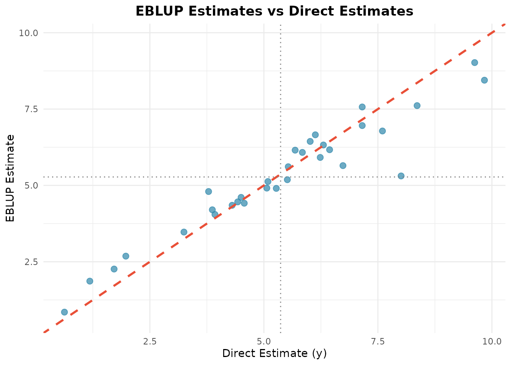
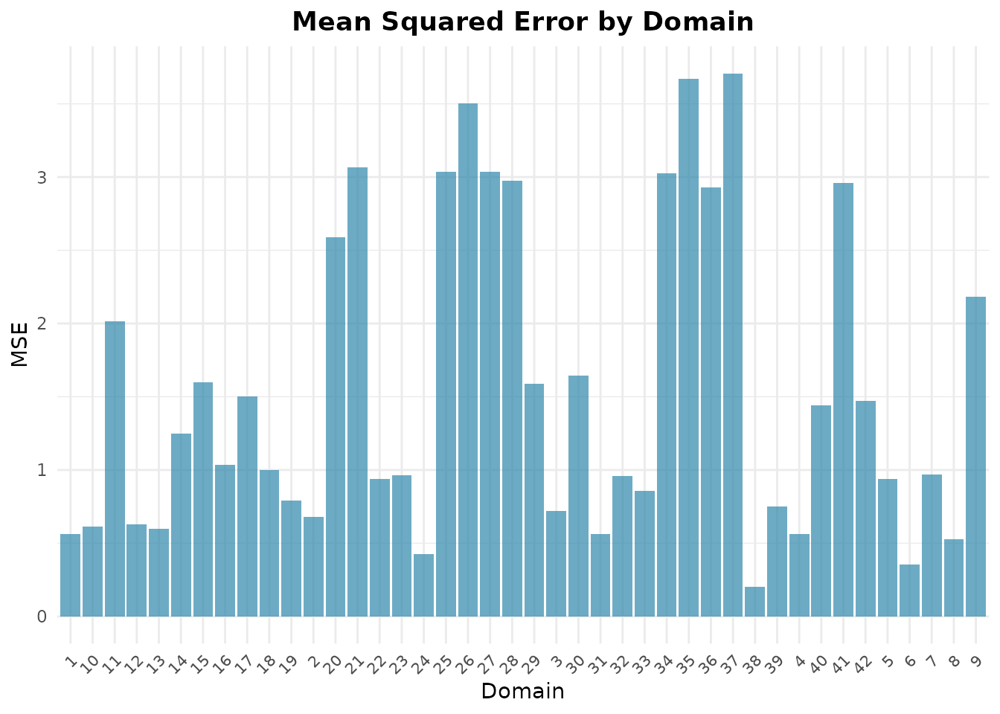
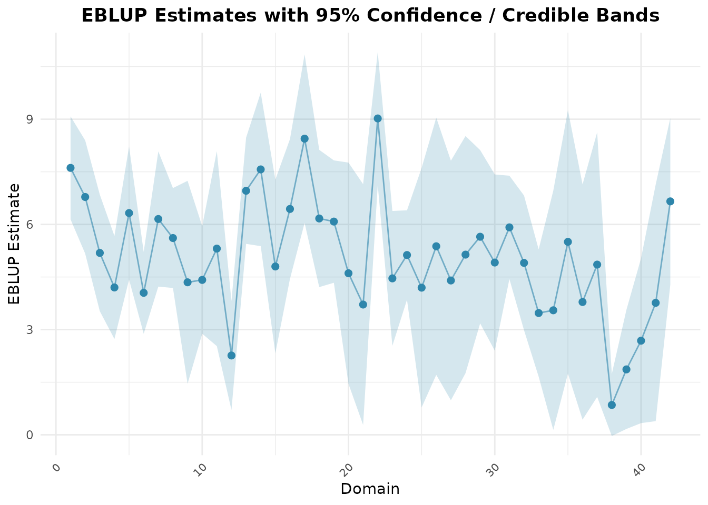

# Memulai fastsae

## Pendahuluan

Estimasi Area Kecil (*Small Area Estimation*, SAE) adalah sekumpulan
teknik statistik untuk menghasilkan estimasi yang andal bagi subpopulasi
atau wilayah geografis yang ukuran sampelnya terlalu kecil, sehingga
estimator survei langsung tidak dapat mencapai presisi yang memadai.

Paket **fastsae** mengestimasi model EBLUP frekuentis dalam kode C++
terkompilasi (melalui `Rcpp`, `RcppArmadillo`, dan `RcppEigen`) serta
model Bayesian hierarkis (*hierarchical Bayes*, HB) dengan INLA.
Keunggulannya:

- **Komputasi cepat**: *Fisher scoring* dan perhitungan MSE dikerjakan
  dalam C++ terkompilasi, dengan aljabar linear matriks jarang
  (*sparse*) untuk model spasial.
- **Sesuai dengan `sae`**: bila kedua paket memakai metode yang sama,
  estimasi, komponen varians, dan MSE analitiknya sama dengan `sae`
  hingga galat pembulatan (ditunjukkan di bawah untuk model
  Fay-Herriot). Pengecualian yang terdokumentasi hanya menyangkut model
  spasial: korelasi spasial yang terestimasi tepat di batas ruang
  parameter, dan MSE untuk estimasi ML (lihat
  [`?eblup_sfh`](https://ridsonap.is-a.dev/fastsae/reference/eblup_sfh.md)).
- **Antarmuka S3 modern**: menyatu dengan metode R yang standar
  ([`summary()`](https://rdrr.io/r/base/summary.html),
  [`coef()`](https://rdrr.io/r/stats/coef.html),
  [`fitted()`](https://rdrr.io/r/stats/fitted.values.html),
  [`residuals()`](https://rdrr.io/r/stats/residuals.html),
  [`autoplot()`](https://ggplot2.tidyverse.org/reference/autoplot.html)).

## Model Fay-Herriot

Model tingkat area yang diperkenalkan Fay dan Herriot (1979)
menghubungkan estimasi survei langsung $`y_d`$ dari parameter area
$`\theta_d`$ dengan variabel penyerta $`x_d`$:

``` math
y_d = x_d^\top \beta + u_d + e_d, \quad d = 1, \dots, D
```

dengan:

- $`u_d \sim \text{i.i.d. } N(0, \sigma_u^2)`$ adalah efek acak khusus
  untuk setiap domain;
- $`e_d \sim \text{ind. } N(0, \psi_d)`$ adalah galat sampling dengan
  varians sampling $`\psi_d`$ yang diketahui (`vardir`).

*Empirical Best Linear Unbiased Predictor* (EBLUP) merupakan kombinasi
terbobot antara estimator langsung dan estimator sintetis regresi:

``` math
\hat{\theta}_d = \gamma_d y_d + (1 - \gamma_d) x_d^\top \hat{\beta}
```

dengan $`\gamma_d = \frac{\hat{\sigma}_u^2}{\hat{\sigma}_u^2 + \psi_d}`$
sebagai faktor penyusutan (*shrinkage factor*, $`0 \le \gamma_d \le 1`$)
dan $`\hat\beta`$ sebagai estimator kuadrat terkecil terampat
(*generalized least squares*). Area yang tidak memiliki estimasi
langsung ($`y_d`$ hilang) memperoleh estimasi sintetis
$`x_d^\top \hat{\beta}`$.

MSE dari EBLUP diestimasi dengan aproksimasi orde kedua
$`g_{1d} + g_{2d} + 2 g_{3d}`$ (Prasad dan Rao, 1990; Datta dan Lahiri,
2000). Di sini $`g_{1d} = \gamma_d \psi_d`$ adalah MSE bila parameternya
diketahui, $`g_{2d}`$ memperhitungkan estimasi $`\beta`$, dan $`g_{3d}`$
memperhitungkan estimasi $`\sigma_u^2`$. Untuk estimasi ML, suku biasnya
dikurangkan. Galat baku relatif (*relative standard error*) dihitung
sebagai $`\mathrm{RSE}_d = 100 \sqrt{\mathrm{MSE}_d} / \hat{\theta}_d`$.

## Contoh Langkah demi Langkah

### 1. Memuat Paket dan Data

Contoh ini memakai data bawaan `mys`, yaitu rata-rata lama sekolah
penyandang disabilitas di 42 area. Sepuluh di antaranya tidak tersampel.

``` r

library(fastsae)
library(ggplot2)

data("mys")
head(mys)
#> # A tibble: 6 × 9
#>    area     y vardir   rse    x1    x2    x3      n  weight
#>   <int> <dbl>  <dbl> <dbl> <dbl> <dbl> <dbl>  <dbl>   <dbl>
#> 1     1  8.36  0.662  9.73   124    24    14  7280. 0.0326 
#> 2     2  7.60  0.837 12.0     89    18     9  2743. 0.0123 
#> 3     3  5.51  0.882 17.0     57    19     5  1706. 0.00764
#> 4     4  3.87  0.658 21.0     88    35    19  3073. 0.0138 
#> 5     5  6.31  1.28  17.9    141    46    29 13400. 0.0600 
#> 6     6  3.93  0.388 15.9     96    29    10  2004. 0.00897
```

### 2. Mengestimasi Model Fay-Herriot (`eblup_fh`)

Model Fay-Herriot tingkat area diestimasi dengan *Restricted Maximum
Likelihood* (REML) sebagai berikut:

``` r

# Estimasi model Fay-Herriot
fit_fh <- eblup_fh(
  formula = y ~ x1 + x2 + x3,
  vardir = ~vardir,
  data = mys,
  method = "REML",
  print_result = FALSE
)
```

### 3. Ringkasan Model dan Koefisien

Metode S3 [`summary()`](https://rdrr.io/r/base/summary.html) menampilkan
diagnostik model, komponen varians, dan uji koefisien secara lengkap:

``` r

summary(fit_fh)
#> 
#> ── Summary of fastsae Fit ──────────────────────────────────────────────────────
#> Call :
#> eblup_fh(formula = y ~ x1 + x2 + x3, vardir = ~vardir, data = mys, method =
#> "REML", print_result = FALSE)
#> 
#> ✔ Convergence: Yes (in 6 iterations)
#> Model: Fay-Herriot (Area-level)
#> Method: REML
#> 
#> Variance Components:
#> sigma2_u: 2.608103 
#> 
#> Coefficients:
#>                   beta  std.error     zvalue pvalue
#> (Intercept)  3.1077510  0.7697687  4.0372527 0.0001
#> x1          -0.0019323  0.0098886 -0.1954019 0.8451
#> x2           0.0555184  0.0614129  0.9040187 0.3660
#> x3           0.0335344  0.0580013  0.5781663 0.5632
#> 
#> Goodness of Fit:
#> loglikelihood           AIC           BIC 
#>     -65.14251     140.28502     147.61370 
#> 
#> EBLUP Summary Statistics:
#>       mse              rse        
#>  Min.   :0.2037   Min.   : 9.844  
#>  1st Qu.:0.6886   1st Qu.:14.889  
#>  Median :1.0156   Median :22.157  
#>  Mean   :1.5434   Mean   :26.275  
#>  3rd Qu.:2.4886   3rd Qu.:35.020  
#>  Max.   :3.7074   Max.   :53.065
```

Koefisien efek tetap diambil dengan
[`coef()`](https://rdrr.io/r/stats/coef.html):

``` r

coef(fit_fh)
#>  (Intercept)           x1           x2           x3 
#>  3.107750953 -0.001932259  0.055518370  0.033534410
```

Nilai EBLUP dan residualnya diambil dengan fungsi generik yang biasa:

``` r

# Nilai dugaan (EBLUP)
head(fitted(fit_fh))
#> [1] 7.612738 6.782316 5.187060 4.201545 6.323679 4.048590

# Residual (estimasi langsung - EBLUP)
head(residuals(fit_fh))
#> [1]  0.74678890  0.81733383  0.32707611 -0.33221827 -0.01861583 -0.12178363
```

### 4. Grafik Diagnostik (`autoplot`)

`fastsae` memperluas
[`ggplot2::autoplot()`](https://ggplot2.tidyverse.org/reference/autoplot.html)
sehingga grafik diagnostik dan perbandingan dapat dibuat dengan mudah.

#### Estimasi Langsung vs EBLUP

Membandingkan estimasi langsung dengan EBLUP memperlihatkan penyusutan
ke arah garis sintetis regresi:

``` r

autoplot(fit_fh, type = "estimates")
```



#### *Mean Squared Error* (MSE) per Domain

Ketidakpastian setiap domain dapat dilihat dari grafik MSE:

``` r

autoplot(fit_fh, type = "mse")
```



#### Estimasi Langsung dan EBLUP per Domain

`type = "comparison"` (atau aliasnya, `"ribbon"`) menampilkan estimasi
langsung dan EBLUP setiap domain beserta ketidakpastiannya:

``` r

autoplot(fit_fh, type = "ribbon")
```



`type = "rse"` menggambar galat baku relatif, sedangkan `type = "map"`
meneruskan hasil estimasi ke
[`map_sae()`](https://ridsonap.is-a.dev/fastsae/reference/map_sae.md)
untuk membuat peta koroplet (memerlukan objek `sf`). Jika yang diberikan
berupa *list* bernama berisi beberapa hasil estimasi, grafik
`"comparison"`, `"mse"`, `"scatter"`, dan `"map"` akan membandingkan
model-model tersebut (lihat
[spatial-temporal.html](https://ridsonap.is-a.dev/fastsae/articles/id/spatial-temporal.md)).

### 5. Model Fay-Herriot Logaritmik (`transform = "log"`)

Untuk indikator yang bernilai positif dan menceng ke kanan (pendapatan,
pengeluaran), model Fay-Herriot dapat diestimasi pada skala logaritma.
`vardir` tetap diberikan pada skala aslinya; fungsi ini mengubahnya ke
skala log dengan metode delta, $`\psi_d / y_d^2`$. Estimasi dikembalikan
ke skala asal dengan koreksi rata-rata bersyarat
$`\exp(\tilde\mu_d + \hat g_{1d}/2)`$ dari model log-normal (bandingkan
Slud & Maiti, 2006, tanpa suku $`O(1/m)`$ mereka), dan MSE-nya merupakan
aproksimasi metode delta
$`\hat\theta_d^2 \cdot \mathrm{mse}_{\log, d}`$. EBLUP dan MSE pada
skala log disimpan di `eblup_log` dan `mse_log`:

``` r

fit_log <- eblup_fh(y ~ x1 + x2 + x3,
  vardir = ~vardir, data = mys, transform = "log", print_result = FALSE
)
head(fit_log$df_eblup[, c("domain", "y", "eblup", "rse", "eblup_log", "mse_log")])
#>   domain        y    eblup       rse eblup_log     mse_log
#> 1      1 8.359527 7.774951  9.263592  2.046928 0.008581414
#> 2      2 7.599650 6.938675 11.136102  1.931495 0.012401277
#> 3      3 5.514137 5.337390 14.730097  1.665568 0.021697575
#> 4      4 3.869326 4.715172 16.585887  1.539108 0.027509165
#> 5      5 6.305063 6.373069 14.935181  1.842308 0.022305964
#> 6      6 3.926807 4.362456 13.945458  1.464679 0.019447580
```

## Kesesuaian dengan `sae`

Pada data yang sama, `fastsae` menghasilkan ulang keluaran
[`sae::mseFH()`](https://rdrr.io/pkg/sae/man/mseFH.html), yaitu EBLUP
beserta MSE analitiknya.

[`sae::mseFH()`](https://rdrr.io/pkg/sae/man/mseFH.html) memerlukan data
yang lengkap, jadi perbandingan dilakukan pada 32 area yang tersampel:

``` r

if (requireNamespace("sae", quietly = TRUE)) {
  mys_sampled <- as.data.frame(mys[!is.na(mys$y), ])
  fit_fast <- eblup_fh(y ~ x1 + x2 + x3, vardir = ~vardir, data = mys_sampled,
                       print_result = FALSE)
  fit_sae <- sae::mseFH(y ~ x1 + x2 + x3, vardir = vardir, data = mys_sampled)

  # EBLUP, koefisien, komponen varians, dan MSE analitik
  print(c(
    eblup = all.equal(fit_fast$df_eblup$eblup, as.vector(fit_sae$est$eblup)),
    beta = all.equal(as.vector(coef(fit_fast)), as.vector(fit_sae$est$fit$estcoef$beta)),
    sigma2_u = all.equal(fit_fast$random_effect_var, fit_sae$est$fit$refvar),
    mse = all.equal(fit_fast$df_eblup$mse, as.vector(fit_sae$mse))
  ))
}
#>    eblup     beta sigma2_u      mse 
#>     TRUE     TRUE     TRUE     TRUE
```

Setiap perbandingan menghasilkan `TRUE`: kedua paket sama hingga batas
toleransi [`all.equal()`](https://rdrr.io/r/base/all.equal.html).

## Langkah Berikutnya

Kemampuan pemodelan lanjutan di **fastsae**:

- **Model Spasial & Spatio-Temporal (EBLUP)**:
  [spatial-temporal.html](https://ridsonap.is-a.dev/fastsae/articles/id/spatial-temporal.md)
  (dinamika SAR dan AR(1)).
- **SAE Bayesian tingkat area dengan INLA (`hb_area`)**:
  [hb-area-inla.html](https://ridsonap.is-a.dev/fastsae/articles/id/hb-area-inla.md)
  (keluarga non-Gaussian: Beta, Poisson, Binomial Negatif, Gamma,
  Binomial; interaksi spatio-temporal; pemeriksaan konvergensi MCMC;
  serta
  [`hb_ratio()`](https://ridsonap.is-a.dev/fastsae/reference/hb_ratio.md)
  untuk subindikator dari sebuah indikator induk).
- **Diagnostik Model dan Analisis Residual (`diagnose`)**:
  [model-diagnostics.html](https://ridsonap.is-a.dev/fastsae/articles/id/model-diagnostics.md)
  (uji kalibrasi, penurunan RSE, dan Moran’s I).
- **Estimasi tingkat unit**:
  [unit-level-bhf.html](https://ridsonap.is-a.dev/fastsae/articles/id/unit-level-bhf.md)
  (model Battese-Harter-Fuller dan padanan HB-nya).
- **Model subarea dua tingkat**:
  [twofold-subarea.html](https://ridsonap.is-a.dev/fastsae/articles/id/twofold-subarea.md)
  ([`eblup_twofold()`](https://ridsonap.is-a.dev/fastsae/reference/eblup_twofold.md),
  [`hb_twofold()`](https://ridsonap.is-a.dev/fastsae/reference/hb_twofold.md)).
- **Prior bawaan model HB**:
  [hb-priors.html](https://ridsonap.is-a.dev/fastsae/articles/id/hb-priors.md).

## Daftar Pustaka

- Datta, G. S., & Lahiri, P. (2000). A unified measure of uncertainty of
  estimated best linear unbiased predictors in small area estimation
  problems. *Statistica Sinica*, 10(2), 613–627.
- Fay, R. E., & Herriot, R. A. (1979). Estimates of income for small
  places: An application of James-Stein procedures to Census data.
  *Journal of the American Statistical Association*, 74(366), 269–277.
- Prasad, N. G. N., & Rao, J. N. K. (1990). The estimation of the mean
  squared error of small-area estimators. *Journal of the American
  Statistical Association*, 85(409), 163–171.
- Rao, J. N. K., & Molina, I. (2015). *Small Area Estimation* (2nd ed.).
  John Wiley & Sons.
- Slud, E. V., & Maiti, T. (2006). Mean-squared error estimation in
  transformed Fay-Herriot models. *Journal of the Royal Statistical
  Society: Series B*, 68(2), 239–257.
