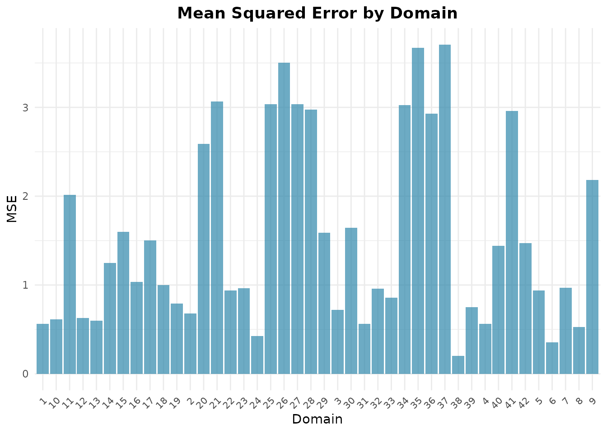

# Memulai dengan fastsae

*Terjemahan dari [versi bahasa
Inggris](https://ridsonap.is-a.dev/fastsae/articles/getting-started.md).
Penjelasan istilah ada di [Daftar
Istilah](https://ridsonap.is-a.dev/fastsae/articles/id/glosarium.md).*

## Pendahuluan

Small Area Estimation (SAE) mencakup teknik-teknik statistika untuk
menghasilkan estimasi yang andal bagi subpopulasi atau domain geografis
yang ukuran sampelnya terlalu kecil bagi direct estimator survei untuk
mencapai presisi yang dapat diterima.

Paket **fastsae** mengestimasi model EBLUP frequentist dalam C++
terkompilasi (melalui `Rcpp`, `RcppArmadillo`, dan `RcppEigen`) serta
hierarchical Bayes model dengan INLA. Paket ini menawarkan:

- **Komputasi cepat**: Fisher scoring dan perhitungan MSE dalam C++
  terkompilasi, dengan sparse linear algebra untuk model spatial.
- **Kesesuaian dengan `sae`**: bila kedua paket memakai metode yang
  sama, estimasi, variance component, dan analytical MSE sesuai dengan
  `sae` hingga galat pembulatan (ditunjukkan di bawah untuk model
  Fay-Herriot). Pengecualian yang terdokumentasi menyangkut model
  spatial: spatial correlation yang diestimasi di batas ruang parameter,
  dan MSE pada model yang diestimasi dengan ML (lihat
  [`?eblup_sfh`](https://ridsonap.is-a.dev/fastsae/reference/eblup_sfh.md)).
- **Antarmuka S3 modern**: terintegrasi dengan metode baku R
  ([`summary()`](https://rdrr.io/r/base/summary.html),
  [`coef()`](https://rdrr.io/r/stats/coef.html),
  [`fitted()`](https://rdrr.io/r/stats/fitted.values.html),
  [`residuals()`](https://rdrr.io/r/stats/residuals.html),
  [`autoplot()`](https://ggplot2.tidyverse.org/reference/autoplot.html)).

## Model Fay-Herriot

Area-level model yang diperkenalkan oleh Fay dan Herriot (1979)
menghubungkan direct estimator survei $`y_d`$ bagi parameter area
$`\theta_d`$ dengan auxiliary variable $`x_d`$:

``` math
y_d = x_d^\top \beta + u_d + e_d, \quad d = 1, \dots, D
```

dengan:

- $`u_d \sim \text{i.i.d. } N(0, \sigma_u^2)`$ adalah random effect
  spesifik domain.
- $`e_d \sim \text{ind. } N(0, \psi_d)`$ adalah sampling error dengan
  sampling variance $`\psi_d`$ yang diketahui (`vardir`).

*Empirical Best Linear Unbiased Predictor* (EBLUP) adalah kombinasi
terboboti antara direct estimator dan synthetic estimator regresi:

``` math
\hat{\theta}_d = \gamma_d y_d + (1 - \gamma_d) x_d^\top \hat{\beta}
```

dengan $`\gamma_d = \frac{\hat{\sigma}_u^2}{\hat{\sigma}_u^2 + \psi_d}`$
adalah shrinkage factor ($`0 \le \gamma_d \le 1`$) dan $`\hat\beta`$
adalah generalized least squares estimator. Area tanpa direct estimator
($`y_d`$ hilang) memperoleh synthetic estimator
$`x_d^\top \hat{\beta}`$.

MSE dari EBLUP diestimasi dengan aproksimasi orde kedua
$`g_{1d} + g_{2d} + 2 g_{3d}`$ (Prasad dan Rao, 1990; Datta dan Lahiri,
2000), dengan $`g_{1d} = \gamma_d \psi_d`$ adalah MSE bila parameter
diketahui, $`g_{2d}`$ memperhitungkan estimasi $`\beta`$, dan $`g_{3d}`$
memperhitungkan estimasi $`\sigma_u^2`$. Pada model yang diestimasi
dengan ML, suatu suku bias dikurangkan. Relative Standard Error (RSE)
adalah $`\mathrm{RSE}_d = 100 \sqrt{\mathrm{MSE}_d} / \hat{\theta}_d`$.

## Contoh Langkah demi Langkah

### 1. Memuat Paket dan Data

Kita memakai data bawaan `mys` (rata-rata lama sekolah penyandang
disabilitas di 42 area, 10 di antaranya tidak tersampel):

``` r

library(fastsae)
library(ggplot2)

data("mys")
head(mys)
#> # A tibble: 6 × 9
#>    area     y vardir   rse    x1    x2    x3      n  weight
#>   <int> <dbl>  <dbl> <dbl> <dbl> <dbl> <dbl>  <dbl>   <dbl>
#> 1     1  8.36  0.662  9.73   124    24    14  7280. 0.0326 
#> 2     2  7.60  0.837 12.0     89    18     9  2743. 0.0123 
#> 3     3  5.51  0.882 17.0     57    19     5  1706. 0.00764
#> 4     4  3.87  0.658 21.0     88    35    19  3073. 0.0138 
#> 5     5  6.31  1.28  17.9    141    46    29 13400. 0.0600 
#> 6     6  3.93  0.388 15.9     96    29    10  2004. 0.00897
```

### 2. Mengestimasi Model Fay-Herriot (`eblup_fh`)

Untuk mengestimasi model Fay-Herriot area-level dengan *Restricted
Maximum Likelihood* (REML):

``` r

# Fit Fay-Herriot model
fit_fh <- eblup_fh(
  formula = y ~ x1 + x2 + x3,
  vardir = ~vardir,
  data = mys,
  method = "REML",
  print_result = FALSE
)
```

### 3. Ringkasan Model dan Koefisien

Metode S3 baku [`summary()`](https://rdrr.io/r/base/summary.html)
menyajikan diagnostik model, variance component, dan uji koefisien
secara lengkap:

``` r

summary(fit_fh)
#> 
#> ── Summary of fastsae Fit ──────────────────────────────────────────────────────
#> Call :
#> eblup_fh(formula = y ~ x1 + x2 + x3, vardir = ~vardir, data = mys, method =
#> "REML", print_result = FALSE)
#> 
#> ✔ Convergence: Yes (in 6 iterations)
#> Model: Fay-Herriot (Area-level)
#> Method: REML
#> 
#> Variance Components:
#> sigma2_u: 2.608103 
#> 
#> Coefficients:
#>                   beta  std.error     zvalue pvalue
#> (Intercept)  3.1077510  0.7697687  4.0372527 0.0001
#> x1          -0.0019323  0.0098886 -0.1954019 0.8451
#> x2           0.0555184  0.0614129  0.9040187 0.3660
#> x3           0.0335344  0.0580013  0.5781663 0.5632
#> 
#> Goodness of Fit:
#> loglikelihood           AIC           BIC 
#>     -65.14251     140.28502     147.61370 
#> 
#> EBLUP Summary Statistics:
#>       mse              rse        
#>  Min.   :0.2037   Min.   : 9.844  
#>  1st Qu.:0.6886   1st Qu.:14.889  
#>  Median :1.0156   Median :22.157  
#>  Mean   :1.5434   Mean   :26.275  
#>  3rd Qu.:2.4886   3rd Qu.:35.020  
#>  Max.   :3.7074   Max.   :53.065
```

Koefisien fixed effect dapat diambil dengan
[`coef()`](https://rdrr.io/r/stats/coef.html):

``` r

coef(fit_fh)
#>  (Intercept)           x1           x2           x3 
#>  3.107750953 -0.001932259  0.055518370  0.033534410
```

Estimasi EBLUP dan residual dapat diambil dengan fungsi generik baku:

``` r

# Fitted values (EBLUP)
head(fitted(fit_fh))
#> [1] 7.612738 6.782316 5.187060 4.201545 6.323679 4.048590

# Residuals (direct estimate - EBLUP)
head(residuals(fit_fh))
#> [1]  0.74678890  0.81733383  0.32707611 -0.33221827 -0.01861583 -0.12178363
```

### 4. Diagnostic Plot (`autoplot`)

`fastsae` memperluas
[`ggplot2::autoplot()`](https://ggplot2.tidyverse.org/reference/autoplot.html)
untuk menyediakan plot diagnostik dan plot perbandingan yang praktis.

#### Direct Estimator vs EBLUP

Membandingkan direct estimator dengan EBLUP memperlihatkan shrinkage
menuju garis sintetik regresi:

``` r

autoplot(fit_fh, type = "estimates")
```


#### Mean Squared Error (MSE) antar Domain

Periksa ketidakpastian pada tingkat domain dengan plot MSE:

``` r

autoplot(fit_fh, type = "mse")
```



## Kesesuaian dengan `sae`

Pada data yang sama, `fastsae` mereproduksi
[`sae::mseFH()`](https://rdrr.io/pkg/sae/man/mseFH.html), yang
menghasilkan EBLUP beserta MSE analitiknya.

[`sae::mseFH()`](https://rdrr.io/pkg/sae/man/mseFH.html) membutuhkan
data lengkap, sehingga kita membandingkan hasil estimasi pada 32 sampled
area:

``` r

if (requireNamespace("sae", quietly = TRUE)) {
  mys_sampled <- as.data.frame(mys[!is.na(mys$y), ])
  fit_fast <- eblup_fh(y ~ x1 + x2 + x3, vardir = ~vardir, data = mys_sampled,
                       print_result = FALSE)
  fit_sae <- sae::mseFH(y ~ x1 + x2 + x3, vardir = vardir, data = mys_sampled)

  # EBLUPs, coefficients, variance component and analytical MSE
  print(c(
    eblup = all.equal(fit_fast$df_eblup$eblup, as.vector(fit_sae$est$eblup)),
    beta = all.equal(as.vector(coef(fit_fast)), as.vector(fit_sae$est$fit$estcoef$beta)),
    sigma2_u = all.equal(fit_fast$random_effect_var, fit_sae$est$fit$refvar),
    mse = all.equal(fit_fast$df_eblup$mse, as.vector(fit_sae$mse))
  ))
}
#>    eblup     beta sigma2_u      mse 
#>     TRUE     TRUE     TRUE     TRUE
```

Setiap perbandingan menghasilkan `TRUE`: kedua paket sesuai dalam batas
toleransi [`all.equal()`](https://rdrr.io/r/base/all.equal.html).

## Langkah Selanjutnya

Jelajahi kemampuan pemodelan lanjutan di **fastsae**:

- **Spatial and Spatio-Temporal Models (EBLUP)**:
  [spatial-temporal.html](https://ridsonap.is-a.dev/fastsae/articles/id/spatial-temporal.md)
  (dinamika SAR dan AR(1)).
- **Area-Level Bayesian SAE dengan INLA (`hb_area`)**:
  [hb-area-inla.html](https://ridsonap.is-a.dev/fastsae/articles/id/hb-area-inla.md)
  (keluarga non-Gaussian: Beta, Poisson, Binomial Negatif, Gamma,
  Binomial, dan interaksi spasial-temporal).
- **Diagnostik Model dan Analisis Residual (`diagnose`)**:
  [model-diagnostics.html](https://ridsonap.is-a.dev/fastsae/articles/id/model-diagnostics.md)
  (uji kalibrasi, penurunan RSE, dan Moran’s I).
- **Unit-Level Estimation**:
  [unit-level-bhf.html](https://ridsonap.is-a.dev/fastsae/articles/id/unit-level-bhf.md)
  (model Battese-Harter-Fuller dan padanan HB-nya).
- **Two-Fold Subarea Models**:
  [twofold-subarea.html](https://ridsonap.is-a.dev/fastsae/articles/id/twofold-subarea.md)
  ([`eblup_twofold()`](https://ridsonap.is-a.dev/fastsae/reference/eblup_twofold.md),
  [`hb_twofold()`](https://ridsonap.is-a.dev/fastsae/reference/hb_twofold.md)).
- **Prior Bawaan Model HB**:
  [hb-priors.html](https://ridsonap.is-a.dev/fastsae/articles/id/hb-priors.md).

## Daftar Pustaka

- Datta, G. S., & Lahiri, P. (2000). A unified measure of uncertainty of
  estimated best linear unbiased predictors in small area estimation
  problems. *Statistica Sinica*, 10(2), 613–627.
- Fay, R. E., & Herriot, R. A. (1979). Estimates of income for small
  places: An application of James-Stein procedures to Census data.
  *Journal of the American Statistical Association*, 74(366), 269–277.
- Prasad, N. G. N., & Rao, J. N. K. (1990). The estimation of the mean
  squared error of small-area estimators. *Journal of the American
  Statistical Association*, 85(409), 163–171.
- Rao, J. N. K., & Molina, I. (2015). *Small Area Estimation* (2nd ed.).
  John Wiley & Sons.
