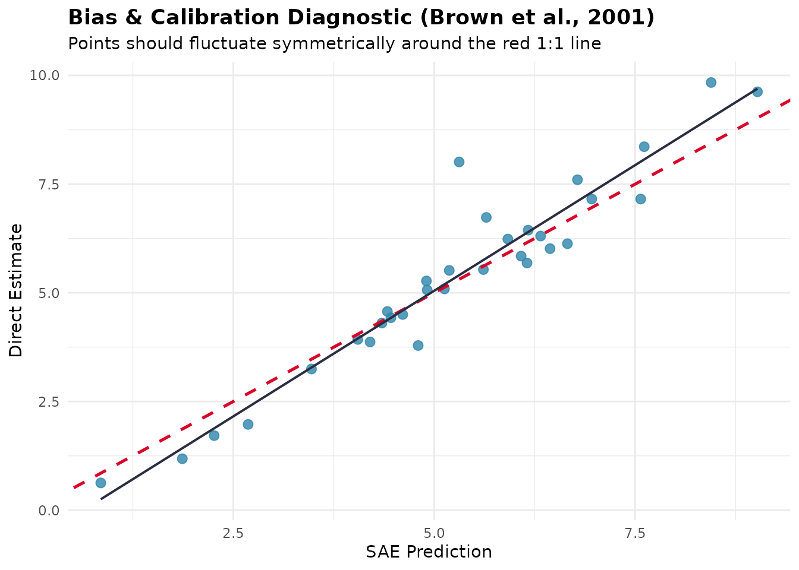
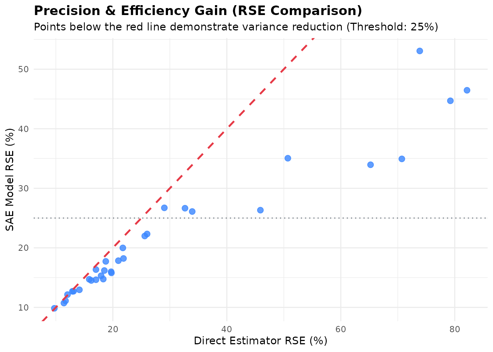
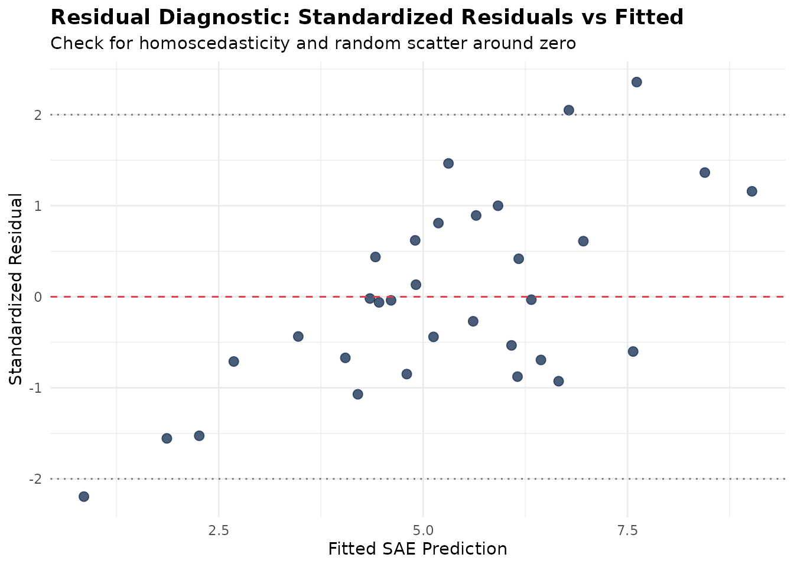
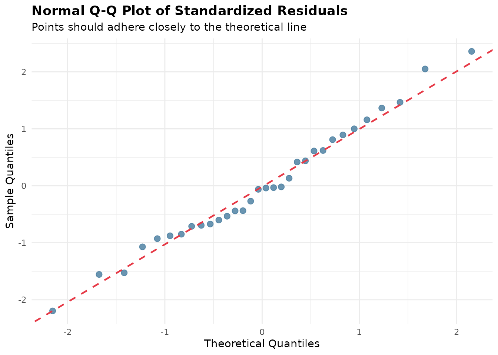
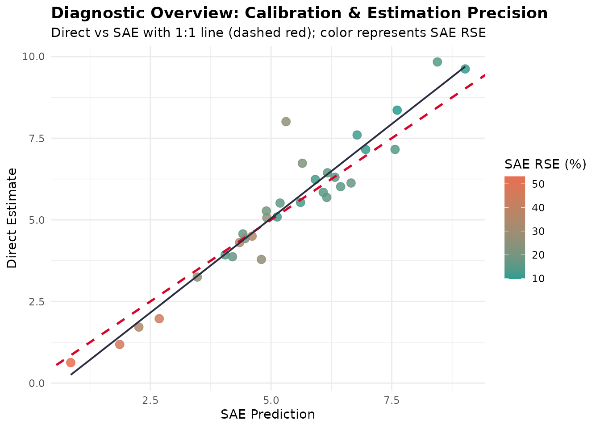
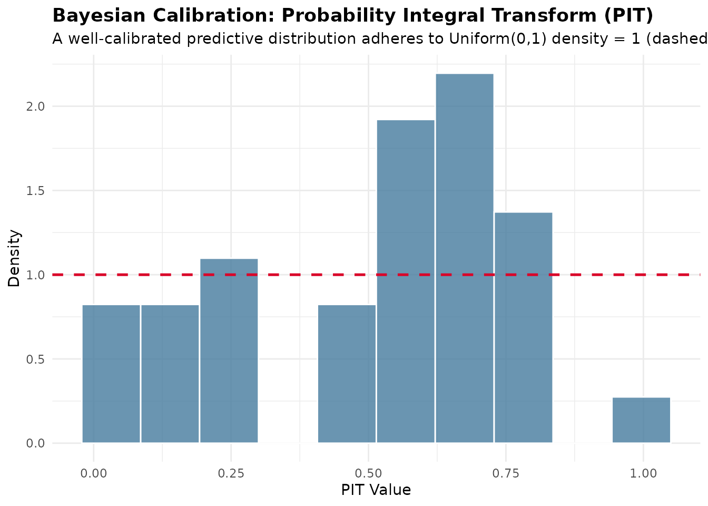
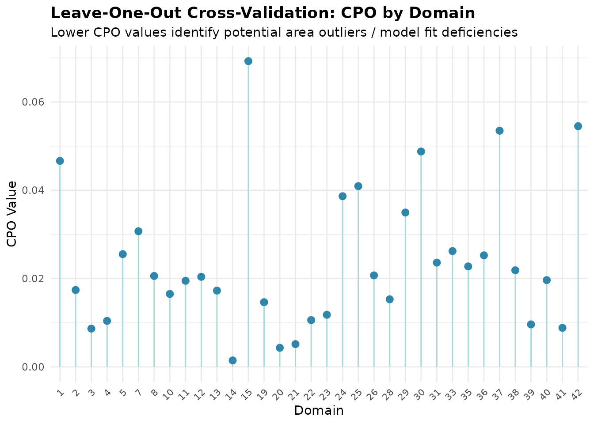

# Diagnostik Model dan Analisis Residual

## Pendahuluan

Dalam Estimasi Area Kecil (SAE), estimator berbasis model meminjam
kekuatan antardomain dan antarwaktu untuk meningkatkan presisi
dibandingkan estimator survei langsung. Namun, setiap asumsi model
membawa risiko: model bisa salah spesifikasi, estimasinya bisa bias, dan
penyusutannya bisa tidak tepat.

Untuk itu, **fastsae** menyediakan kerangka diagnostik terpadu yang
berpusat pada fungsi
[`diagnose()`](https://ridsonap.is-a.dev/fastsae/reference/diagnose.md)
beserta metode visualisasi S3 khususnya,
[`autoplot()`](https://ggplot2.tidyverse.org/reference/autoplot.html).
Kerangka ini dapat menilai model **EBLUP frekuentis berbasis C++**
(`eblup_fh`, `eblup_sfh`, `eblup_stfh`, `eblup_bhf`) maupun model **HB
Bayesian berbasis INLA** (`hb_area`).

------------------------------------------------------------------------

## Kriteria Diagnostik Utama

Diagnostik ini menilai empat dimensi pokok kualitas model SAE:

1.  **Peningkatan presisi dan penurunan RSE**: Mengukur perbaikan galat
    baku relatif
    ($`\text{RSE} = \frac{\sqrt{\text{MSE}}}{\hat{\theta}} \times 100\%`$)
    dibandingkan estimasi survei langsung, serta menilai apakah setiap
    area memenuhi ambang keandalan statistik resmi (umumnya
    $`\text{RSE} < 25\%`$ atau $`20\%`$).
2.  **Statistik kecocokan model (Brown dkk., 2001)**: Menghitung
    statistik diagnostik khi-kuadrat $`W`$ pada domain yang tersampel:
    ``` math
    W = \sum_{d=1}^D \frac{(y_d - \hat{\theta}_d)^2}{V_d + \text{MSE}(\hat{\theta}_d)}
    ```
    lalu membandingkannya dengan $`\chi^2(D)`$. Hanya nilai yang besar
    yang menandakan bahwa estimasi model berbeda dari estimasi langsung
    melebihi ketidakpastiannya, sehingga nilai-p dihitung dari ekor atas
    (seperti di `emdi`). Statistik ini mengabaikan korelasi positif
    antara $`y_d`$ dan $`\hat{\theta}_d`$, sehingga bersifat
    konservatif: bila modelnya benar, $`W`$ biasanya jauh di bawah
    $`D`$.
3.  **Diagnostik bias (Brown dkk., 2001)**: Regresi estimasi langsung
    terhadap estimasi model,
    ``` math
    y_d = \alpha + \beta \hat{\theta}_d + e_d,
    ```
    dilaporkan secara deskriptif (dengan
    `autoplot(type = "calibration")`) untuk melihat penyimpangan yang
    sistematis. Regresi ini tidak dipakai sebagai uji formal untuk
    $`\alpha = 0, \beta = 1`$: pada estimator penyusutan seperti EBLUP,
    kemiringannya melebihi 1 meskipun modelnya benar (sekitar
    $`1/\gamma_d`$ untuk variasi yang tidak dijelaskan oleh kovariat),
    sehingga uji semacam itu akan menolak model yang benar.
4.  **Autokorelasi spasial residual (Moran’s I)**: Memeriksa apakah
    autokorelasi spasial sudah sepenuhnya ditangkap oleh efek acak
    model. Pengelompokan spasial residual yang signifikan menandakan
    masih ada pola spasial yang belum dimodelkan.

------------------------------------------------------------------------

## Contoh Praktis: Mendiagnosis Model Fay-Herriot

Alur kerja diagnostik diperagakan dengan data bawaan `mys` (rata-rata
lama sekolah di 42 kabupaten).

### 1. Mengestimasi Model dan Menjalankan `diagnose()`

``` r

library(fastsae)
library(ggplot2)

data("mys")
data("mys_proxmat")

# Estimasi model Fay-Herriot tingkat area
fit_fh <- eblup_fh(
  formula = y ~ x1 + x2 + x3,
  vardir = ~vardir,
  data = na.omit(mys),
  method = "REML",
  print_result = FALSE
)

# Jalankan seluruh pemeriksaan diagnostik
diag_fh <- diagnose(fit_fh, W = mys_proxmat[!is.na(mys$y), !is.na(mys$y)])
print(diag_fh)
```

### 2. Memeriksa Komponen Diagnostik

Objek `fastsae_diagnose` yang dihasilkan memberikan akses terstruktur ke
setiap bagian diagnostik:

``` r

# Peningkatan efisiensi
diag_fh$precision
#> $rse_threshold
#> [1] 25
#> 
#> $prop_reliable
#> [1] 68.75
#> 
#> $mean_direct_rse
#> [1] 29.49003
#> 
#> $median_direct_rse
#> [1] 19.72062
#> 
#> $mean_sae_rse
#> [1] 21.63848
#> 
#> $median_sae_rse
#> [1] 17.03635
#> 
#> $eff_ratio_summary
#>      Min   Q1.25%   Median     Mean   Q3.75%      Max 
#> 1.017672 1.194006 1.291102 1.529910 1.491337 3.907487 
#> 
#> $prop_gain
#> [1] 100

# Hasil uji kalibrasi
diag_fh$brown_test
#> $bias_regression
#> $bias_regression$alpha
#> [1] -0.7316943
#> 
#> $bias_regression$beta
#> [1] 1.155679
#> 
#> $bias_regression$se_alpha
#> [1] 0.363461
#> 
#> $bias_regression$se_beta
#> [1] 0.0652052
#> 
#> $bias_regression$r_squared
#> [1] 0.9128237
#> 
#> $bias_regression$n
#> [1] 32
#> 
#> 
#> $goodness_of_fit
#> $goodness_of_fit$w_stat
#> [1] 4.525856
#> 
#> $goodness_of_fit$df
#> [1] 32
#> 
#> $goodness_of_fit$crit
#> [1] 46.19426
#> 
#> $goodness_of_fit$p_value
#> [1] 1
#> 
#> $goodness_of_fit$is_good_fit
#> [1] TRUE

# Uji spasial Moran's I pada residual
diag_fh$spatial_test
#> $moran_I
#> [1] -0.1196823
#> 
#> $expected_I
#> [1] -0.03225806
#> 
#> $sd_I
#> [1] 0.1105189
#> 
#> $z_stat
#> [1] -0.7910343
#> 
#> $p_value
#> [1] 0.428924
#> 
#> $no_residual_autocorrelation
#> [1] TRUE
```

------------------------------------------------------------------------

## Diagnostik Visual dengan `autoplot()`

`fastsae` menyediakan beberapa jenis grafik ggplot2 khusus untuk objek
`fastsae_diagnose`.

### 1. Grafik Kalibrasi (`type = "calibration"`)

Memplot estimasi survei langsung terhadap prediksi model, disertai garis
identitas 1:1 dan garis regresi kalibrasi hasil estimasi:

``` r

autoplot(diag_fh, type = "calibration")
```



### 2. Perbandingan Presisi (`type = "rse"`)

Menampilkan penurunan galat baku relatif untuk setiap domain:

``` r

autoplot(diag_fh, type = "rse")
```



### 3. Diagnostik Residual (`type = "residuals"` & `type = "qq"`)

Periksa residual terstandardisasi terhadap nilai dugaan untuk mendeteksi
heteroskedastisitas, ketaklinearan, atau pencilan:

``` r

autoplot(diag_fh, type = "residuals")
```



``` r

autoplot(diag_fh, type = "qq")
```



### 4. Dasbor Diagnostik Gabungan (`type = "all"`)

Menghasilkan satu tampilan diagnostik yang merangkum kalibrasi dan
peningkatan presisi:

``` r

autoplot(diag_fh, type = "all")
```



------------------------------------------------------------------------

## Mendiagnosis Model Spatio-Temporal Bayesian

Fungsi
[`diagnose()`](https://ridsonap.is-a.dev/fastsae/reference/diagnose.md)
yang sama juga langsung berlaku untuk model Bayesian yang diestimasi
dengan
[`hb_area()`](https://ridsonap.is-a.dev/fastsae/reference/hb_area.md):

``` r

data("sim_area", package = "fastsae")

# Estimasi model HB spasial dengan prior BYM2
fit_hb <- hb_area(
  formula = y_gaussian ~ x1 + x2,
  data = sim_area,
  vardir = "vardir",
  spatial = "bym2",
  W = create_weights(cbind(sim_area$x_coord, sim_area$y_coord), method = "knn", k = 4),
  print_result = FALSE
)

# Diagnosis model Bayesian
diag_hb <- diagnose(fit_hb)
diag_hb$precision
#> $rse_threshold
#> [1] 25
#> 
#> $prop_reliable
#> [1] 64.28571
#> 
#> $mean_direct_rse
#> [1] 103.231
#> 
#> $median_direct_rse
#> [1] 17.64954
#> 
#> $mean_sae_rse
#> [1] 70.50124
#> 
#> $median_sae_rse
#> [1] 19.57359
#> 
#> $eff_ratio_summary
#>      Min   Q1.25%   Median     Mean   Q3.75%      Max 
#> 1.109209 1.238711 1.281725 1.288101 1.357725 1.458810 
#> 
#> $prop_gain
#> [1] 100
diag_hb$status
#> [1] "WARNING: High proportions of domains with RSE >= threshold."
```

### Kalibrasi Prediktif: PIT dan CPO (`type = "pit"` & `type = "cpo"`)

Untuk model Bayesian,
[`diagnose()`](https://ridsonap.is-a.dev/fastsae/reference/diagnose.md)
juga menghitung *probability integral transform* (PIT)
$`u_d = F_d(y_d)`$ dari setiap estimasi langsung di bawah distribusi
prediktifnya, yang berdistribusi seragam bila modelnya terkalibrasi,
serta *conditional predictive ordinate* (CPO). Untuk data cacahan,
$`F_d`$ berupa fungsi tangga, sehingga PIT-nya diacak (Czado, Gneiting,
dan Held, 2009). CPO *leave-one-out* dari INLA bisa jauh berbeda dari
hasil estimasi ulang tanpa area tersebut pada model binomial dan
Poisson. Karena itu, untuk model tingkat area dengan efek area yang
saling bebas dan likelihood binomial atau Poisson, `pit_method = "auto"`
memakai prediktif campuran (*mixed predictive*) dari Marshall dan
Spiegelhalter (2003); rinciannya ada di
[`?diagnose`](https://ridsonap.is-a.dev/fastsae/reference/diagnose.md).
`bayesian_metrics$pit_test` melaporkan uji Kolmogorov-Smirnov dan
proporsi nilai PIT yang berada di $`[0{,}05; 0{,}95]`$, yang bernilai
0,90 untuk model yang terkalibrasi:

``` r

fit_bin <- hb_area(y_binomial ~ x1 + x2,
  data = sim_area, family = "binomial", trials = "trials", print_result = FALSE
)
diag_bin <- diagnose(fit_bin)
diag_bin$bayesian_metrics$pit_test[c("method", "p_value", "central90", "central90_range")]
#> $method
#> [1] "mixed"
#> 
#> $p_value
#> [1] 0.3466186
#> 
#> $central90
#> [1] 0.9411765
#> 
#> $central90_range
#> [1] 0.7991607 1.0008393

autoplot(diag_bin, type = "pit") # histogram datar: terkalibrasi
```



``` r

autoplot(diag_bin, type = "cpo") # nilai kecil: domain yang prediksinya buruk
```



------------------------------------------------------------------------

## Daftar Pustaka

- Brown, G., Chambers, R., Heady, P., & Heasman, D. (2001). Evaluation
  of small area estimation methods: An application to unemployment
  estimates from the UK LFS. *Proceedings of Statistics Canada Symposium
  2001: Achieving Data Quality in a Statistical Agency*.
- Czado, C., Gneiting, T., & Held, L. (2009). Predictive model
  assessment for count data. *Biometrics*, 65(4), 1254–1261.
- Fay, R. E., & Herriot, R. A. (1979). Estimates of income for small
  places: An application of James-Stein procedures to Census data.
  *Journal of the American Statistical Association*, 74(366), 269–277.
- Marshall, E. C., & Spiegelhalter, D. J. (2003). Approximate
  cross-validatory predictive checks in disease mapping models.
  *Statistics in Medicine*, 22(10), 1649–1660.
- Rao, J. N. K., & Molina, I. (2015). *Small Area Estimation* (2nd ed.).
  John Wiley & Sons.
