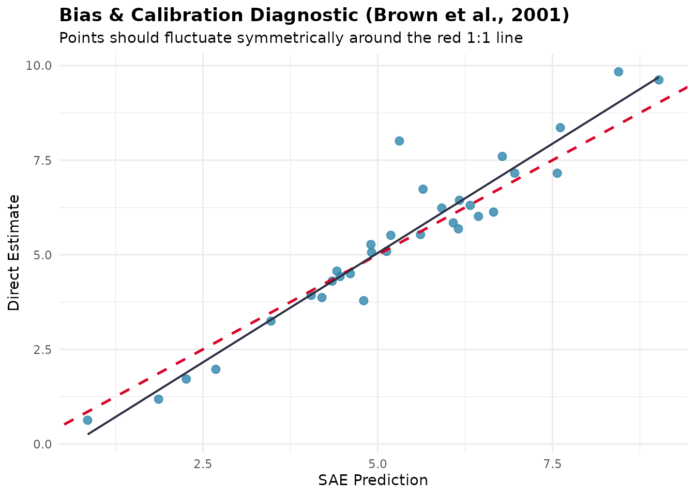
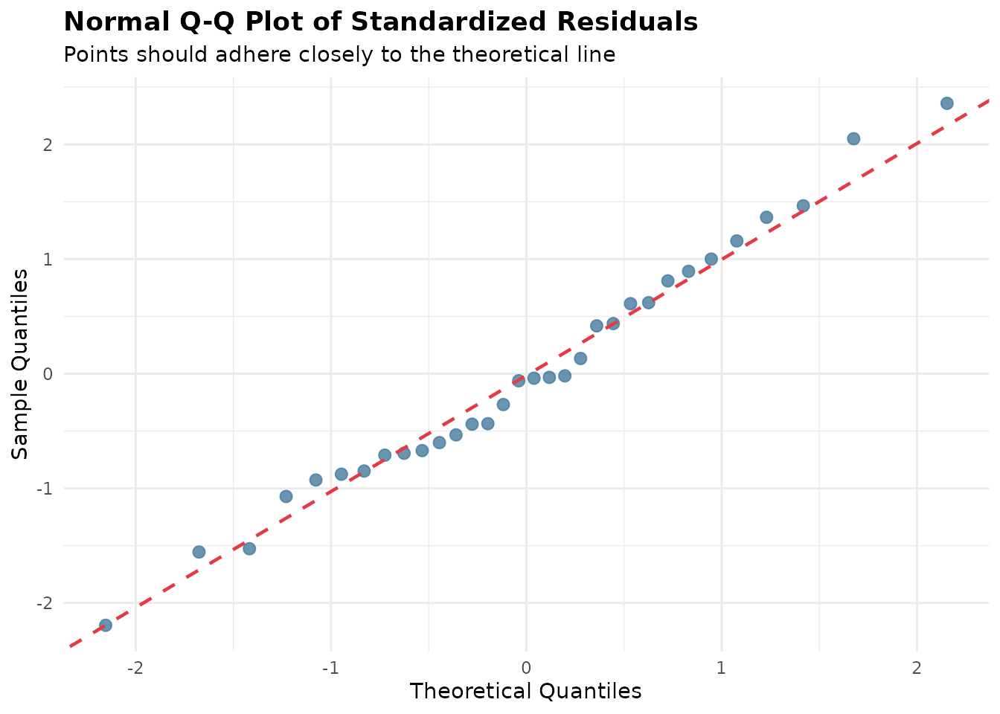
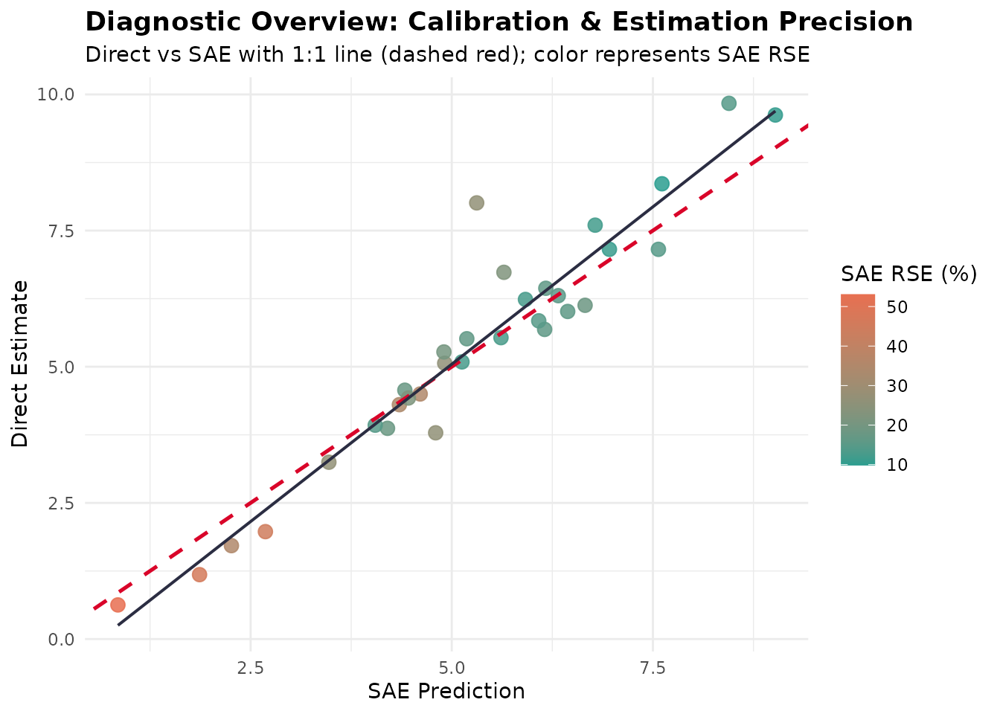

# Diagnostik Model dan Analisis Residual

*Terjemahan dari [versi bahasa
Inggris](https://ridsonap.is-a.dev/fastsae/articles/model-diagnostics.md).
Penjelasan istilah ada di [Daftar
Istilah](https://ridsonap.is-a.dev/fastsae/articles/id/glosarium.md).*

## Pendahuluan

Dalam small area estimation (SAE), model-based estimator meminjam
informasi antardomain dan antarwaktu untuk meningkatkan presisi
dibandingkan direct estimator survei. Namun, asumsi model membawa risiko
kesalahan spesifikasi model, bias, dan shrinkage yang tidak tepat.

Untuk menjawab tantangan ini, **fastsae** menyediakan kerangka
diagnostik terpadu yang berpusat pada fungsi
[`diagnose()`](https://ridsonap.is-a.dev/fastsae/reference/diagnose.md)
dan metode S3
[`autoplot()`](https://ggplot2.tidyverse.org/reference/autoplot.html)
khusus untuk visualisasinya. Kerangka ini mengevaluasi model **EBLUP
frequentist berbasis C++** (`eblup_fh`, `eblup_sfh`, `eblup_stfh`,
`eblup_bhf`) maupun model **HB Bayesian berbasis INLA** (`hb_area`).

------------------------------------------------------------------------

## Kriteria Diagnostik Utama

Alur diagnostik mengevaluasi empat dimensi mendasar dari kualitas model
SAE:

1.  **Precision Gain dan RSE Reduction**: Mengukur perbaikan Relative
    Standard Error
    ($`\text{RSE} = \frac{\sqrt{\text{MSE}}}{\hat{\theta}} \times 100\%`$)
    dibandingkan direct estimator survei. Mengevaluasi apakah area
    memenuhi ambang keandalan statistik resmi (umumnya
    $`\text{RSE} < 25\%`$ atau $`20\%`$).
2.  **Statistik Goodness-of-Fit (Brown dkk., 2001)**: Menghitung
    statistik diagnostik Chi-square $`W`$ pada domain yang tersampel:
    ``` math
    W = \sum_{d=1}^D \frac{(y_d - \hat{\theta}_d)^2}{V_d + \text{MSE}(\hat{\theta}_d)}
    ```
    lalu membandingkannya dengan $`\chi^2(D)`$. Hanya nilai yang besar
    yang menunjukkan bahwa estimasi model berbeda dari direct estimator
    lebih jauh daripada ketidakpastiannya, sehingga p-value dihitung
    pada ekor atas (seperti di `emdi`). Statistik ini mengabaikan
    korelasi positif antara $`y_d`$ dan $`\hat{\theta}_d`$, sehingga
    bersifat konservatif: pada model yang benar, $`W`$ biasanya jauh di
    bawah $`D`$.
3.  **Diagnostik Bias (Brown dkk., 2001)**: Regresi direct estimator
    terhadap estimasi model,
    ``` math
    y_d = \alpha + \beta \hat{\theta}_d + e_d,
    ```
    dilaporkan secara deskriptif (dengan
    `autoplot(type = "calibration")`) untuk mencari penyimpangan
    sistematis. Regresi ini tidak dipakai sebagai uji formal untuk
    $`\alpha = 0, \beta = 1`$: pada shrinkage estimator seperti EBLUP,
    slope melebihi 1 walaupun modelnya benar (sekitar $`1/\gamma_d`$
    untuk variasi yang tidak dijelaskan oleh covariate), sehingga uji
    semacam itu akan menolak model yang benar.
4.  **Spatial Autocorrelation pada Residual (Moran’s I)**: Memeriksa
    apakah spatial autocorrelation telah sepenuhnya ditangkap oleh
    random effect model. Residual spatial clustering yang signifikan
    menunjukkan masih ada pola spatial yang belum dimodelkan.

------------------------------------------------------------------------

## Contoh Praktis: Mendiagnosis Model Fay-Herriot

Kita mendemonstrasikan alur diagnostik dengan data bawaan `mys`
(Rata-rata Lama Sekolah di 42 kabupaten/kota):

### 1. Mengestimasi Model dan Menjalankan `diagnose()`

``` r

library(fastsae)
library(ggplot2)

data("mys")
data("mys_proxmat")

# Fit Area-Level Fay-Herriot model
fit_fh <- eblup_fh(
  formula = y ~ x1 + x2 + x3,
  vardir = ~vardir,
  data = na.omit(mys),
  method = "REML",
  print_result = FALSE
)

# Run comprehensive diagnostic checks
diag_fh <- diagnose(fit_fh, W = mys_proxmat[!is.na(mys$y), !is.na(mys$y)])
print(diag_fh)
```

### 2. Memeriksa Komponen Diagnostik

Objek `fastsae_diagnose` yang dihasilkan menyediakan akses terstruktur
ke setiap domain diagnostik:

``` r

# Efficiency gains
diag_fh$precision
#> $rse_threshold
#> [1] 25
#> 
#> $prop_reliable
#> [1] 68.75
#> 
#> $mean_direct_rse
#> [1] 29.49003
#> 
#> $median_direct_rse
#> [1] 19.72062
#> 
#> $mean_sae_rse
#> [1] 21.63848
#> 
#> $median_sae_rse
#> [1] 17.03635
#> 
#> $eff_ratio_summary
#>      Min   Q1.25%   Median     Mean   Q3.75%      Max 
#> 1.017672 1.194006 1.291102 1.529910 1.491337 3.907487 
#> 
#> $prop_gain
#> [1] 100

# Calibration test results
diag_fh$brown_test
#> $bias_regression
#> $bias_regression$alpha
#> [1] -0.7316943
#> 
#> $bias_regression$beta
#> [1] 1.155679
#> 
#> $bias_regression$se_alpha
#> [1] 0.363461
#> 
#> $bias_regression$se_beta
#> [1] 0.0652052
#> 
#> $bias_regression$r_squared
#> [1] 0.9128237
#> 
#> $bias_regression$n
#> [1] 32
#> 
#> 
#> $goodness_of_fit
#> $goodness_of_fit$w_stat
#> [1] 4.525856
#> 
#> $goodness_of_fit$df
#> [1] 32
#> 
#> $goodness_of_fit$crit
#> [1] 46.19426
#> 
#> $goodness_of_fit$p_value
#> [1] 1
#> 
#> $goodness_of_fit$is_good_fit
#> [1] TRUE

# Moran's I spatial test on residuals
diag_fh$spatial_test
#> $moran_I
#> [1] -0.1196823
#> 
#> $expected_I
#> [1] -0.03225806
#> 
#> $sd_I
#> [1] 0.1105189
#> 
#> $z_stat
#> [1] -0.7910343
#> 
#> $p_value
#> [1] 0.428924
#> 
#> $no_residual_autocorrelation
#> [1] TRUE
```

------------------------------------------------------------------------

## Diagnostik Visual dengan `autoplot()`

`fastsae` mengimplementasikan beberapa tipe visualisasi ggplot2 khusus
untuk objek `fastsae_diagnose`:

### 1. Calibration Plot (`type = "calibration"`)

Memplot direct estimator survei terhadap prediksi model beserta garis
identitas 1:1 dan regresi kalibrasi hasil estimasi:

``` r

autoplot(diag_fh, type = "calibration")
```



### 2. Perbandingan Presisi (`type = "rse"`)

Memvisualisasikan penurunan Relative Standard Error untuk setiap domain:

``` r

autoplot(diag_fh, type = "rse")
```


### 3. Diagnostik Residual (`type = "residuals"` dan `type = "qq"`)

Periksa standardized residual terhadap nilai terprediksi untuk
mendeteksi heteroscedasticity, ketidaklinearan, atau pencilan:

``` r

autoplot(diag_fh, type = "residuals")
```


``` r

autoplot(diag_fh, type = "qq")
```



### 4. Combined Diagnostic Dashboard (`type = "all"`)

Menghasilkan tampilan diagnostik terpadu yang merangkum kalibrasi dan
peningkatan presisi:

``` r

autoplot(diag_fh, type = "all")
```



------------------------------------------------------------------------

## Mendiagnosis Model Bayesian Spatio-Temporal

Fungsi
[`diagnose()`](https://ridsonap.is-a.dev/fastsae/reference/diagnose.md)
yang sama dapat langsung dipakai pada model Bayesian yang diestimasi
dengan
[`hb_area()`](https://ridsonap.is-a.dev/fastsae/reference/hb_area.md):

``` r

data("sim_area", package = "fastsae")

# Fit Spatial EBP model with BYM2 prior
fit_hb <- hb_area(
  formula = y_gaussian ~ x1 + x2,
  data = sim_area,
  vardir = "vardir",
  spatial = "bym2",
  W = create_weights(cbind(sim_area$x_coord, sim_area$y_coord), method = "knn", k = 4),
  print_result = FALSE
)

# Diagnose Bayesian model
diag_hb <- diagnose(fit_hb)
diag_hb$precision
#> $rse_threshold
#> [1] 25
#> 
#> $prop_reliable
#> [1] 64.28571
#> 
#> $mean_direct_rse
#> [1] 103.231
#> 
#> $median_direct_rse
#> [1] 17.64954
#> 
#> $mean_sae_rse
#> [1] 70.49315
#> 
#> $median_sae_rse
#> [1] 19.57027
#> 
#> $eff_ratio_summary
#>      Min   Q1.25%   Median     Mean   Q3.75%      Max 
#> 1.108100 1.238707 1.281716 1.288164 1.357667 1.459160 
#> 
#> $prop_gain
#> [1] 100
diag_hb$status
#> [1] "WARNING: High proportions of domains with RSE >= threshold."
```

------------------------------------------------------------------------

## Daftar Pustaka

- Brown, G., Chambers, R., Heady, P., & Heasman, D. (2001). Evaluation
  of small area estimation methods: An application to unemployment
  estimates from the UK LFS. *Proceedings of Statistics Canada Symposium
  2001: Achieving Data Quality in a Statistical Agency*.
- Fay, R. E., & Herriot, R. A. (1979). Estimates of income for small
  places: An application of James-Stein procedures to Census data.
  *Journal of the American Statistical Association*, 74(366), 269–277.
- Rao, J. N. K., & Molina, I. (2015). *Small Area Estimation* (2nd ed.).
  John Wiley & Sons.
