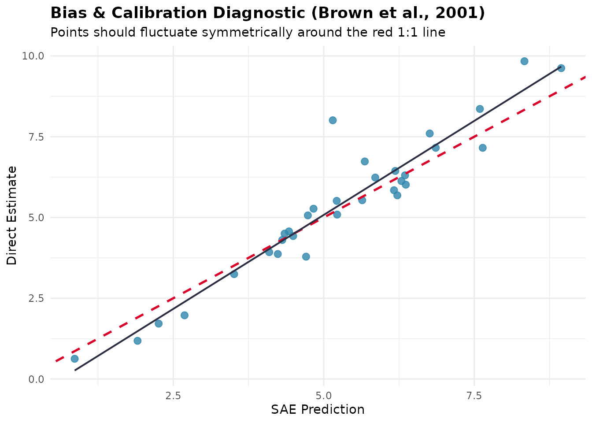

# Alur Kerja yang Optimal untuk Estimasi Area Kecil

Artikel ini menyusun fungsi-fungsi **fastsae** menurut urutan yang biasa
ditempuh dalam sebuah analisis, mulai dari estimasi langsung hasil
survei sampai tabel yang dipublikasikan. Urutan ini adalah titik awal
yang masuk akal, bukan aturan baku: setiap langkah menjelaskan apa yang
diperiksa dan apa yang perlu dilakukan dengan hasilnya. Contohnya
memakai data `mys` (rata-rata lama sekolah penyandang disabilitas di 42
kabupaten, 10 di antaranya tanpa sampel), sehingga semua keluaran di
bawah berasal dari pemanggilan fungsi yang sebenarnya.

| Langkah | Pertanyaan | Fungsi |
|:---|:---|:---|
| 1 | Seberapa baik estimasi langsungnya? | [`add_reliability_flags()`](https://ridsonap.is-a.dev/fastsae/reference/add_reliability_flags.md), [`gvf_smooth()`](https://ridsonap.is-a.dev/fastsae/reference/gvf_smooth.md) |
| 2 | Adakah struktur spasial yang perlu dimodelkan? | [`create_weights()`](https://ridsonap.is-a.dev/fastsae/reference/create_weights.md), [`spatial_test()`](https://ridsonap.is-a.dev/fastsae/reference/spatial_test.md) |
| 3 | Kovariat mana yang dipakai? | [`step_sae()`](https://ridsonap.is-a.dev/fastsae/reference/step_sae.md) |
| 4 | Model mana yang dipilih? | [`eblup_fh()`](https://ridsonap.is-a.dev/fastsae/reference/eblup_fh.md), [`eblup_sfh()`](https://ridsonap.is-a.dev/fastsae/reference/eblup_sfh.md), [`compare_sae()`](https://ridsonap.is-a.dev/fastsae/reference/compare_sae.md) |
| 5 | Apakah modelnya memadai? | [`diagnose()`](https://ridsonap.is-a.dev/fastsae/reference/diagnose.md), [`autoplot()`](https://ggplot2.tidyverse.org/reference/autoplot.html) |
| 6 | Apakah estimasinya konsisten dengan total yang dipublikasikan? | [`benchmark_sae()`](https://ridsonap.is-a.dev/fastsae/reference/benchmark_sae.md) |
| 7 | Bagaimana hasilnya dilaporkan? | [`map_sae()`](https://ridsonap.is-a.dev/fastsae/reference/map_sae.md), [`export_sae()`](https://ridsonap.is-a.dev/fastsae/reference/export_sae.md) |

``` r

library(fastsae)
data("mys")
data("mys_proxmat")
```

## 1. Memeriksa estimasi langsung

Model area kecil layak dipakai bila estimasi langsungnya tidak presisi.
Estimasi model pertama, lalu tandai setiap domain menurut tingkat
keandalan BPS (RSE paling tinggi 25%, 25–50%, dan di atas 50%):

``` r

fit_full <- eblup_fh(y ~ x1 + x2 + x3, vardir = ~vardir, data = mys, print_result = FALSE)
flags <- add_reliability_flags(fit_full)
table(flags$reliability)
#> 
#>               Reliable (RSE ≤ 25%) Use with caution (25% < RSE ≤ 50%) 
#>                                 22                                 19 
#>             Unreliable (RSE > 50%) 
#>                                  1
```

Tingkat keandalan yang sama dapat dihitung untuk estimasi langsung saja,
dan dari situlah terlihat seberapa besar perbaikan yang bisa diperoleh.
Bila `vardir` sendiri tidak stabil (sampelnya kecil sehingga varians
yang dipakai pun hanya hasil estimasi), haluskan dulu dengan
[`gvf_smooth()`](https://ridsonap.is-a.dev/fastsae/reference/gvf_smooth.md).
Model Fay-Herriot menganggap `vardir` diketahui, sehingga
ketidakstabilan pada `vardir` langsung terbawa ke dalam penyusutan. Di
sini `vardir` dari `mys` dipakai apa adanya; metode penghalusannya
dijelaskan di
[`?gvf_smooth`](https://ridsonap.is-a.dev/fastsae/reference/gvf_smooth.md).

## 2. Adakah struktur spasial?

[`spatial_test()`](https://ridsonap.is-a.dev/fastsae/reference/spatial_test.md)
menjalankan serangkaian uji sebelum model spasial apa pun diestimasi:
Moran’s I pada estimasi langsung dan pada residual regresi, uji LM
Anselin, serta uji rasio likelihood model Fay-Herriot Spasial terhadap
model standar.
[`create_weights()`](https://ridsonap.is-a.dev/fastsae/reference/create_weights.md)
membentuk `W` dari poligon atau koordinat; dalam contoh ini
`mys_proxmat` sudah tersedia.

``` r

spatial_test(y ~ x1 + x2 + x3, vardir = ~vardir, data = mys, W = mys_proxmat)
#> 
#> ── Pre-Modeling Spatial Diagnostic Tests (fastsae) ─────────────────────────────
#> 
#> ── 1. Direct Response Variable (ESDA) ──
#> 
#> • Global Moran's I: -0.2773 (Expected: -0.0323, z-stat: -2.049)
#> • p-value: "0.9798" [ns]
#> ℹ Direct estimates show no significant spatial clustering.
#> 
#> ── 2. Regression Residuals (Controlling for Auxiliary Variables) ──
#> 
#> • Residual Moran's I: -0.246 (z-stat: -1.778, p-value: "0.9623") [ns]
#> • Anselin LM-Error Test: 3.616 (df = 1, p-value: "0.05724") [ns]
#> • Anselin LM-Lag Test: 1.974 (df = 1, p-value: "0.16")
#> 
#> ── 3. Model Comparison (Standard FH vs Spatial FH) ──
#> 
#> • Standard FH: sigma2_u = 2.1629, ML LogLik = -65.01, AIC = 140.02
#> • Spatial FH (SAR): sigma2_u = 0.8141, rho = -1, ML LogLik = -63.06, AIC =
#>   138.12
#> • Likelihood Ratio: Chisq = 3.901 (df = 1, p-value = "0.04825") [*]
#> • Information Delta: Delta AIC = -1.9, Delta BIC = -0.44
#> 
#> ── 4. Final Recommendation ──
#> 
#> Decision test: likelihood ratio test (FH vs Spatial FH) at alpha = 0.05.
#> ✔ SPATIAL MODEL RECOMMENDED: Significant spatial spillover detected.
#> ✔ The likelihood ratio test of rho = 0 rejects the standard Fay-Herriot model
#>   in favour of the Spatial Fay-Herriot model.
#> ℹ Recommended functions: `eblup_sfh()` (Frequentist) or `hb_area(..., spatial =
#>   'bym2')` (Bayesian).
```

Hasil uji-uji ini perlu dibaca bersama, bukan satu per satu. Di sini uji
rasio likelihood signifikan secara tipis, tetapi Moran’s I residualnya
negatif dan tidak signifikan, dan model spasial menempatkan
autokorelasinya di batas ruang parameter:

``` r

fit_sfh_full <- eblup_sfh(y ~ x1 + x2 + x3, vardir = ~vardir, data = mys,
                          W = mys_proxmat, print_result = FALSE)
fit_sfh_full$rho
#> [1] -1
```

Parameter SAR $`\rho = -1`$ berada di tepi ruang parameternya (cara
[`eblup_sfh()`](https://ridsonap.is-a.dev/fastsae/reference/eblup_sfh.md)
menanganinya dijelaskan di berkas NEWS). Nilai ini menunjukkan
ketergantungan spasial yang negatif, bukan positif, sehingga bukan pola
“wilayah bertetangga cenderung mirip” yang menjadi alasan memakai model
spasial. Pada data ini bukti adanya efek spasial lemah, dan keputusan di
bawah adalah tetap memakai model standar. Pada data dengan pengelompokan
positif yang jelas, semua uji akan sejalan, dan model spasial menjadi
pilihan.

## 3. Memilih kovariat

[`step_sae()`](https://ridsonap.is-a.dev/fastsae/reference/step_sae.md)
menelusuri kovariat berdasarkan kriteria informasi (bawaannya BIC) dan
mengestimasi ulang model dengan pengaturan yang sama di setiap langkah.
Untuk model EBLUP, model-model dibandingkan dengan ML karena likelihood
REML tidak dapat membandingkan model yang kovariatnya berbeda; model
terpilih kemudian diestimasi ulang dengan metode yang dipakai pada model
awal.

``` r

sel <- step_sae(fit_full, trace = FALSE)
sel$path
#>   Step      BIC
#> 1      147.3513
#> 2 - x1 143.9140
#> 3 - x3 141.0402
formula(sel$model)
#> y ~ x2
#> <environment: 0x632abedf7b60>
```

Pilihlah kovariat dengan model yang memang akan dipakai. Pada model
spasial, kovariat yang mulus secara spasial dan efek acak spasial
menjelaskan variasi yang sama, sehingga kovariat yang dipertahankan oleh
penelusuran nonspasial bisa menjadi mubazir setelah efek spasial
dimasukkan (lihat
[`?step_sae`](https://ridsonap.is-a.dev/fastsae/reference/step_sae.md)).
Selain itu, pemilihan ini mengoptimalkan kriteria pada data yang sama
dengan data untuk mengestimasi model, sehingga galat baku model terpilih
tidak memperhitungkan proses penelusurannya. Anggaplah model terpilih
sebagai deskripsi yang baik, bukan sebagai hipotesis yang sudah teruji.

## 4. Mengestimasi dan membandingkan kandidat

Estimasi spesifikasi terpilih sebagai model standar dan sebagai model
spasial, lalu bandingkan keduanya pada domain yang sama:

``` r

fit_fh <- eblup_fh(y ~ x2, vardir = ~vardir, data = mys, print_result = FALSE)
fit_sfh <- eblup_sfh(y ~ x2, vardir = ~vardir, data = mys, W = mys_proxmat,
                     print_result = FALSE)
compare_sae(fit_fh, fit_sfh, names = c("FH", "SFH"))
#> 
#> ── Small Area Estimation Model Concordance & Comparison ────────────────────────
#> Model 1: FH
#> Model 2: SFH
#> Matched Domains: 42
#> ────────────────────────────────────────────────────────────────────────────────
#> 
#> Agreement, Ranking & Efficiency Metrics:
#>  Group       Metric                                      Value            
#>  Domains     Matched Domains                             42               
#>  Agreement   Mean Difference (SFH - FH)                  -0.0095          
#>  Agreement   95% Limits of Agreement                     [-0.7415, 0.7225]
#>  Agreement   Mean Absolute Difference (MAE)              0.2857           
#>  Agreement   Root Mean Squared Difference (RMSD)         0.3691           
#>  Agreement   Lin's Concordance Correlation (CCC)         0.9750           
#>  Uncertainty Median |Difference| / RMSE of FH            0.213            
#>  Uncertainty % of domains with |Difference| > RMSE of FH 0.0%             
#>  Ranking     Spearman Rank Correlation (rho)             0.9610           
#>  Ranking     Mean Absolute Rank Change                   2.50             
#>  Ranking     Shared Top 4 (highest estimates)            4 / 4            
#>  Ranking     Shared Bottom 4 (lowest estimates)          4 / 4            
#>  Efficiency  Mean MSE Ratio (FH / SFH)                   1.3998           
#>  Efficiency  Median MSE Ratio (FH / SFH)                 1.2767           
#>  Efficiency  % of domains where SFH is more efficient    100.0%           
#>  Efficiency  Mean RSE % (FH)                             25.13%           
#>  Efficiency  Mean RSE % (SFH)                            21.12%
```

[`compare_sae()`](https://ridsonap.is-a.dev/fastsae/reference/compare_sae.md)
melaporkan kesesuaian (batas Bland-Altman, korelasi konkordansi Lin),
peringkat, dan efisiensi. Model yang di atas kertas lebih efisien baru
lebih baik bila modelnya juga benar: rasio MSE dihitung di bawah asumsi
masing-masing model, sehingga MSE yang lebih kecil saja tidak cukup
untuk membenarkan model yang parameter spasialnya berada di batas. Di
sini kedua himpunan estimasi sangat berdekatan, sehingga model yang
lebih sederhana dipertahankan.

Bila responsnya berupa proporsi, cacahan, atau besaran positif yang
menceng, atau bila ketidakpastian ingin dinyatakan sebagai posterior,
gunakan
[`hb_area()`](https://ridsonap.is-a.dev/fastsae/reference/hb_area.md)
(lihat [artikel
Bayesian](https://ridsonap.is-a.dev/fastsae/articles/id/hb-area-inla.md)).
Untuk data tingkat unit, gunakan
[`eblup_bhf()`](https://ridsonap.is-a.dev/fastsae/reference/eblup_bhf.md)
atau
[`hb_unit()`](https://ridsonap.is-a.dev/fastsae/reference/hb_unit.md)
(lihat [artikel tingkat
unit](https://ridsonap.is-a.dev/fastsae/articles/id/unit-level-bhf.md)).
[`step_sae()`](https://ridsonap.is-a.dev/fastsae/reference/step_sae.md)
dan
[`compare_sae()`](https://ridsonap.is-a.dev/fastsae/reference/compare_sae.md)
juga berlaku untuk model-model tersebut. Bila MSE lebih penting daripada
estimasi titiknya,
[`eblup_sfh()`](https://ridsonap.is-a.dev/fastsae/reference/eblup_sfh.md)
dan
[`eblup_stfh()`](https://ridsonap.is-a.dev/fastsae/reference/eblup_stfh.md)
juga menyediakan MSE bootstrap parametrik (`mse_type = "pbmse"`) yang
dijalankan secara paralel.

## 5. Memeriksa model

``` r

diag_fh <- diagnose(fit_fh, W = mys_proxmat[!is.na(mys$y), !is.na(mys$y)])
diag_fh$precision[c("mean_direct_rse", "mean_sae_rse", "prop_reliable")]
#> $mean_direct_rse
#> [1] 29.49003
#> 
#> $mean_sae_rse
#> [1] 25.13293
#> 
#> $prop_reliable
#> [1] 52.38095
diag_fh$goodness_of_fit[c("w_stat", "df", "p_value")]
#> NULL
```

[`diagnose()`](https://ridsonap.is-a.dev/fastsae/reference/diagnose.md)
melaporkan peningkatan presisi dibandingkan estimasi langsung, uji
kecocokan model (*goodness of fit*) dari Brown dkk. (2001), regresi
kalibrasi deskriptif, dan autokorelasi spasial residual. Cara membaca
setiap bagiannya dijelaskan di [artikel
diagnostik](https://ridsonap.is-a.dev/fastsae/articles/id/model-diagnostics.md).
Grafiknya cukup dibuat dengan satu pemanggilan:

``` r

autoplot(diag_fh, type = "calibration")
```



Ada dua hal yang perlu diperhatikan. Pertama, kemiringan kalibrasi yang
jauh dari 1 disertai pola yang terlihat pada residual, yang menandakan
ada kovariat yang terlewat atau fungsi link yang keliru. Kedua, residual
yang mengelompok secara spasial, yang menjadi tanda untuk kembali ke
langkah 2.

## 6. Benchmarking ke total yang dipublikasikan

Statistik resmi sering kali harus konsisten secara agregat: estimasi
area harus menghasilkan kembali angka yang telah dipublikasikan untuk
seluruh populasi.
[`benchmark_sae()`](https://ridsonap.is-a.dev/fastsae/reference/benchmark_sae.md)
menyesuaikan model yang sudah diestimasi. Targetnya harus berasal dari
luar model, misalnya estimasi langsung tingkat nasional dari survei yang
sama. Dalam contoh ini, rata-rata terbobot sampel dari estimasi langsung
dipakai sebagai penggantinya:

``` r

national <- weighted.mean(mys$y, mys$weight, na.rm = TRUE)
bm <- benchmark_sae(fit_fh, target = national, weight = mys$weight, method = "ratio")

c(target = national,
  before = weighted.mean(bm$original, mys$weight),
  after = weighted.mean(bm$benchmarked, mys$weight))
#>   target   before    after 
#> 5.848214 5.703441 5.848214
```

Bobot yang semestinya dipakai adalah proporsi populasi tiap domain.
`mys$weight` adalah proporsi *sampel*; di sini ia dipakai hanya agar
contohnya dapat dijalankan. Dengan proporsi sampel, benchmarking
menghasilkan kembali angka yang bukan rata-rata populasi. Metode rasio,
selisih, optimal, dan logit berbeda dalam cara menyebarkan penyesuaian
dan dalam dampaknya terhadap MSE (lihat
[`?benchmark_sae`](https://ridsonap.is-a.dev/fastsae/reference/benchmark_sae.md)).
Benchmarking juga menambah MSE estimasi yang disesuaikan (kolom
`mse_benchmarked` pada hasilnya). Bila kendala tersebut ingin langsung
dimasukkan ke dalam estimasi, gunakan `self_benchmark = TRUE` pada
fungsi modelnya.

## 7. Pelaporan

[`map_sae()`](https://ridsonap.is-a.dev/fastsae/reference/map_sae.md)
menggambar peta koroplet untuk estimasi, RSE, atau tingkat keandalannya
dari sebuah objek `sf`, sedangkan
[`export_sae()`](https://ridsonap.is-a.dev/fastsae/reference/export_sae.md)
menulis estimasi, penanda keandalan, dan nilai hasil benchmarking ke
lembar kerja:

``` r

out <- tempfile(fileext = ".xlsx")
invisible(export_sae(fit_fh, file = out, benchmark = bm))
#> ✔ Successfully exported SAE results to Excel: /tmp/RtmptiAV4y/file53767ddc1ac8.xlsx
file.exists(out)
#> [1] TRUE
```

``` r

# memerlukan poligon: objek sf dengan satu baris per domain dan kunci untuk mencocokkan `domain`
map_sae(fit_fh, sf_geom = polygons, key = "area_id", type = "estimate")
map_sae(fit_fh, sf_geom = polygons, key = "area_id", type = "reliability")
```

Cantumkan RSE atau tingkat keandalan di samping setiap estimasi, dan
sebutkan area mana yang tidak memiliki estimasi langsung
(`mys$area[is.na(mys$y)]`), karena nilainya semata-mata berasal dari
model.

## Ringkasan keputusan

1.  Mulailah dari keandalan estimasi langsung; pakai model bila memang
    memberi manfaat.
2.  Uji struktur spasial, dan pastikan hasil uji dan parameter yang
    terestimasi sejalan sebelum menambahkan efek spasial.
3.  Pilih kovariat dengan model yang akan dipakai.
4.  Bandingkan kandidat berdasarkan kesesuaian dan pemeriksaan kelayakan
    model, bukan hanya berdasarkan MSE.
5.  Periksa kalibrasi, residual, dan autokorelasi spasial residual
    sebelum publikasi.
6.  Lakukan benchmarking hanya ke target yang berasal dari luar model,
    dengan bobot populasi.
7.  Publikasikan ukuran ketidakpastian dan tingkat keandalan bersama
    setiap estimasi.

## Daftar Pustaka

- Brown, G., Chambers, R., Heady, P., & Heasman, D. (2001). Evaluation
  of small area estimation methods: An application to unemployment
  estimates from the UK LFS. *Proceedings of Statistics Canada Symposium
  2001: Achieving Data Quality in a Statistical Agency*.
- Rao, J. N. K., & Molina, I. (2015). *Small Area Estimation* (2nd ed.).
  John Wiley & Sons.
