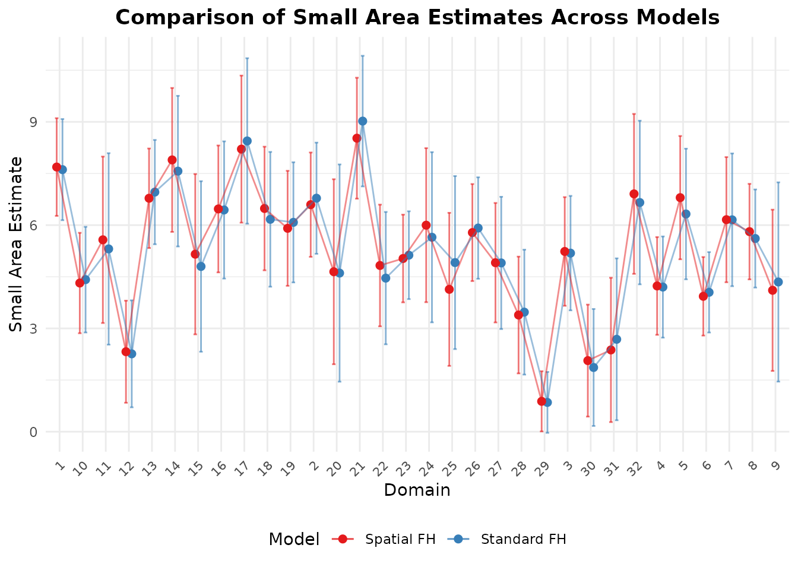

# Spatial and Spatio-Temporal Models

*Terjemahan dari [versi bahasa
Inggris](https://ridsonap.is-a.dev/fastsae/articles/spatial-temporal.md).
Penjelasan istilah ada di [Daftar
Istilah](https://ridsonap.is-a.dev/fastsae/articles/id/glosarium.md).*

## Gambaran Umum

Bila area kecil berupa unit geografis (seperti kabupaten/kota atau
kecamatan), spatial correlation sering muncul: area yang bertetangga
cenderung memiliki hasil yang lebih mirip daripada area yang berjauhan.
Selain itu, bila survei diulang selama beberapa tahun, temporal
correlation antarperiode juga ada.

**fastsae** menyediakan implementasi khusus berkinerja tinggi untuk
keduanya:

1.  **Spatial Fay-Herriot (`eblup_sfh`)**: random effect Simultaneous
    Autoregressive SAR(1).
2.  **Spatio-Temporal Fay-Herriot (`eblup_stfh`)**: gabungan random
    effect spatial SAR(1) dan temporal AR(1).

------------------------------------------------------------------------

## 1. Model Spatial Fay-Herriot (`eblup_sfh`)

### Formulasi Model

Model Spatial Fay-Herriot (Pratesi & Salvati, 2008) memodelkan random
effect area dengan proses Simultaneous Autoregressive (SAR(1)):

``` math
y = X\beta + u + e
```

``` math
u = \rho_1 W u + \epsilon_1 \implies u = (I - \rho_1 W)^{-1} \epsilon_1
```

dengan:

- $`W`$ adalah matriks proximity spasial ($`D \times D`$) yang diketahui
  dan row-standardized.
- $`\rho_1 \in (-1, 1)`$ adalah parameter autoregresif spasial.
- $`\epsilon_1 \sim N(0, \sigma_{u1}^2 I_D)`$ adalah noise inovasi yang
  saling bebas.
- $`e \sim N(0, V_e)`$ adalah sampling error dengan matriks diagonal
  $`V_e = \text{diag}(D_1, \dots, D_D)`$.

### Mengestimasi Model

``` r

library(fastsae)
data("mys")
data("mys_proxmat")

# Fit Spatial Fay-Herriot model with REML
fit_sfh <- eblup_sfh(
  formula = y ~ x1 + x2 + x3,
  vardir = ~vardir,
  data = mys,
  W = mys_proxmat,
  method = "REML",
  print_result = FALSE
)

summary(fit_sfh)
#> 
#> ── Summary of fastsae Fit ──────────────────────────────────────────────────────
#> Call :
#> eblup_sfh(formula = y ~ x1 + x2 + x3, vardir = ~vardir, data = mys, method =
#> "REML", W = mys_proxmat, print_result = FALSE)
#> 
#> ✔ Convergence: Yes (in 18 iterations)
#> Model: Spatial Fay-Herriot (Area-level SAR)
#> Method: REML
#> 
#> Variance & Correlation Components:
#>  parameter   estimate std.error
#>   sigma2_u  0.9892261 0.4797447
#>        rho -1.0000000        NA
#> rho (spatial): -1 
#> 
#> Coefficients:
#>                   beta  std.error     zvalue pvalue
#> (Intercept)  3.2570714  0.6265689  5.1982651 0.0000
#> x1          -0.0020340  0.0080925 -0.2513457 0.8015
#> x2           0.0568516  0.0525488  1.0818827 0.2793
#> x3           0.0252179  0.0497283  0.5071123 0.6121
#> 
#> Goodness of Fit:
#> loglikelihood           AIC           BIC 
#>     -62.58874     137.17748     145.97189 
#> 
#> EBLUP Summary Statistics:
#>       mse              rse        
#>  Min.   :0.1966   Min.   : 9.384  
#>  1st Qu.:0.5897   1st Qu.:13.643  
#>  Median :0.8169   Median :19.046  
#>  Mean   :1.0420   Mean   :22.242  
#>  3rd Qu.:1.4214   3rd Qu.:27.305  
#>  Max.   :2.1610   Max.   :46.894
```

### Unsampled Area dan Spatial Kriging

Keunggulan utama `eblup_sfh` di **fastsae** adalah penanganan otomatis
untuk unsampled area (domain dengan `y = NA`). Alih-alih menampilkan
error atau meminta subsetting manual, `eblup_sfh` secara otomatis
melakukan **full-spatial kriging**:

``` r

# Count sampled vs unsampled domains
table(is.na(mys$y))
#> 
#> FALSE  TRUE 
#>    32    10

# Inspect estimates for unsampled domains
head(fit_sfh$df_eblup[is.na(mys$y), ])
#>    domain  y vardir    eblup random_effect      mse      rse
#> 21     21 NA      0 4.136624    0.33273263 1.773635 32.19482
#> 25     25 NA      0 3.666578   -0.63352730 1.606281 34.56606
#> 26     26 NA      0 6.293404    0.82251711 1.962186 22.25792
#> 27     27 NA      0 5.185438    0.66260236 1.879788 26.44046
#> 28     28 NA      0 5.159499   -0.02771458 1.448608 23.32748
#> 34     34 NA      0 3.834916    0.17166576 1.587847 32.85856
```

Untuk unsampled area, prediksi meminjam informasi dari komponen
synthetic regresi $`x_d^\top \hat{\beta}`$ dan dari kedekatan spasial
dengan area tetangga yang tersampel melalui
$`(I - \hat{\rho}_1 W)^{-1}`$.

### Bootstrap MSE Multi-Thread

Selain MSE analitik bergaya Prasad-Rao, `eblup_sfh` mendukung estimasi
bootstrap MSE multi-thread dengan OpenMP:

- **Parametric Bootstrap (`mse_type = "pbmse"`)**
- **Non-Parametric Bootstrap (`mse_type = "npbmse"`)**

``` r

fit_sfh_pb <- eblup_sfh(
  formula = y ~ x1 + x2 + x3,
  vardir = ~vardir,
  data = mys,
  W = mys_proxmat,
  mse_type = "pbmse",
  B = 50,
  n_threads = 2,
  seed = 123,
  print_result = FALSE
)
#> ℹ 10 unsampled domain(s) detected. Bootstrap MSE (pbmse) is computed for the 32 sampled domain(s); unsampled domain(s) get a full-spatial synthetic (kriging) prediction and analytical MSE instead.

head(fit_sfh_pb$df_eblup[, c("domain", "y", "eblup", "mse", "mse_pb", "mse_pbbc")])
#>   domain        y    eblup       mse    mse_pb  mse_pbbc
#> 1      1 8.359527 7.535193 0.4999462 0.5838185 0.5822064
#> 2      2 7.599650 6.564385 0.5831410 0.7059036 0.6571795
#> 3      3 5.514137 5.109460 0.6095214 0.7555265 0.6814817
#> 4      4 3.869326 4.273391 0.5018535 0.5742035 0.5552008
#> 5      5 6.305063 6.791422 0.7644430 0.7705470 0.8859110
#> 6      6 3.926807 4.016701 0.3398919 0.3798275 0.3712704
```

------------------------------------------------------------------------

## 2. Model Spatio-Temporal Fay-Herriot (`eblup_stfh`)

### Formulasi Model

Model Spatio-Temporal (Marhuenda, Molina, & Morales, 2013) menggabungkan
spatial correlation dan autoregresi temporal untuk $`D`$ area selama
$`T`$ periode. Panel tidak harus lengkap: sel tanpa direct estimator
tetap diprediksi (lihat di bawah).

``` math
y_{dt} = x_{dt}^\top \beta + u_{1d} + u_{2dt} + e_{dt}
```

dengan:

- $`u_1 = (u_{11}, \dots, u_{1D})^\top`$ menangkap efek spasial statis:
  $`u_1 = \rho_1 W u_1 + \epsilon_1`$.
- $`u_{2d} = (u_{2d1}, \dots, u_{2dT})^\top`$ menangkap efek temporal
  dinamis untuk area $`d`$:
  $`u_{2dt} = \rho_2 u_{2d,t-1} + \epsilon_{2dt}`$.
- $`e_{dt} \sim \text{ind. } N(0, D_{dt})`$ adalah sampling error.

Model didefinisikan pada grid penuh $`D \times T`$: $`u_1`$ pada semua
domain di $`W`$, dan $`u_2`$ pada semua periode.

### Mengestimasi Model Spatio-Temporal

``` r

data("mys_panel")

# 42 domains x 11 years; y is NA for the two domains that are never sampled
table(sampled = !is.na(mys_panel$y))
#> sampled
#> FALSE  TRUE 
#>    22   440

# Fit Spatio-Temporal model with the analytical MSE, on the full panel and full W
fit_stfh <- eblup_stfh(
  formula = y ~ x1 + x2 + x3,
  data = mys_panel,
  vardir = ~vardir,
  domain = ~area,
  time = ~year,
  W = mys_proxmat,
  model = "ST",
  mse_type = "analytical",
  print_result = FALSE
)

summary(fit_stfh)
#> 
#> ── Summary of fastsae Fit ──────────────────────────────────────────────────────
#> Call :
#> eblup_stfh(formula = y ~ x1 + x2 + x3, vardir = ~vardir, data = mys_panel,
#> domain = ~area, time = ~year, W = mys_proxmat, model = "ST", mse_type =
#> "analytical", print_result = FALSE)
#> 
#> ✔ Convergence: Yes (in 11 iterations)
#> Model: Spatio-Temporal Fay-Herriot (SAR + AR(1) time effects)
#> Method: REML
#> Cells without a direct estimate: 22 of 462 (predicted from the model)
#> 
#> Variance & Correlation Components:
#>    estimate  std.error
#>   2.2066952 0.64896010
#>  -0.9011506 0.31237444
#>   0.0000000 0.02602554
#>   0.7526384         NA
#> 
#> Coefficients:
#>                   beta  std.error     zvalue pvalue
#> (Intercept)  4.4442780  0.4445132  9.9980779 0.0000
#> x1          -0.0008817  0.0060240 -0.1463646 0.8836
#> x2           0.0254871  0.0277726  0.9177081 0.3588
#> x3           0.0163716  0.0256365  0.6386035 0.5231
#> 
#> Goodness of Fit:
#> loglikelihood           AIC           BIC 
#>     -597.2647     1210.5294     1243.2236 
#> 
#> EBLUP Summary Statistics:
#>       mse               rse          
#>  Min.   :0.03199   Min.   :   2.997  
#>  1st Qu.:0.08171   1st Qu.:   5.256  
#>  Median :0.11107   Median :   6.117  
#>  Mean   :0.25728   Mean   :  29.722  
#>  3rd Qu.:0.16233   3rd Qu.:   9.613  
#>  Max.   :2.47830   Max.   :2521.153
```

Komponen variance dan correlation yang diestimasi meliputi:

- `sigma21`: varians random effect spasial ($`\sigma_{u1}^2`$).
- `rho1`: spatial autocorrelation ($`\rho_1`$).
- `sigma22`: varians random effect temporal ($`\sigma_{u2}^2`$).
- `rho2`: koefisien autoregresi temporal AR(1) ($`\rho_2`$).

MSE analitik adalah $`g_1 + g_2 + 2 g_3 - g_4`$ (tipe Prasad-Rao, dengan
turunan eksak EBLUP pada $`g_3`$ dan suku kurvatur $`g_4`$ untuk
$`\rho_1`$, $`\rho_2`$ yang nonlinear); komponennya dikembalikan sebagai
`fit_stfh$g1`, …, `fit_stfh$g4`. Bootstrap MSE parametrik tersedia
dengan `mse_type = "bootstrap"` (beserta `B` dan `seed`).

### Unsampled Domain dan Periode yang Hilang

Baris dengan respons `NA` tetap dipertahankan dan diprediksi, selama
auxiliary variable-nya diketahui. Variance component diestimasi hanya
dari sel yang tersampel (marginal likelihood dengan sel yang hilang
diintegralkan keluar), dan setiap sel yang hilang memperoleh best linear
unbiased predictor berdasarkan data yang tersampel (Saei & Chambers,
2005; Benedetti dkk., 2024):

- **periode yang hilang** pada domain yang tersampel meminjam informasi
  dari periode lain di domain tersebut (korelasi AR(1)) dan dari domain
  tetangga (SAR);
- **domain yang tidak pernah tersampel** diprediksi hanya dari
  tetangganya (spatial kriging), sehingga `W` harus menyertakannya.

``` r

est <- fit_stfh$df_eblup
# Cells predicted without a direct estimate
head(est[!est$sampled, c("domain", "time", "eblup", "mse", "rse")])
#>     domain time    eblup      mse      rse
#> 21      21 2016 6.356729 2.389320 24.31664
#> 25      25 2016 3.225462 2.405876 48.08889
#> 63      21 2017 6.367907 2.385248 24.25326
#> 67      25 2017 3.213502 2.416602 48.37534
#> 105     21 2018 6.361026 2.389905 24.30319
#> 109     25 2018 3.174470 2.438947 49.19602

# Their MSE is larger: no direct estimate, only borrowed strength
tapply(est$mse, ifelse(est$sampled, "sampled", "unsampled"), median)
#>   sampled unsampled 
#> 0.1084668 2.4016341
```

Untuk sel-sel ini, MSE analitik adalah $`g_1 + g_2 + g_3`$ ($`g_3`$ dari
turunan eksak prediktor terhadap variance component); bootstrap
membangkitkan random effect pada grid penuh dan juga mencakup setiap
sel.

------------------------------------------------------------------------

## 3. Membandingkan Model dengan `autoplot`

Estimasi EBLUP dan ketidakpastian dari beberapa model dapat dibandingkan
langsung dengan
[`autoplot()`](https://ggplot2.tidyverse.org/reference/autoplot.html):

``` r

# Compare Fay-Herriot vs Spatial Fay-Herriot
fit_fh <- eblup_fh(y ~ x1 + x2 + x3, vardir = ~vardir, data = na.omit(mys), print_result = FALSE)
W_clean <- mys_proxmat[!is.na(mys$y), !is.na(mys$y)]
fit_sfh_clean <- eblup_sfh(y ~ x1 + x2 + x3, vardir = ~vardir, data = na.omit(mys), W = W_clean, print_result = FALSE)
#> Warning: `W` is not row-standardised: some rows do not sum to 1.
#> ℹ The SAR model with rho in (-1, 1) assumes rows summing to 1; use `W /
#>   rowSums(W)` or `create_weights(style = "W")`.

autoplot(list("Standard FH" = fit_fh, "Spatial FH" = fit_sfh_clean), type = "comparison")
```



------------------------------------------------------------------------

## 4. Pemodelan Bayesian Spatio-Temporal (`hb_area`)

Selain implementasi EBLUP frequentist dalam C++ (`eblup_sfh` dan
`eblup_stfh`), **fastsae** menyediakan
[`hb_area()`](https://ridsonap.is-a.dev/fastsae/reference/hb_area.md)
untuk pemodelan Bayesian spatio-temporal berbasis **INLA**. Fungsi ini
mendukung:

- Proporsi terbatas melalui regresi Beta (sesuai dengan `tipsae`)
- Data cacah diskret melalui regresi Poisson dan Negative Binomial
- Agregat biner melalui regresi Binomial
- Struktur ruang-waktu yang fleksibel, termasuk random walk spesifik
  domain, separable dynamic field, dan Knorr-Held Tipe I–IV.

Untuk rincian lengkap dan studi kasus data kemiskinan Italia, lihat
artikel [Area-Level Small Area Estimation dengan
INLA](https://ridsonap.is-a.dev/fastsae/articles/id/hb-area-inla.md).

------------------------------------------------------------------------

## Daftar Pustaka

- Benedetti, R., Piersimoni, F., Pratesi, M., Salvati, N., & Suesse, T.
  (2024). Handling out-of-sample areas to estimate the unemployment rate
  at local labour market areas in Italy. *International Statistical
  Review*. <https://doi.org/10.1111/insr.12596>
- Marhuenda, Y., Molina, I., & Morales, D. (2013). Small area estimation
  with spatio-temporal Fay-Herriot models. *Computational Statistics &
  Data Analysis*, 58, 308–325.
- Pratesi, M., & Salvati, N. (2008). Small area estimation: The EBLUP
  estimator based on spatially correlated random area effects.
  *Statistical Methods & Applications*, 17(1), 113–141.
- Saei, A., & Chambers, R. (2005). Out of sample estimation for small
  areas using area level data. Southampton Statistical Sciences Research
  Institute, Methodology Working Paper M05/11.
