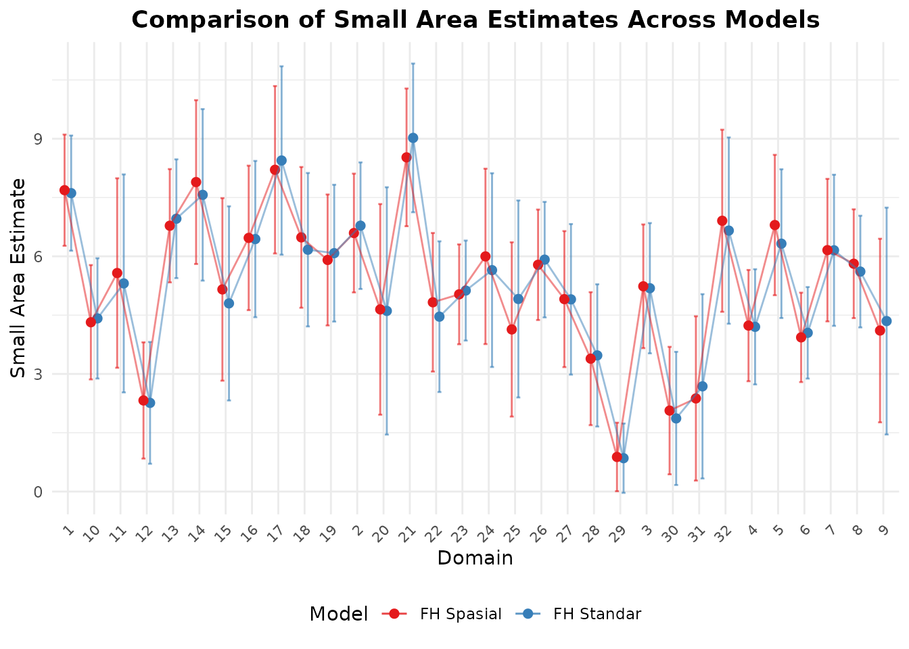
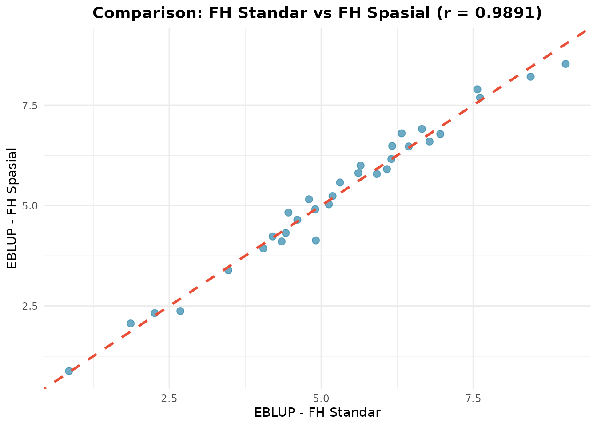
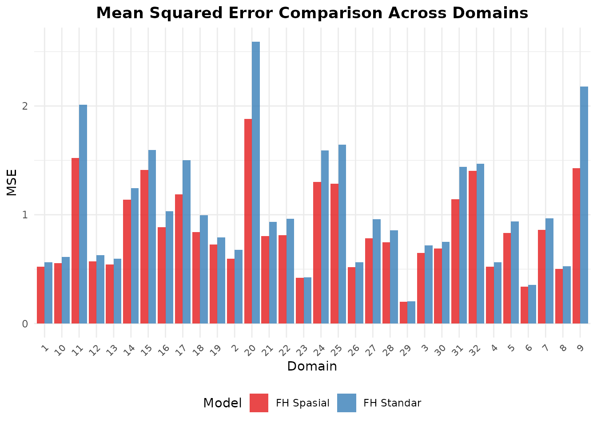

# Model Spasial dan Spatio-Temporal

## Gambaran Umum

Bila area kecil berupa unit geografis (kabupaten, kota, atau kecamatan),
korelasi spasial sering muncul: wilayah yang bertetangga cenderung
memiliki nilai yang lebih mirip daripada wilayah yang berjauhan. Selain
itu, bila survei diulang selama beberapa tahun, ada pula korelasi
temporal antarperiode.

**fastsae** menyediakan implementasi khusus berkinerja tinggi untuk
keduanya:

1.  **Fay-Herriot Spasial (`eblup_sfh`)**: efek acak *Simultaneous
    Autoregressive* SAR(1).
2.  **Fay-Herriot Spatio-Temporal (`eblup_stfh`)**: gabungan efek acak
    spasial SAR(1) dan temporal AR(1).

------------------------------------------------------------------------

## 1. Model Fay-Herriot Spasial (`eblup_sfh`)

### Formulasi Model

Model Fay-Herriot Spasial (Pratesi & Salvati, 2008) memodelkan efek acak
area dengan proses *Simultaneous Autoregressive* (SAR(1)):

``` math
y = X\beta + u + e
```

``` math
u = \rho_1 W u + \epsilon_1 \implies u = (I - \rho_1 W)^{-1} \epsilon_1
```

dengan:

- $`W`$ adalah matriks kedekatan spasial ($`D \times D`$) yang diketahui
  dan sudah distandardisasi per baris;
- $`\rho_1 \in (-1, 1)`$ adalah parameter autoregresif spasial;
- $`\epsilon_1 \sim N(0, \sigma_{u1}^2 I_D)`$ adalah galat inovasi yang
  saling bebas;
- $`e \sim N(0, V_e)`$ adalah galat sampling dengan matriks diagonal
  $`V_e = \text{diag}(D_1, \dots, D_D)`$.

### Mengestimasi Model

``` r

library(fastsae)
data("mys")
data("mys_proxmat")

# Estimasi model Fay-Herriot Spasial dengan REML
fit_sfh <- eblup_sfh(
  formula = y ~ x1 + x2 + x3,
  vardir = ~vardir,
  data = mys,
  W = mys_proxmat,
  method = "REML",
  print_result = FALSE
)

summary(fit_sfh)
#> 
#> ── Summary of fastsae Fit ──────────────────────────────────────────────────────
#> Call :
#> eblup_sfh(formula = y ~ x1 + x2 + x3, vardir = ~vardir, data = mys, method =
#> "REML", W = mys_proxmat, print_result = FALSE)
#> 
#> ✔ Convergence: Yes (in 18 iterations)
#> Model: Spatial Fay-Herriot (Area-level SAR)
#> Method: REML
#> 
#> Variance & Correlation Components:
#>  parameter   estimate std.error
#>   sigma2_u  0.9892261 0.4797447
#>        rho -1.0000000        NA
#> rho (spatial): -1 
#> 
#> Coefficients:
#>                   beta  std.error     zvalue pvalue
#> (Intercept)  3.2570714  0.6265689  5.1982651 0.0000
#> x1          -0.0020340  0.0080925 -0.2513457 0.8015
#> x2           0.0568516  0.0525488  1.0818827 0.2793
#> x3           0.0252179  0.0497283  0.5071123 0.6121
#> 
#> Goodness of Fit:
#> loglikelihood           AIC           BIC 
#>     -62.58874     137.17748     145.97189 
#> 
#> EBLUP Summary Statistics:
#>       mse              rse        
#>  Min.   :0.1966   Min.   : 9.384  
#>  1st Qu.:0.5897   1st Qu.:13.643  
#>  Median :0.8169   Median :19.046  
#>  Mean   :1.0420   Mean   :22.242  
#>  3rd Qu.:1.4214   3rd Qu.:27.305  
#>  Max.   :2.1610   Max.   :46.894
```

### Domain Tak Tersampel dan *Kriging* Spasial

Salah satu keunggulan utama `eblup_sfh` di **fastsae** adalah penanganan
otomatis untuk domain tak tersampel (domain dengan `y = NA`). Alih-alih
menghentikan proses dengan galat atau meminta pengguna memilah data
secara manual, `eblup_sfh` otomatis melakukan ***kriging* spasial
penuh**:

``` r

# Jumlah domain tersampel dan tak tersampel
table(is.na(mys$y))
#> 
#> FALSE  TRUE 
#>    32    10

# Estimasi untuk domain tak tersampel
head(fit_sfh$df_eblup[is.na(mys$y), ])
#>    domain  y vardir    eblup random_effect      mse      rse
#> 21     21 NA      0 4.136624    0.33273263 1.773635 32.19482
#> 25     25 NA      0 3.666578   -0.63352730 1.606281 34.56606
#> 26     26 NA      0 6.293404    0.82251711 1.962186 22.25792
#> 27     27 NA      0 5.185438    0.66260236 1.879788 26.44046
#> 28     28 NA      0 5.159499   -0.02771458 1.448608 23.32748
#> 34     34 NA      0 3.834916    0.17166576 1.587847 32.85856
```

Untuk area tak tersampel, prediksi meminjam kekuatan dari komponen
sintetis regresi $`x_d^\top \hat{\beta}`$ sekaligus dari kedekatan
spasial dengan area tersampel di sekitarnya melalui
$`(I - \hat{\rho}_1 W)^{-1}`$.

### MSE Bootstrap *Multi-Thread*

Selain MSE analitik ala Prasad-Rao, `eblup_sfh` juga dapat mengestimasi
MSE dengan bootstrap *multi-thread* melalui OpenMP:

- **Bootstrap parametrik (`mse_type = "pbmse"`)**
- **Bootstrap nonparametrik (`mse_type = "npbmse"`)**

``` r

fit_sfh_pb <- eblup_sfh(
  formula = y ~ x1 + x2 + x3,
  vardir = ~vardir,
  data = mys,
  W = mys_proxmat,
  mse_type = "pbmse",
  B = 50,
  n_threads = 2,
  seed = 123,
  print_result = FALSE
)
#> ℹ 10 unsampled domain(s) detected. Bootstrap MSE (pbmse) is computed for the 32 sampled domain(s); unsampled domain(s) get a full-spatial synthetic (kriging) prediction and analytical MSE instead.

head(fit_sfh_pb$df_eblup[, c("domain", "y", "eblup", "mse", "mse_pb", "mse_pbbc")])
#>   domain        y    eblup       mse    mse_pb  mse_pbbc
#> 1      1 8.359527 7.535193 0.4999462 0.5854030 0.5806763
#> 2      2 7.599650 6.564385 0.5831410 0.7066187 0.6551951
#> 3      3 5.514137 5.109460 0.6095214 0.7523068 0.6805248
#> 4      4 3.869326 4.273391 0.5018535 0.5752400 0.5553161
#> 5      5 6.305063 6.791422 0.7644430 0.7612421 0.8819870
#> 6      6 3.926807 4.016701 0.3398919 0.3751907 0.3681698
```

------------------------------------------------------------------------

## 2. Model Fay-Herriot Spatio-Temporal (`eblup_stfh`)

### Formulasi Model

Model spatio-temporal (Marhuenda, Molina, & Morales, 2013) menggabungkan
korelasi spasial dan autoregresi temporal untuk $`D`$ area selama $`T`$
periode. Datanya tidak harus berupa panel lengkap: sel yang tidak
memiliki estimasi langsung akan diprediksi (lihat di bawah).

``` math
y_{dt} = x_{dt}^\top \beta + u_{1d} + u_{2dt} + e_{dt}
```

dengan:

- $`u_1 = (u_{11}, \dots, u_{1D})^\top`$ menangkap efek spasial yang
  statis: $`u_1 = \rho_1 W u_1 + \epsilon_1`$;
- $`u_{2d} = (u_{2d1}, \dots, u_{2dT})^\top`$ menangkap efek temporal
  yang dinamis untuk area $`d`$:
  $`u_{2dt} = \rho_2 u_{2d,t-1} + \epsilon_{2dt}`$;
- $`e_{dt} \sim \text{ind. } N(0, D_{dt})`$ adalah galat sampling.

Model ini didefinisikan pada seluruh kisi $`D \times T`$: $`u_1`$ pada
semua domain dalam $`W`$, dan $`u_2`$ pada semua periode.

### Mengestimasi Model Spatio-Temporal

``` r

data("mys_panel")

# 42 domain x 11 tahun; y bernilai NA untuk dua domain yang tidak pernah tersampel
table(sampled = !is.na(mys_panel$y))
#> sampled
#> FALSE  TRUE 
#>    22   440

# Estimasi model spatio-temporal dengan MSE analitik, pada panel lengkap dan W lengkap
fit_stfh <- eblup_stfh(
  formula = y ~ x1 + x2 + x3,
  data = mys_panel,
  vardir = ~vardir,
  domain = ~area,
  time = ~year,
  W = mys_proxmat,
  model = "ST",
  mse_type = "analytical",
  print_result = FALSE
)

summary(fit_stfh)
#> 
#> ── Summary of fastsae Fit ──────────────────────────────────────────────────────
#> Call :
#> eblup_stfh(formula = y ~ x1 + x2 + x3, vardir = ~vardir, data = mys_panel,
#> domain = ~area, time = ~year, W = mys_proxmat, model = "ST", mse_type =
#> "analytical", print_result = FALSE)
#> 
#> ✔ Convergence: Yes (in 16 iterations)
#> Model: Spatio-Temporal Fay-Herriot (SAR + AR(1) time effects)
#> Method: REML
#> Cells without a direct estimate: 22 of 462 (predicted from the model)
#> 
#> Variance & Correlation Components:
#>       estimate   std.error
#>   1.8250368492 0.790026019
#>  -0.9990000000          NA
#>   0.0005145706 0.001444823
#>   0.9990000000          NA
#> 
#> Coefficients:
#>                    beta   std.error      zvalue pvalue
#> (Intercept)  4.39878365  0.44921728  9.79210703 0.0000
#> x1          -0.00068256  0.00597669 -0.11420395 0.9091
#> x2           0.02595246  0.02772502  0.93606644 0.3492
#> x3           0.01695061  0.02570240  0.65949541 0.5096
#> 
#> Goodness of Fit:
#> loglikelihood           AIC           BIC 
#>     -597.2793     1210.5587     1243.2529 
#> 
#> EBLUP Summary Statistics:
#>       mse               rse          
#>  Min.   :0.01994   Min.   :   2.912  
#>  1st Qu.:0.07623   1st Qu.:   5.056  
#>  Median :0.10770   Median :   5.980  
#>  Mean   :0.26423   Mean   :  24.908  
#>  3rd Qu.:0.16075   3rd Qu.:   9.470  
#>  Max.   :2.63652   Max.   :2680.093
```

Komponen varians dan korelasi yang diestimasi:

- `sigma21`: varians efek acak spasial ($`\sigma_{u1}^2`$);
- `rho1`: autokorelasi spasial ($`\rho_1`$);
- `sigma22`: varians efek acak temporal ($`\sigma_{u2}^2`$);
- `rho2`: koefisien autoregresi temporal AR(1) ($`\rho_2`$).

MSE analitiknya adalah $`g_1 + g_2 + 2 g_3 - g_4`$ (tipe Prasad-Rao,
dengan turunan eksak EBLUP pada $`g_3`$ dan suku kelengkungan $`g_4`$
untuk $`\rho_1`$ dan $`\rho_2`$ yang nonlinear); komponen-komponennya
tersedia sebagai `fit_stfh$g1`, …, `fit_stfh$g4`. MSE bootstrap
parametrik tersedia dengan `mse_type = "bootstrap"` (beserta `B` dan
`seed`).

### Domain Tak Tersampel dan Periode yang Hilang

Baris yang responsnya `NA` tetap disertakan dan diprediksi, asalkan
variabel penyertanya diketahui. Komponen varians diestimasi hanya dari
sel yang tersampel (likelihood marginal dengan sel yang hilang
diintegralkan), dan setiap sel yang hilang memperoleh prediktor tak bias
linear terbaik berdasarkan data yang tersampel (Saei & Chambers, 2005;
Benedetti dkk., 2024):

- **periode yang hilang** pada domain yang tersampel meminjam informasi
  dari periode lain di domain yang sama (korelasi AR(1)) dan dari domain
  tetangganya (SAR);
- **domain yang tidak pernah tersampel** diprediksi hanya dari
  tetangganya (*kriging* spasial), sehingga domain tersebut harus tetap
  ada di dalam `W`.

``` r

est <- fit_stfh$df_eblup
# Sel yang diprediksi tanpa estimasi langsung
head(est[!est$sampled, c("domain", "time", "eblup", "mse", "rse")])
#>     domain time    eblup      mse      rse
#> 21      21 2016 6.137783 2.626182 26.40285
#> 25      25 2016 3.369663 2.557295 47.45741
#> 63      21 2017 6.148986 2.619596 26.32168
#> 67      25 2017 3.359054 2.572143 47.74530
#> 105     21 2018 6.142760 2.625602 26.37855
#> 109     25 2018 3.319488 2.595463 48.53291

# MSE-nya lebih besar: tidak ada estimasi langsung, hanya kekuatan pinjaman
tapply(est$mse, ifelse(est$sampled, "tersampel", "tak tersampel"), median)
#> tak tersampel     tersampel 
#>     2.6167041     0.1061676
```

Untuk sel-sel ini, MSE analitiknya adalah $`g_1 + g_2 + g_3`$ ($`g_3`$
diperoleh dari turunan eksak prediktor terhadap komponen varians).
Bootstrap membangkitkan efek acak pada seluruh kisi, sehingga juga
mencakup setiap sel.

------------------------------------------------------------------------

## 3. Membandingkan Model dengan `autoplot`

Estimasi EBLUP dan ketidakpastiannya dari beberapa model dapat langsung
dibandingkan dengan
[`autoplot()`](https://ggplot2.tidyverse.org/reference/autoplot.html):

``` r

# Bandingkan Fay-Herriot dengan Fay-Herriot Spasial
fit_fh <- eblup_fh(y ~ x1 + x2 + x3, vardir = ~vardir, data = na.omit(mys), print_result = FALSE)
W_clean <- mys_proxmat[!is.na(mys$y), !is.na(mys$y)]
fit_sfh_clean <- eblup_sfh(y ~ x1 + x2 + x3, vardir = ~vardir, data = na.omit(mys), W = W_clean, print_result = FALSE)
#> Warning: `W` is not row-standardised: some rows do not sum to 1.
#> ℹ The SAR model with rho in (-1, 1) assumes rows summing to 1; use `W /
#>   rowSums(W)` or `create_weights(style = "W")`.

autoplot(list("FH Standar" = fit_fh, "FH Spasial" = fit_sfh_clean), type = "comparison")
```



`type = "scatter"` memplot estimasi antarmodel satu sama lain, sedangkan
`type = "mse"` memplot MSE-nya per domain:

``` r

fits <- list("FH Standar" = fit_fh, "FH Spasial" = fit_sfh_clean)
autoplot(fits, type = "scatter")
```



``` r

autoplot(fits, type = "mse")
```



------------------------------------------------------------------------

## 4. Pemodelan Spatio-Temporal Bayesian (`hb_area`)

Selain implementasi EBLUP frekuentis dalam C++ (`eblup_sfh` dan
`eblup_stfh`), **fastsae** menyediakan
[`hb_area()`](https://ridsonap.is-a.dev/fastsae/reference/hb_area.md)
untuk pemodelan spatio-temporal Bayesian dengan **INLA**. Fungsi ini
mendukung:

- proporsi yang terbatas melalui regresi Beta (setara dengan `tipsae`);
- data cacahan melalui regresi Poisson dan Binomial Negatif;
- agregat biner melalui regresi Binomial;
- struktur ruang-waktu yang fleksibel, termasuk *random walk* khusus per
  domain, medan dinamis terpisah (*separable*), dan Knorr-Held Tipe
  I–IV.

Penjelasan lengkap beserta studi kasus data kemiskinan Italia ada di
artikel [Estimasi Area Kecil Bayesian Tingkat Area dengan
INLA](https://ridsonap.is-a.dev/fastsae/articles/id/hb-area-inla.md).

### Panel Simulasi dengan `sim_series_data()`

[`sim_series_data()`](https://ridsonap.is-a.dev/fastsae/reference/sim_series_data.md)
membangkitkan panel spatio-temporal dengan parameter yang diketahui:
efek area spasial SAR, dinamika AR(1) di dalam setiap domain, tren
temporal, domain yang tidak pernah tersampel, dan periode yang sesekali
hilang, dengan respons Gaussian, Poisson, binomial, beta, binomial
negatif, dan gamma. Fungsi ini mengembalikan data dalam urutan
domain-utama (*domain-major*) seperti yang diharapkan
[`eblup_stfh()`](https://ridsonap.is-a.dev/fastsae/reference/eblup_stfh.md),
matriks bobot biner `W` beserta versi yang distandardisasi per baris
`W_std`, serta efek acak yang sebenarnya:

``` r

sim_st <- sim_series_data(D = 30, T = 4, time_start = 2021, seed = 123)
sim_st
#> =================================================================
#>   fastsae Simulated Spatio-Temporal Multi-Distribution Panel
#> =================================================================
#> Domains (D): 30 | Time periods (T): 4 | Total observations: 120
#> Observations: 99 observed, 21 missing/unsampled (17.5%)
#> Spatio-temporal parameters:
#>   - Spatial correlation (rho_s / rho1):  0.50 (sigma_s = 0.40)
#>   - Temporal AR(1)     (rho_t / rho2):  0.60 (sigma_t = 0.30)
#>   - Temporal trend:                     linear (slope = 0.050)
#>   - Row sort order:                     domain-major
#> Responses generated:
#>   - Gaussian (FH):     y_gaussian (vardir)
#>   - Poisson:           y_poisson (exposure)
#>   - Binomial:          y_binomial (trials)
#>   - Beta:              y_beta
#>   - Negative Binomial: y_nbinomial
#>   - Gamma:             y_gamma
#> Spatial proximity:     30 x 30 (W binary, W_std row-standardized)
#> =================================================================
fit_sim_stfh <- eblup_stfh(y_gaussian ~ x1 + x2,
  data = sim_st$data, domain = ~area, time = ~year, vardir = ~vardir, W = sim_st$W_std
)
#> ℹ Predicting 21 cells without a direct estimate: 4 unsampled domains (spatial borrowing) and 5 missing periods of sampled domains.
#> 
#> ── Fast Small Area Estimation (fastsae) ────────────────────────────────────────
#> Call:
#> eblup_stfh(formula = y_gaussian ~ x1 + x2, vardir = ~vardir, data =
#> sim_st$data, domain = ~area, time = ~year, W = sim_st$W_std)
#> 
#> ✔ Convergence: Yes (in 54 iterations)
#> Model: Spatio-Temporal Fay-Herriot (SAR + AR(1) time effects)
#> Method: REML
#> Cells without a direct estimate: 21 of 120 (predicted from the model)
#> 
#> Fixed Effects Coefficients:
#>                  beta std.error    zvalue pvalue
#> (Intercept)  1.269492  0.337142  3.765448  2e-04
#> x1           0.732842  0.095006  7.713648  0e+00
#> x2          -0.514087  0.093151 -5.518876  0e+00
#> 
#> EBLUP Estimates (First 6 domains):
#>   domain time      y     eblup  vardir        mse       rse mse_pb
#> 1      1 2021 1.4259 1.3231777 0.04593 0.02553239 12.076124     NA
#> 2      1 2022 0.9198 0.9296162 0.12341 0.02302511 16.322894     NA
#> 3      1 2023 1.1845 0.9588192 0.08359 0.02673284 17.052412     NA
#> 4      1 2024 1.0411 1.3837820 0.14610 0.03535159 13.587413     NA
#> 5      2 2021 1.7132 1.7990165 0.13304 0.03122553  9.822449     NA
#> 6      2 2022 2.4992 2.2251026 0.05670 0.02387886  6.944752     NA
#>   random_effect_u1 random_effect_u2 sampled
#> 1       0.03508106       0.33449464    TRUE
#> 2       0.03508106       0.32568488    TRUE
#> 3       0.03508106       0.31805952    TRUE
#> 4       0.03508106       0.28526816    TRUE
#> 5      -0.03653546      -0.03536499    TRUE
#> 6      -0.03653546      -0.03056140    TRUE
#> ... and 114 more rows.
```

Panel yang sama juga dapat diestimasi dengan
[`hb_area()`](https://ridsonap.is-a.dev/fastsae/reference/hb_area.md).
Dengan interaksi Knorr-Held (`st_interaction = "type1"` hingga
`"type4"`), varians interaksinya dilaporkan sebagai
`random_effect_var_st`, di samping varians efek area:

``` r

fit_sim_hb <- hb_area(y_gaussian ~ x1 + x2,
  data = sim_st$data, domain = "area", time = "year", vardir = "vardir",
  spatial = "bym2", temporal = "rw1", st_interaction = "type1", W = sim_st$W,
  print_result = FALSE
)
fit_sim_hb$random_effect_var # efek area
#> [1] 0.235844
fit_sim_hb$random_effect_var_st # interaksi ruang-waktu
#> [1] 0.01095788
```

------------------------------------------------------------------------

## Daftar Pustaka

- Benedetti, R., Piersimoni, F., Pratesi, M., Salvati, N., & Suesse, T.
  (2024). Handling out-of-sample areas to estimate the unemployment rate
  at local labour market areas in Italy. *International Statistical
  Review*. <https://doi.org/10.1111/insr.12596>
- Marhuenda, Y., Molina, I., & Morales, D. (2013). Small area estimation
  with spatio-temporal Fay-Herriot models. *Computational Statistics &
  Data Analysis*, 58, 308–325.
- Pratesi, M., & Salvati, N. (2008). Small area estimation: The EBLUP
  estimator based on spatially correlated random area effects.
  *Statistical Methods & Applications*, 17(1), 113–141.
- Saei, A., & Chambers, R. (2005). Out of sample estimation for small
  areas using area level data. Southampton Statistical Sciences Research
  Institute, Methodology Working Paper M05/11.
