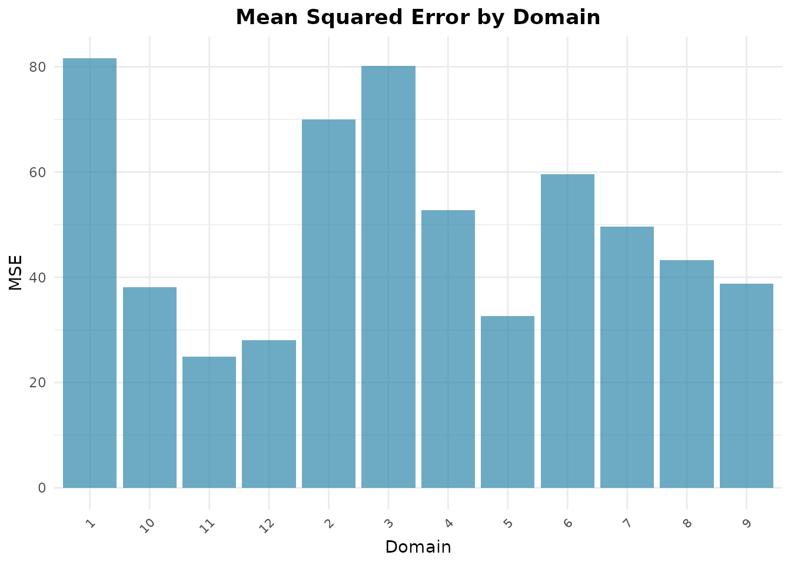
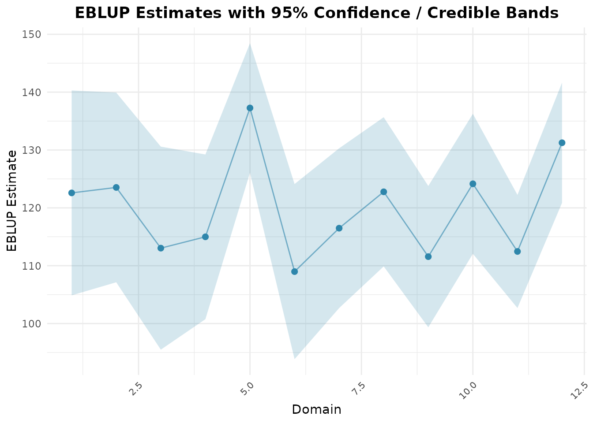

# Estimasi Tingkat Unit dengan Model Battese-Harter-Fuller

## Gambaran Umum

Berbeda dengan model tingkat area yang mengagregasikan data sebelum
pemodelan, **model tingkat unit** bekerja langsung pada catatan unit
survei individual (misalnya rumah tangga, usaha tani, atau orang) dan
menghubungkannya dengan agregat variabel penyerta di tingkat populasi
(misalnya rata-rata hasil sensus atau citra satelit).

Paket **fastsae** mengimplementasikan model regresi galat tersarang
(*nested error regression*) dari Battese, Harter, dan Fuller (1988)
melalui
[`eblup_bhf()`](https://ridsonap.is-a.dev/fastsae/reference/eblup_bhf.md),
dengan estimasi yang cepat dan MSE bootstrap parametrik yang berjalan
paralel.
[`hb_unit()`](https://ridsonap.is-a.dev/fastsae/reference/hb_unit.md)
mengestimasi model yang sama sebagai model Bayesian hierarkis dengan
INLA (lihat bagian terakhir).

------------------------------------------------------------------------

## Formulasi Model

Untuk unit individual $`j`$ ($`j = 1, \dots, n_d`$) di area kecil $`d`$
($`d = 1, \dots, D`$):

``` math
y_{dj} = x_{dj}^\top \beta + u_d + e_{dj}
```

dengan:

- $`u_d \sim \text{i.i.d. } N(0, \sigma_u^2)`$ adalah efek acak khusus
  untuk setiap area;
- $`e_{dj} \sim \text{i.i.d. } N(0, \sigma_e^2)`$ adalah galat tingkat
  unit;
- $`u_d`$ dan $`e_{dj}`$ saling bebas.

Rata-rata populasi area kecil $`\bar{Y}_d`$ diestimasi dengan:

``` math
\hat{\bar{Y}}_d^{\text{EBLUP}} = \bar{X}_d^\top \hat{\beta} + \gamma_d (\bar{y}_d - \bar{x}_d^\top \hat{\beta})
```

dengan:

- $`\bar{X}_d`$ adalah vektor rata-rata populasi variabel penyerta untuk
  domain $`d`$ yang diketahui;
- $`\bar{y}_d`$ dan $`\bar{x}_d`$ adalah rata-rata sampel untuk domain
  $`d`$;
- $`\gamma_d = \frac{\sigma_u^2}{\sigma_u^2 + \sigma_e^2 / n_d}`$ adalah
  rasio penyusutan.

------------------------------------------------------------------------

## Contoh Langkah demi Langkah

### 1. Menyiapkan Data

Contoh ini memakai data klasik `cornsoybean`, yang mencatat luas tanaman
jagung (hektare) per segmen di 12 *county* di Iowa:

``` r

library(fastsae)
data("cornsoybean")
data("cornsoybeanmeans")

# Samakan nama kolom untuk rata-rata variabel penyerta di tingkat populasi
df_pop <- cornsoybeanmeans
names(df_pop)[names(df_pop) == "MeanCornPixPerSeg"] <- "CornPix"
names(df_pop)[names(df_pop) == "MeanSoyBeansPixPerSeg"] <- "SoyBeansPix"
names(df_pop)[names(df_pop) == "CountyIndex"] <- "County"

head(cornsoybean)
#>   County CornHec SoyBeansHec CornPix SoyBeansPix
#> 1      1  165.76        8.09     374          55
#> 2      2   96.32      106.03     209         218
#> 3      3   76.08      103.60     253         250
#> 4      4  185.35        6.47     432          96
#> 5      4  116.43       63.82     367         178
#> 6      5  162.08       43.50     361         137
head(df_pop)
#>   County CountyName SampSegments PopnSegments CornPix SoyBeansPix
#> 1      1 CerroGordo            1          545  295.29      189.70
#> 2      2   Hamilton            1          566  300.40      196.65
#> 3      3      Worth            1          394  289.60      205.28
#> 4      4   Humboldt            2          424  290.74      220.22
#> 5      5   Franklin            3          564  318.21      188.06
#> 6      6 Pocahontas            3          570  257.17      247.13
```

### 2. Mengestimasi Model BHF dengan MSE Bootstrap

Model diestimasi dengan
[`eblup_bhf()`](https://ridsonap.is-a.dev/fastsae/reference/eblup_bhf.md).
*Mean squared error* (MSE) tingkat domain diestimasi dengan bootstrap
parametrik (`mse_type = "bootstrap"`, bawaan; `mse_type = "none"`
melewatinya):

``` r

fit_bhf <- eblup_bhf(
  formula = CornHec ~ CornPix + SoyBeansPix,
  unit_data = cornsoybean,
  Xpop = df_pop,
  domain_var = "County",
  popsize_var = "PopnSegments",
  method = "REML",
  mse_type = "bootstrap",
  B = 50,
  seed = 123,
  print_result = FALSE
)

summary(fit_bhf)
#> 
#> ── Summary of fastsae Fit ──────────────────────────────────────────────────────
#> Call :
#> eblup_bhf(formula = CornHec ~ CornPix + SoyBeansPix, unit_data = cornsoybean,
#> Xpop = df_pop, domain_var = "County", popsize_var = "PopnSegments", method =
#> "REML", B = 50, mse_type = "bootstrap", seed = 123, print_result = FALSE)
#> 
#> ✔ Convergence: Yes (in - iterations)
#> Model: Battese-Harter-Fuller (Unit-level)
#> 
#> Variance Components:
#> sigma2_u: 63.31489 
#> 
#> Coefficients:
#>                  beta std.error    zvalue pvalue
#> (Intercept) 17.963979 30.974505  0.579960 0.5619
#> CornPix      0.366335  0.064959  5.639511 0.0000
#> SoyBeansPix -0.030364  0.067576 -0.449327 0.6532
#> 
#> Goodness of Fit:
#> loglikelihood           AIC           BIC 
#>     -159.2759      328.5517      336.6063 
#> 
#> EBLUP Summary Statistics:
#>       mse             rse       
#>  Min.   :24.89   Min.   :4.039  
#>  1st Qu.:36.74   1st Qu.:4.838  
#>  Median :46.45   Median :5.816  
#>  Mean   :49.96   Mean   :5.839  
#>  3rd Qu.:62.20   3rd Qu.:6.849  
#>  Max.   :81.65   Max.   :7.921
```

### 3. Memeriksa Estimasi Domain

*Data frame* `df_eblup` yang dihasilkan berisi estimasi setiap domain
beserta ukuran sampel, MSE, dan galat baku relatif (RSE):

``` r

head(fit_bhf$df_eblup)
#>   domain    eblup samp_size      mse      rse
#> 1      1 122.5825         1 81.64650 7.371235
#> 2      2 123.5274         1 69.94383 6.770354
#> 3      3 113.0343         1 80.17283 7.921429
#> 4      4 114.9901         2 52.75789 6.316599
#> 5      5 137.2660         3 32.60240 4.159698
#> 6      6 108.9807         3 59.61422 7.084763
```

### 4. Visualisasi Hasil dengan `autoplot`

Untuk model tingkat unit, ketidakpastian setiap domain dan perbandingan
antarmodel dapat ditampilkan dengan
[`autoplot()`](https://ggplot2.tidyverse.org/reference/autoplot.html):

``` r

# Plot MSE per county
autoplot(fit_bhf, type = "mse")
```



``` r


# Plot estimasi EBLUP beserta selang kepercayaannya
autoplot(fit_bhf, type = "comparison")
```



------------------------------------------------------------------------

## Bayesian Hierarkis dengan `hb_unit()`

[`hb_unit()`](https://ridsonap.is-a.dev/fastsae/reference/hb_unit.md)
mengestimasi model galat tersarang dengan INLA dan menghasilkan
rata-rata posterior, simpangan baku, dan selang kredibel untuk rata-rata
setiap *county*. Fungsi ini memerlukan paket **INLA**, yang tidak
tersedia di CRAN (<https://www.r-inla.org/download/>); potongan kode di
bawah hanya dijalankan bila INLA terpasang. Argumennya sama dengan
argumen
[`eblup_bhf()`](https://ridsonap.is-a.dev/fastsae/reference/eblup_bhf.md):

``` r

fit_hbu <- hb_unit(
  CornHec ~ CornPix + SoyBeansPix,
  unit_data = cornsoybean,
  Xpop = df_pop,
  domain_var = "County",
  popsize_var = "PopnSegments",
  print_result = FALSE
)

head(fit_hbu$df_hb[, c("domain", "samp_size", "hb", "sd", "ci_lower", "ci_upper")])
#>   domain samp_size       hb       sd  ci_lower ci_upper
#> 1      1         1 122.8950 8.969005 105.31571 140.4742
#> 2      2         1 123.8021 8.829260 106.49672 141.1074
#> 3      3         1 112.0792 9.592781  93.27737 130.8811
#> 4      4         2 114.6780 8.083981  98.83344 130.5226
#> 5      5         3 137.1491 8.556696 120.37795 153.9202
#> 6      6         3 108.9851 7.432531  94.41732 123.5528
```

Untuk setiap *county*, rata-rata posteriornya dekat dengan EBLUP:

``` r

data.frame(
  County = fit_bhf$df_eblup$domain,
  n = fit_bhf$df_eblup$samp_size,
  eblup = round(fit_bhf$df_eblup$eblup, 1),
  hb = round(fit_hbu$df_hb$hb, 1),
  rmse_eblup = round(sqrt(fit_bhf$df_eblup$mse), 1),
  sd_hb = round(fit_hbu$df_hb$sd, 1)
)
#>    County n eblup    hb rmse_eblup sd_hb
#> 1       1 1 122.6 122.9        9.0   9.0
#> 2       2 1 123.5 123.8        8.4   8.8
#> 3       3 1 113.0 112.1        9.0   9.6
#> 4       4 2 115.0 114.7        7.3   8.1
#> 5       5 3 137.3 137.1        5.7   8.6
#> 6       6 3 109.0 109.0        7.7   7.4
#> 7       7 3 116.5 116.4        7.0   7.0
#> 8       8 3 122.8 122.7        6.6   7.0
#> 9       9 4 111.6 111.3        6.2   7.0
#> 10     10 5 124.2 124.3        6.2   6.1
#> 11     11 5 112.5 112.9        5.0   7.2
#> 12     12 6 131.3 131.2        5.3   5.8
```

Kedua himpunan estimasi berselisih paling banyak sekitar 1 hektare
(kurang dari 1% rata-rata *county*). Akar MSE bootstrap dan simpangan
baku posterior adalah dua besaran yang berbeda; di sini simpangan baku
posterior lebih besar di 10 dari 12 *county* (hingga separuhnya lebih
besar di *county* 5 dan 11), dan dengan `B = 50` MSE bootstrap itu
sendiri pun belum stabil.

Prior untuk $`\sigma_u`$ adalah *half-normal* dengan skala respons unit
(lihat [artikel prior
bawaan](https://ridsonap.is-a.dev/fastsae/articles/id/hb-priors.md)).
Dengan 12 *county*, posterior $`\sigma_u^2`$ masih menceng: rata-rata
posterior eksaknya sekitar 100 dan mediannya 68, sedangkan estimasi
REML-nya 63, dan ringkasan INLA untuk besaran ini (`random_effect_var`,
115 pada data ini) tidak akurat. Jangan membandingkannya dengan estimasi
REML dari
[`eblup_bhf()`](https://ridsonap.is-a.dev/fastsae/reference/eblup_bhf.md).
Estimasi *county* di `df_hb` dapat diandalkan:
[`hb_unit()`](https://ridsonap.is-a.dev/fastsae/reference/hb_unit.md)
mengestimasi model dalam mode `"classic"` INLA, yang pada data ini
sesuai dengan posterior eksak (dihitung dengan integrasi numerik atas
kedua varians) hingga selisih 0,06 simpangan baku posterior, dengan
simpangan baku yang berselisih kurang dari 2%.

### MCMC dengan `engine = jax_engine()`

`hb_unit(engine = jax_engine())` menarik sampel dari model yang sama
dengan *sampler* NUTS dari NumPyro sebagai pengganti INLA (memerlukan
Python dengan ‘jax’ dan ‘numpyro’; lihat
[`setup_numpyro_env()`](https://ridsonap.is-a.dev/fastsae/reference/setup_numpyro_env.md)),
lalu meringkas rata-rata setiap *county* dari tarikan MCMC:

``` r

fit_hbu_jax <- hb_unit(
  CornHec ~ CornPix + SoyBeansPix,
  unit_data = cornsoybean,
  Xpop = df_pop,
  domain_var = "County",
  popsize_var = "PopnSegments",
  engine = jax_engine(chains = 4, samples = 2000),
  print_result = FALSE
)
fit_hbu_jax$rhat_max
```

*Engine* ini memakai prior yang sama dengan *engine* INLA. Pada data
ini, rata-rata *county*-nya berselisih paling banyak 0,16 simpangan baku
posterior dari hasil INLA, dan simpangan bakunya 0,98–1,06 kali
simpangan baku INLA (empat rantai masing-masing 2.000 tarikan, R-hat
terbesar 1,002). Selisih tersebut merupakan galat Monte Carlo:
dibandingkan dengan posterior eksak, rata-rata hasil JAX berselisih
paling banyak 0,14 simpangan baku.

### *County* tanpa sampel

Domain yang ada di `Xpop` tetapi tidak memiliki baris di `unit_data`
diprediksi dari regresi dan rata-rata populasinya, baik oleh
[`eblup_bhf()`](https://ridsonap.is-a.dev/fastsae/reference/eblup_bhf.md)
maupun
[`hb_unit()`](https://ridsonap.is-a.dev/fastsae/reference/hb_unit.md).
Misalnya, tanpa sampel *county* 1:

``` r

cs_without_1 <- cornsoybean[cornsoybean$County != 1, ]
fit_hbu1 <- hb_unit(
  CornHec ~ CornPix + SoyBeansPix,
  unit_data = cs_without_1,
  Xpop = df_pop,
  domain_var = "County",
  popsize_var = "PopnSegments",
  print_result = FALSE
)
fit_hbu1$unsampled_domains
#> [1] 1
fit_hbu1$df_hb[fit_hbu1$df_hb$domain == 1, c("domain", "samp_size", "hb", "sd")]
#>   domain samp_size       hb       sd
#> 1      1         0 119.4854 11.05936
```

Rata-rata populasi di `Xpop` harus lengkap. Rata-rata yang hilang
menimbulkan galat, karena prediksi untuk *county* tersebut akan keliru.
[`hb_unit()`](https://ridsonap.is-a.dev/fastsae/reference/hb_unit.md)
juga dapat mengestimasi respons binomial dan Poisson (`family`) serta
efek *county* spasial (`spatial = "bym2"` atau `"besag"` dengan matriks
kedekatan `W`). Untuk respons binomial dan Poisson, rata-rata *county*
diprediksi pada rata-rata kovariatnya. Cara ini bias bila fungsi
link-nya nonlinear (sebesar -8% dan -16% dalam sebuah simulasi; lihat
[`?hb_unit`](https://ridsonap.is-a.dev/fastsae/reference/hb_unit.md)),
dan fungsi ini memberi peringatan tentang hal tersebut.

## Daftar Pustaka

- Battese, G. E., Harter, R. M., & Fuller, W. A. (1988). An
  error-components model for prediction of county crop areas using
  survey and satellite data. *Journal of the American Statistical
  Association*, 83(401), 28–36.
- Rao, J. N. K., & Molina, I. (2015). *Small Area Estimation* (2nd ed.).
  John Wiley & Sons.
- Rue, H., Martino, S., & Chopin, N. (2009). Approximate Bayesian
  inference for latent Gaussian models by using integrated nested
  Laplace approximations. *Journal of the Royal Statistical Society:
  Series B*, 71(2), 319–392.
