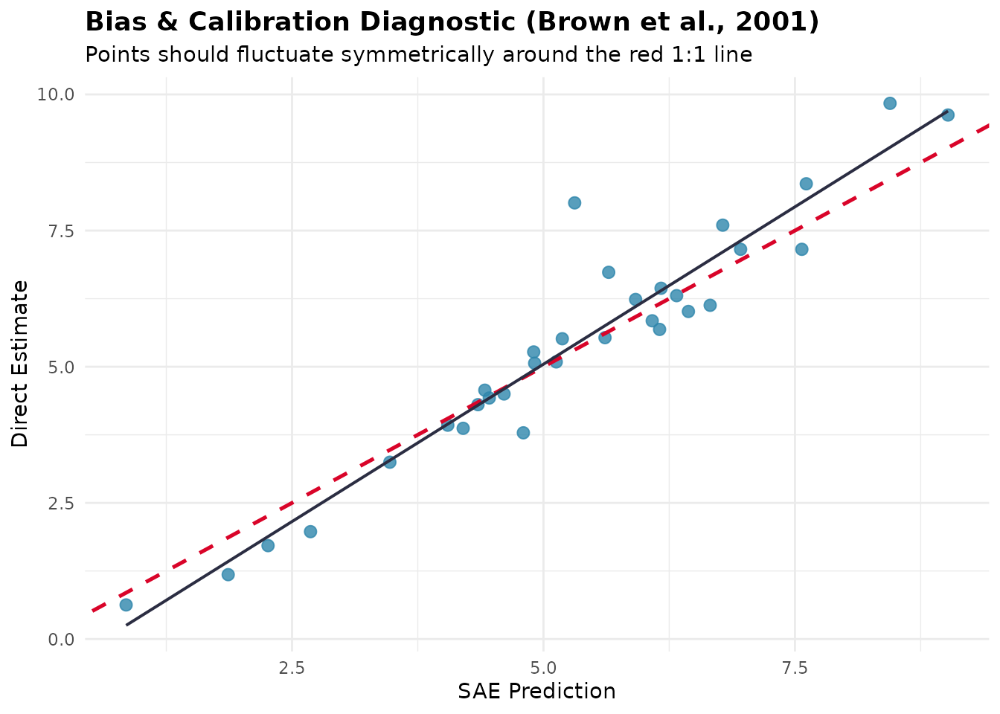
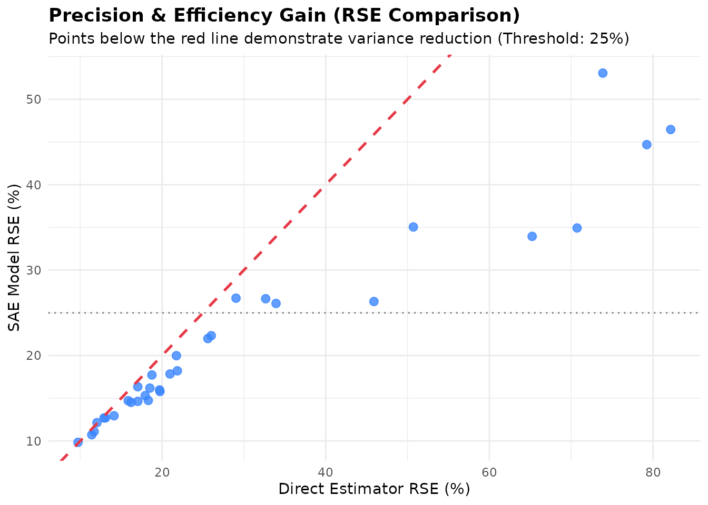
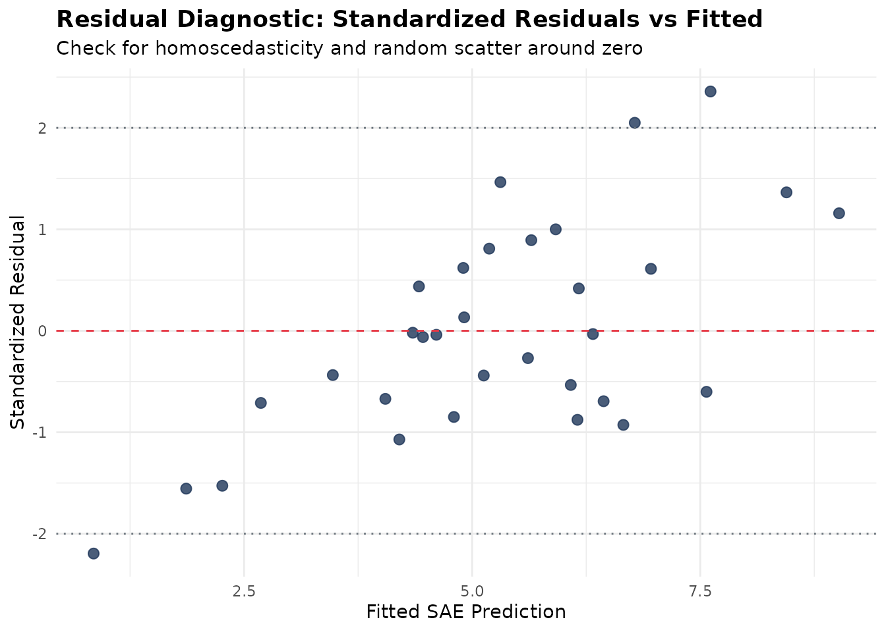
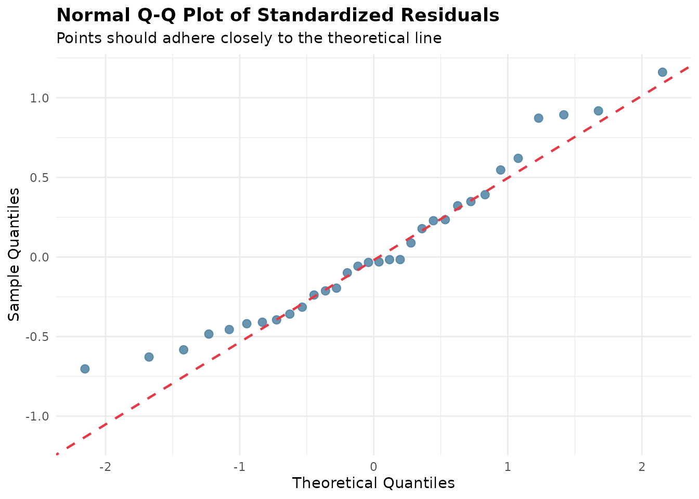

# Model Diagnostics and Residual Analysis

## Introduction

In Small Area Estimation (SAE), model-based estimators borrow strength
across domains and time to improve estimation precision over direct
survey estimators. However, introducing model assumptions carries the
risk of model misspecification, bias, and inappropriate shrinkage.

To address these challenges, **fastsae** provides a unified diagnostic
framework centered on the
[`diagnose()`](https://ridsonap.is-a.dev/fastsae/reference/diagnose.md)
function and its dedicated S3
[`autoplot()`](https://ggplot2.tidyverse.org/reference/autoplot.html)
visualization method. It evaluates both **frequentist C++ EBLUP** models
(`eblup_fh`, `eblup_sfh`, `eblup_stfh`, `eblup_bhf`) and **Bayesian INLA
HB** models (`hb_area`).

------------------------------------------------------------------------

## Core Diagnostic Criteria

The diagnostic workflow evaluates four fundamental dimensions of SAE
model quality:

1.  **Precision Gain & RSE Reduction**: Quantifies the improvement in
    Relative Standard Error
    ($`\text{RSE} = \frac{\sqrt{\text{MSE}}}{\hat{\theta}} \times 100\%`$)
    compared to direct survey estimates. Evaluates whether areas satisfy
    the official statistics reliability threshold (typically
    $`\text{RSE} < 25\%`$ or $`20\%`$).
2.  **Goodness-of-Fit Statistic (Brown et al., 2001)**: Computes the
    Chi-square diagnostic statistic $`W`$ over the sampled domains:
    ``` math
    W = \sum_{d=1}^D \frac{(y_d - \hat{\theta}_d)^2}{V_d + \text{MSE}(\hat{\theta}_d)}
    ```
    and compares it with $`\chi^2(D)`$. Only large values indicate that
    the model estimates differ from the direct estimates by more than
    their uncertainty, so the p-value is upper-tailed (as in `emdi`).
    The statistic ignores the positive correlation between $`y_d`$ and
    $`\hat{\theta}_d`$, so it is conservative: under a correct model
    $`W`$ is usually well below $`D`$.
3.  **Bias Diagnostic (Brown et al., 2001)**: The regression of the
    direct estimates on the model estimates,
    ``` math
    y_d = \alpha + \beta \hat{\theta}_d + e_d,
    ```
    is reported descriptively (with `autoplot(type = "calibration")`) to
    look for systematic deviations. It is not used as a formal test of
    $`\alpha = 0, \beta = 1`$: for shrinkage estimators such as the
    EBLUP the slope exceeds 1 even when the model is correct (about
    $`1/\gamma_d`$ for the variation not explained by the covariates),
    so such a test would reject correct models.
4.  **Residual Spatial Autocorrelation (Moran’s I)**: Verifies whether
    spatial autocorrelation has been fully captured by the model random
    effects. Significant residual spatial clustering indicates that
    unmodeled spatial patterns remain.

------------------------------------------------------------------------

## Practical Example: Diagnosing a Fay-Herriot Model

We demonstrate the diagnostic workflow using the built-in `mys` dataset
(Mean Years of Schooling in 42 regencies):

### 1. Fit Model and Run `diagnose()`

``` r

library(fastsae)
library(ggplot2)

data("mys")
data("mys_proxmat")

# Fit Area-Level Fay-Herriot model
fit_fh <- eblup_fh(
  formula = y ~ x1 + x2 + x3,
  vardir = ~vardir,
  data = na.omit(mys),
  method = "REML",
  print_result = FALSE
)

# Run comprehensive diagnostic checks
diag_fh <- diagnose(fit_fh, W = mys_proxmat[!is.na(mys$y), !is.na(mys$y)])
print(diag_fh)
```

### 2. Inspect Diagnostic Components

The resulting `fastsae_diagnose` object provides structured access to
each diagnostic domain:

``` r

# Efficiency gains
diag_fh$precision
#> $rse_threshold
#> [1] 25
#> 
#> $prop_reliable
#> [1] 68.75
#> 
#> $mean_direct_rse
#> [1] 29.49003
#> 
#> $median_direct_rse
#> [1] 19.72062
#> 
#> $mean_sae_rse
#> [1] 21.63848
#> 
#> $median_sae_rse
#> [1] 17.03635
#> 
#> $eff_ratio_summary
#>      Min   Q1.25%   Median     Mean   Q3.75%      Max 
#> 1.017672 1.194006 1.291102 1.529910 1.491337 3.907487 
#> 
#> $prop_gain
#> [1] 100

# Calibration test results
diag_fh$brown_test
#> $bias_regression
#> $bias_regression$alpha
#> [1] -0.7316943
#> 
#> $bias_regression$beta
#> [1] 1.155679
#> 
#> $bias_regression$se_alpha
#> [1] 0.363461
#> 
#> $bias_regression$se_beta
#> [1] 0.0652052
#> 
#> $bias_regression$r_squared
#> [1] 0.9128237
#> 
#> $bias_regression$n
#> [1] 32
#> 
#> 
#> $goodness_of_fit
#> $goodness_of_fit$w_stat
#> [1] 4.525856
#> 
#> $goodness_of_fit$df
#> [1] 32
#> 
#> $goodness_of_fit$crit
#> [1] 46.19426
#> 
#> $goodness_of_fit$p_value
#> [1] 1
#> 
#> $goodness_of_fit$is_good_fit
#> [1] TRUE

# Moran's I spatial test on residuals
diag_fh$spatial_test
#> $moran_I
#> [1] -0.1196823
#> 
#> $expected_I
#> [1] -0.03225806
#> 
#> $sd_I
#> [1] 0.1105189
#> 
#> $z_stat
#> [1] -0.7910343
#> 
#> $p_value
#> [1] 0.428924
#> 
#> $no_residual_autocorrelation
#> [1] TRUE
```

------------------------------------------------------------------------

## Visual Diagnostics with `autoplot()`

`fastsae` implements dedicated ggplot2 visualization types for
`fastsae_diagnose` objects:

### 1. Calibration Plot (`type = "calibration"`)

Plots direct survey estimates against model predictions along with the
1:1 identity line and the fitted calibration regression:

``` r

autoplot(diag_fh, type = "calibration")
```



### 2. Precision Comparison (`type = "rse"`)

Visualizes the domain-by-domain reduction in Relative Standard Error:

``` r

autoplot(diag_fh, type = "rse")
```



### 3. Residual Diagnostics (`type = "residuals"` & `type = "qq"`)

Inspect standardized residuals against fitted values to detect
heteroscedasticity, non-linearities, or outliers:

``` r

autoplot(diag_fh, type = "residuals")
```



``` r

autoplot(diag_fh, type = "qq")
```



### 4. Combined Diagnostic Dashboard (`type = "all"`)

Generates a unified diagnostic view summarizing calibration and
precision gains:

``` r

autoplot(diag_fh, type = "all")
```


------------------------------------------------------------------------

## Diagnosing Bayesian Spatio-Temporal Models

The exact same
[`diagnose()`](https://ridsonap.is-a.dev/fastsae/reference/diagnose.md)
function applies directly to Bayesian models fitted with
[`hb_area()`](https://ridsonap.is-a.dev/fastsae/reference/hb_area.md):

``` r

data("sim_area", package = "fastsae")

# Fit Spatial EBP model with BYM2 prior
fit_hb <- hb_area(
  formula = y_gaussian ~ x1 + x2,
  data = sim_area,
  vardir = "vardir",
  spatial = "bym2",
  W = create_weights(cbind(sim_area$x_coord, sim_area$y_coord), method = "knn", k = 4),
  print_result = FALSE
)

# Diagnose Bayesian model
diag_hb <- diagnose(fit_hb)
diag_hb$precision
#> $rse_threshold
#> [1] 25
#> 
#> $prop_reliable
#> [1] 64.28571
#> 
#> $mean_direct_rse
#> [1] 103.231
#> 
#> $median_direct_rse
#> [1] 17.64954
#> 
#> $mean_sae_rse
#> [1] 70.50113
#> 
#> $median_sae_rse
#> [1] 19.57357
#> 
#> $eff_ratio_summary
#>      Min   Q1.25%   Median     Mean   Q3.75%      Max 
#> 1.109209 1.238711 1.281726 1.288101 1.357724 1.458812 
#> 
#> $prop_gain
#> [1] 100
diag_hb$status
#> [1] "WARNING: High proportions of domains with RSE >= threshold."
```

------------------------------------------------------------------------

## References

- Brown, G., Chambers, R., Heady, P., & Heasman, D. (2001). Evaluation
  of small area estimation methods: An application to unemployment
  estimates from the UK LFS. *Proceedings of Statistics Canada Symposium
  2001: Achieving Data Quality in a Statistical Agency*.
- Fay, R. E., & Herriot, R. A. (1979). Estimates of income for small
  places: An application of James-Stein procedures to Census data.
  *Journal of the American Statistical Association*, 74(366), 269–277.
- Rao, J. N. K., & Molina, I. (2015). *Small Area Estimation* (2nd ed.).
  John Wiley & Sons.
