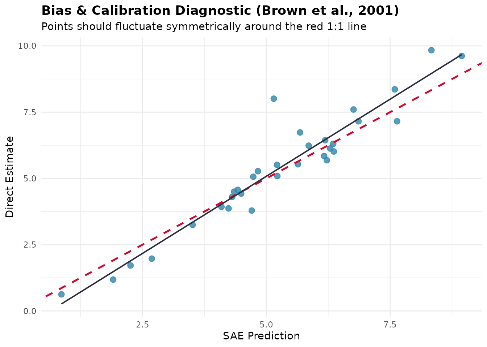

# An Optimal Workflow for Small Area Estimation

This article puts the functions of **fastsae** in the order in which an
analysis usually goes, from the direct estimates of a survey to the
tables that are published. The order is a sensible default, not a
theorem: each step says what it checks and what to do with the answer.
The example is the `mys` data (mean years of schooling of people with
disabilities in 42 regencies, 10 of them without a sample), so every
output below comes from a real call.

| Step | Question | Functions |
|:---|:---|:---|
| 1 | How good are the direct estimates? | [`add_reliability_flags()`](https://ridsonap.is-a.dev/fastsae/reference/add_reliability_flags.md), [`gvf_smooth()`](https://ridsonap.is-a.dev/fastsae/reference/gvf_smooth.md) |
| 2 | Is there spatial structure to model? | [`create_weights()`](https://ridsonap.is-a.dev/fastsae/reference/create_weights.md), [`spatial_test()`](https://ridsonap.is-a.dev/fastsae/reference/spatial_test.md) |
| 3 | Which covariates? | [`step_sae()`](https://ridsonap.is-a.dev/fastsae/reference/step_sae.md) |
| 4 | Which model? | [`eblup_fh()`](https://ridsonap.is-a.dev/fastsae/reference/eblup_fh.md), [`eblup_sfh()`](https://ridsonap.is-a.dev/fastsae/reference/eblup_sfh.md), [`compare_sae()`](https://ridsonap.is-a.dev/fastsae/reference/compare_sae.md) |
| 5 | Is the model adequate? | [`diagnose()`](https://ridsonap.is-a.dev/fastsae/reference/diagnose.md), [`autoplot()`](https://ggplot2.tidyverse.org/reference/autoplot.html) |
| 6 | Do the estimates add up to a published total? | [`benchmark_sae()`](https://ridsonap.is-a.dev/fastsae/reference/benchmark_sae.md) |
| 7 | How are the results reported? | [`map_sae()`](https://ridsonap.is-a.dev/fastsae/reference/map_sae.md), [`export_sae()`](https://ridsonap.is-a.dev/fastsae/reference/export_sae.md) |

``` r

library(fastsae)
data("mys")
data("mys_proxmat")
```

## 1. Check the direct estimates

Small area models are worth fitting where the direct estimates are
imprecise. Fit a first model and flag each domain by the BPS reliability
tiers (RSE up to 25%, 25-50%, above 50%):

``` r

fit_full <- eblup_fh(y ~ x1 + x2 + x3, vardir = ~vardir, data = mys, print_result = FALSE)
flags <- add_reliability_flags(fit_full)
table(flags$reliability)
#> 
#>               Reliable (RSE ≤ 25%) Use with caution (25% < RSE ≤ 50%) 
#>                                 22                                 19 
#>             Unreliable (RSE > 50%) 
#>                                  1
```

The same tiers can be computed on the direct estimates alone, and this
is what tells you how much there is to gain. When `vardir` itself is
noisy (small samples, so that the estimated variances are themselves
estimates), smooth it first with
[`gvf_smooth()`](https://ridsonap.is-a.dev/fastsae/reference/gvf_smooth.md):
a Fay-Herriot model treats `vardir` as known, so noise in it goes
straight into the shrinkage. We use the `vardir` of `mys` as given here;
see
[`?gvf_smooth`](https://ridsonap.is-a.dev/fastsae/reference/gvf_smooth.md)
for the methods.

## 2. Is there spatial structure?

[`spatial_test()`](https://ridsonap.is-a.dev/fastsae/reference/spatial_test.md)
runs the tests before any spatial model is fitted: Moran’s I on the
direct estimates and on the regression residuals, the Anselin LM tests,
and a likelihood ratio test of the Spatial Fay-Herriot model against the
standard one.
[`create_weights()`](https://ridsonap.is-a.dev/fastsae/reference/create_weights.md)
builds `W` from polygons or coordinates; `mys_proxmat` is ready-made
here.

``` r

spatial_test(y ~ x1 + x2 + x3, vardir = ~vardir, data = mys, W = mys_proxmat)
#> 
#> ── Pre-Modeling Spatial Diagnostic Tests (fastsae) ─────────────────────────────
#> 
#> ── 1. Direct Response Variable (ESDA) ──
#> 
#> • Global Moran's I: -0.2773 (Expected: -0.0323, z-stat: -2.049)
#> • p-value: "0.9798" [ns]
#> ℹ Direct estimates show no significant spatial clustering.
#> 
#> ── 2. Regression Residuals (Controlling for Auxiliary Variables) ──
#> 
#> • Residual Moran's I: -0.246 (z-stat: -1.778, p-value: "0.9623") [ns]
#> • Anselin LM-Error Test: 3.616 (df = 1, p-value: "0.05724") [ns]
#> • Anselin LM-Lag Test: 1.974 (df = 1, p-value: "0.16")
#> 
#> ── 3. Model Comparison (Standard FH vs Spatial FH) ──
#> 
#> • Standard FH: sigma2_u = 2.1629, ML LogLik = -65.01, AIC = 140.02
#> • Spatial FH (SAR): sigma2_u = 0.8141, rho = -1, ML LogLik = -63.06, AIC =
#>   138.12
#> • Likelihood Ratio: Chisq = 3.901 (df = 1, p-value = "0.04825") [*]
#> • Information Delta: Delta AIC = -1.9, Delta BIC = -0.44
#> 
#> ── 4. Final Recommendation ──
#> 
#> Decision test: likelihood ratio test (FH vs Spatial FH) at alpha = 0.05.
#> ✔ SPATIAL MODEL RECOMMENDED: Significant spatial spillover detected.
#> ✔ The likelihood ratio test of rho = 0 rejects the standard Fay-Herriot model
#>   in favour of the Spatial Fay-Herriot model.
#> ℹ Recommended functions: `eblup_sfh()` (Frequentist) or `hb_area(..., spatial =
#>   'bym2')` (Bayesian).
```

Read the tests together, not one at a time. Here the likelihood ratio
test is just significant, but the Moran’s I of the residuals is negative
and not significant, and the spatial model puts the autocorrelation at
the boundary:

``` r

fit_sfh_full <- eblup_sfh(y ~ x1 + x2 + x3, vardir = ~vardir, data = mys,
                          W = mys_proxmat, print_result = FALSE)
fit_sfh_full$rho
#> [1] -1
```

A SAR parameter of $`\rho = -1`$ is on the edge of its parameter space
(see the NEWS file for how
[`eblup_sfh()`](https://ridsonap.is-a.dev/fastsae/reference/eblup_sfh.md)
treats it), and it means negative, not positive, spatial dependence,
which is not the “neighbours resemble each other” pattern that motivates
a spatial model. On these data the evidence for a spatial effect is
weak, and the decision below is to keep the standard model. On data with
clear positive clustering the tests agree, and the spatial model is the
choice.

## 3. Select the covariates

[`step_sae()`](https://ridsonap.is-a.dev/fastsae/reference/step_sae.md)
searches the covariates by an information criterion (BIC by default) and
refits the model with the same settings at every step. For the EBLUP
models it compares fits by ML, because the REML likelihood cannot
compare models with different covariates; the selected model is then
refitted with the method of the original.

``` r

sel <- step_sae(fit_full, trace = FALSE)
sel$path
#>   Step      BIC
#> 1      147.3513
#> 2 - x1 143.9140
#> 3 - x3 141.0402
formula(sel$model)
#> y ~ x2
#> <environment: 0x55c4a901a4f0>
```

Select with the model you intend to use. With a spatial model, a
spatially smooth covariate and the spatial random effect explain the
same variation, so the covariates kept by a non-spatial search can be
redundant once the spatial effect is in (see
[`?step_sae`](https://ridsonap.is-a.dev/fastsae/reference/step_sae.md)).
Selection also optimises the criterion on the same data it is then
fitted to, so the standard errors of the selected model do not account
for the search; treat the selected model as a good description, not as a
tested hypothesis.

## 4. Fit and compare the candidates

Fit the selected specification as a standard and as a spatial model and
compare them on the same domains:

``` r

fit_fh <- eblup_fh(y ~ x2, vardir = ~vardir, data = mys, print_result = FALSE)
fit_sfh <- eblup_sfh(y ~ x2, vardir = ~vardir, data = mys, W = mys_proxmat,
                     print_result = FALSE)
compare_sae(fit_fh, fit_sfh, names = c("FH", "SFH"))
#> 
#> ── Small Area Estimation Model Concordance & Comparison ────────────────────────
#> Model 1: FH
#> Model 2: SFH
#> Matched Domains: 42
#> ────────────────────────────────────────────────────────────────────────────────
#> 
#> Agreement, Ranking & Efficiency Metrics:
#>  Group       Metric                                      Value            
#>  Domains     Matched Domains                             42               
#>  Agreement   Mean Difference (SFH - FH)                  -0.0095          
#>  Agreement   95% Limits of Agreement                     [-0.7415, 0.7225]
#>  Agreement   Mean Absolute Difference (MAE)              0.2857           
#>  Agreement   Root Mean Squared Difference (RMSD)         0.3691           
#>  Agreement   Lin's Concordance Correlation (CCC)         0.9750           
#>  Uncertainty Median |Difference| / RMSE of FH            0.213            
#>  Uncertainty % of domains with |Difference| > RMSE of FH 0.0%             
#>  Ranking     Spearman Rank Correlation (rho)             0.9610           
#>  Ranking     Mean Absolute Rank Change                   2.50             
#>  Ranking     Shared Top 4 (highest estimates)            4 / 4            
#>  Ranking     Shared Bottom 4 (lowest estimates)          4 / 4            
#>  Efficiency  Mean MSE Ratio (FH / SFH)                   1.3998           
#>  Efficiency  Median MSE Ratio (FH / SFH)                 1.2767           
#>  Efficiency  % of domains where SFH is more efficient    100.0%           
#>  Efficiency  Mean RSE % (FH)                             25.13%           
#>  Efficiency  Mean RSE % (SFH)                            21.12%
```

[`compare_sae()`](https://ridsonap.is-a.dev/fastsae/reference/compare_sae.md)
reports agreement (Bland-Altman limits, Lin’s concordance correlation),
ranking, and efficiency. A model that is more efficient on paper is only
better if it is also right: the MSE ratio is computed under each model’s
own assumptions, so a smaller MSE does not by itself justify a model
whose spatial parameter sits on the boundary. Here the two sets of
estimates are very close, and the simpler model is kept.

When the response is a proportion, a count or a skewed positive
quantity, or you want the uncertainty as a posterior, use
[`hb_area()`](https://ridsonap.is-a.dev/fastsae/reference/hb_area.md)
instead (see the [Bayesian
article](https://ridsonap.is-a.dev/fastsae/articles/hb-area-inla.md));
with unit-level data,
[`eblup_bhf()`](https://ridsonap.is-a.dev/fastsae/reference/eblup_bhf.md)
or [`hb_unit()`](https://ridsonap.is-a.dev/fastsae/reference/hb_unit.md)
(see the [unit-level
article](https://ridsonap.is-a.dev/fastsae/articles/unit-level-bhf.md)).
[`step_sae()`](https://ridsonap.is-a.dev/fastsae/reference/step_sae.md)
and
[`compare_sae()`](https://ridsonap.is-a.dev/fastsae/reference/compare_sae.md)
work with those too. If the MSE matters more than the point estimates,
[`eblup_sfh()`](https://ridsonap.is-a.dev/fastsae/reference/eblup_sfh.md)
and
[`eblup_stfh()`](https://ridsonap.is-a.dev/fastsae/reference/eblup_stfh.md)
also have a parametric bootstrap MSE (`mse_type = "pbmse"`), run in
parallel.

## 5. Check the model

``` r

diag_fh <- diagnose(fit_fh, W = mys_proxmat[!is.na(mys$y), !is.na(mys$y)])
diag_fh$precision[c("mean_direct_rse", "mean_sae_rse", "prop_reliable")]
#> $mean_direct_rse
#> [1] 29.49003
#> 
#> $mean_sae_rse
#> [1] 25.13293
#> 
#> $prop_reliable
#> [1] 52.38095
diag_fh$goodness_of_fit[c("w_stat", "df", "p_value")]
#> NULL
```

[`diagnose()`](https://ridsonap.is-a.dev/fastsae/reference/diagnose.md)
reports the gain in precision against the direct estimates, the goodness
of fit of Brown et al. (2001), the descriptive calibration regression,
and the residual spatial autocorrelation; see the [diagnostics
article](https://ridsonap.is-a.dev/fastsae/articles/model-diagnostics.md)
for how to read each. The plots are one call away:

``` r

autoplot(diag_fh, type = "calibration")
```



Two things to look for: a calibration slope far from 1 together with a
visible pattern in the residuals, which means a missing covariate or a
wrong link; and residuals that are spatially clustered, which is the cue
to go back to step 2.

## 6. Benchmark to a published total

Official statistics often have to add up: the area estimates must
reproduce a published estimate for the whole population.
[`benchmark_sae()`](https://ridsonap.is-a.dev/fastsae/reference/benchmark_sae.md)
adjusts a fitted model after the fact. The target must come from outside
the model, such as the national direct estimate of the same survey. Here
the sample-weighted mean of the direct estimates stands in for it:

``` r

national <- weighted.mean(mys$y, mys$weight, na.rm = TRUE)
bm <- benchmark_sae(fit_fh, target = national, weight = mys$weight, method = "ratio")

c(target = national,
  before = weighted.mean(bm$original, mys$weight),
  after = weighted.mean(bm$benchmarked, mys$weight))
#>   target   before    after 
#> 5.848214 5.703441 5.848214
```

The weights should be the population shares of the domains. `mys$weight`
is a *sample* share, used here only so that the example runs. With
sample shares, the benchmark reproduces a figure that is not the
population mean. The ratio, difference, optimal and logit methods differ
in how they spread the adjustment and in what happens to the MSE (see
[`?benchmark_sae`](https://ridsonap.is-a.dev/fastsae/reference/benchmark_sae.md));
benchmarking also adds to the MSE of the adjusted estimates (the
`mse_benchmarked` column of the result). If you want the constraint
built into the fit, use `self_benchmark = TRUE` in the model function
instead.

## 7. Report

[`map_sae()`](https://ridsonap.is-a.dev/fastsae/reference/map_sae.md)
draws choropleth maps of the estimate, its RSE or its reliability tier
from an `sf` object, and
[`export_sae()`](https://ridsonap.is-a.dev/fastsae/reference/export_sae.md)
writes the estimates, the reliability flags and the benchmarked values
to a spreadsheet:

``` r

out <- tempfile(fileext = ".xlsx")
invisible(export_sae(fit_fh, file = out, benchmark = bm))
#> ✔ Successfully exported SAE results to Excel: /tmp/Rtmp7IqWMy/file40a86e69e2ee.xlsx
file.exists(out)
#> [1] TRUE
```

``` r

# needs polygons: an sf object with one row per domain and a key to match `domain`
map_sae(fit_fh, sf_geom = polygons, key = "area_id", type = "estimate")
map_sae(fit_fh, sf_geom = polygons, key = "area_id", type = "reliability")
```

Report the RSE or the reliability tier next to every estimate, and say
which areas have no direct estimate (`mys$area[is.na(mys$y)]`): their
value comes from the model alone.

## Summary of the decisions

1.  Start from the reliability of the direct estimates; fit a model
    where it pays.
2.  Test for spatial structure, and require the tests and the estimated
    parameter to agree before adding a spatial effect.
3.  Select covariates with the model you will use.
4.  Compare candidates on agreement and on the adequacy checks, not on
    the MSE alone.
5.  Check calibration, residuals and residual spatial autocorrelation
    before publishing.
6.  Benchmark only to a target from outside the model, with population
    weights.
7.  Publish the uncertainty and the reliability tier with every
    estimate.

## References

- Brown, G., Chambers, R., Heady, P., & Heasman, D. (2001). Evaluation
  of small area estimation methods: An application to unemployment
  estimates from the UK LFS. *Proceedings of Statistics Canada Symposium
  2001: Achieving Data Quality in a Statistical Agency*.
- Rao, J. N. K., & Molina, I. (2015). *Small Area Estimation* (2nd ed.).
  John Wiley & Sons.
