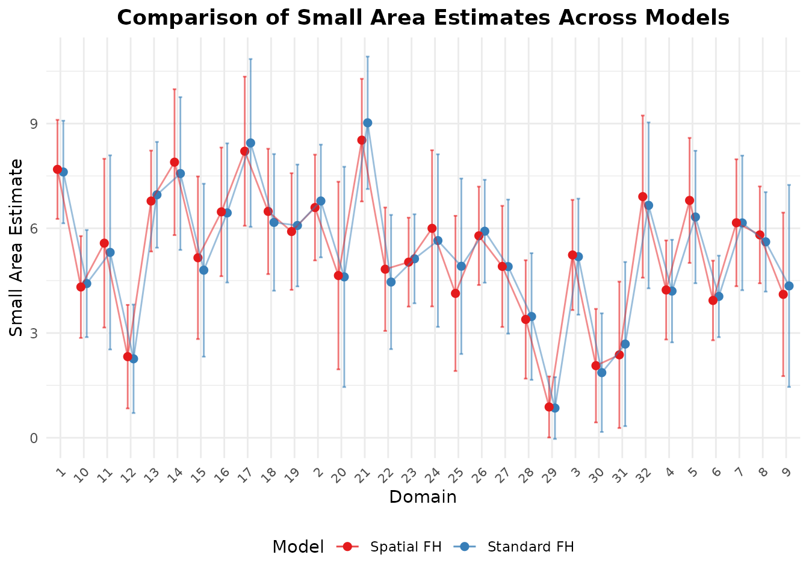

# Spatial and Spatio-Temporal Models

## Overview

When small areas are geographic units (such as counties, regencies, or
districts), spatial correlation frequently occurs: neighboring areas
tend to have more similar outcomes than distant ones. Furthermore, when
surveys are repeated over multiple years, temporal correlation between
time periods is also present.

**fastsae** provides specialized, high-performance implementations for
both: 1. **Spatial Fay-Herriot (`eblup_sfh`)**: Simultaneous
Autoregressive SAR(1) random effects. 2. **Spatio-Temporal Fay-Herriot
(`eblup_stfh`)**: Combined spatial SAR(1) and temporal AR(1) random
effects.

------------------------------------------------------------------------

## 1. Spatial Fay-Herriot Model (`eblup_sfh`)

### Model Formulation

The Spatial Fay-Herriot model (Pratesi & Salvati, 2008) models area
random effects using a Simultaneous Autoregressive (SAR(1)) process:

``` math
y = X\beta + u + e
```

``` math
u = \rho_1 W u + \epsilon_1 \implies u = (I - \rho_1 W)^{-1} \epsilon_1
```

where: - $`W`$ is a known row-standardized spatial proximity matrix
($`D \times D`$). - $`\rho_1 \in (-1, 1)`$ is the spatial autoregressive
parameter. - $`\epsilon_1 \sim N(0, \sigma_{u1}^2 I_D)`$ is independent
innovation noise. - $`e \sim N(0, V_e)`$ is sampling error with diagonal
matrix $`V_e = \text{diag}(D_1, \dots, D_D)`$.

### Fitting the Model

``` r

library(fastsae)
data("mys")
data("mys_proxmat")

# Fit Spatial Fay-Herriot model with REML
fit_sfh <- eblup_sfh(
  formula = y ~ x1 + x2 + x3,
  vardir = ~vardir,
  data = mys,
  W = mys_proxmat,
  method = "REML",
  print_result = FALSE
)

summary(fit_sfh)
#> 
#> ── Summary of fastsae Fit ──────────────────────────────────────────────────────
#> Call :
#> eblup_sfh(formula = y ~ x1 + x2 + x3, vardir = ~vardir, data = mys, method =
#> "REML", W = mys_proxmat, print_result = FALSE)
#> 
#> ✔ Convergence: Yes (in 18 iterations)
#> Model: Spatial Fay-Herriot (Area-level SAR)
#> Method: REML
#> 
#> Variance & Correlation Components:
#>  parameter   estimate std.error
#>   sigma2_u  0.9892261 0.4797447
#>        rho -1.0000000        NA
#> rho (spatial): -1 
#> 
#> Coefficients:
#>                   beta  std.error     zvalue pvalue
#> (Intercept)  3.2570714  0.6265689  5.1982651 0.0000
#> x1          -0.0020340  0.0080925 -0.2513457 0.8015
#> x2           0.0568516  0.0525488  1.0818827 0.2793
#> x3           0.0252179  0.0497283  0.5071123 0.6121
#> 
#> Goodness of Fit:
#> loglikelihood           AIC           BIC 
#>     -62.58874     137.17748     145.97189 
#> 
#> EBLUP Summary Statistics:
#>       mse              rse        
#>  Min.   :0.1966   Min.   : 9.384  
#>  1st Qu.:0.5897   1st Qu.:13.643  
#>  Median :0.8169   Median :19.046  
#>  Mean   :1.0420   Mean   :22.242  
#>  3rd Qu.:1.4214   3rd Qu.:27.305  
#>  Max.   :2.1610   Max.   :46.894
```

### Unsampled Domains and Spatial Kriging

A major advantage of `eblup_sfh` in **fastsae** is its automatic
handling of unsampled domains (domains with `y = NA`). Instead of
throwing an error or requiring manual subsetting, `eblup_sfh`
automatically performs **full-spatial kriging**:

``` r

# Count sampled vs unsampled domains
table(is.na(mys$y))
#> 
#> FALSE  TRUE 
#>    32    10

# Inspect estimates for unsampled domains
head(fit_sfh$df_eblup[is.na(mys$y), ])
#>    domain  y vardir    eblup random_effect      mse      rse
#> 21     21 NA      0 4.136624    0.33273263 1.773635 32.19482
#> 25     25 NA      0 3.666578   -0.63352730 1.606281 34.56606
#> 26     26 NA      0 6.293404    0.82251711 1.962186 22.25792
#> 27     27 NA      0 5.185438    0.66260236 1.879788 26.44046
#> 28     28 NA      0 5.159499   -0.02771458 1.448608 23.32748
#> 34     34 NA      0 3.834916    0.17166576 1.587847 32.85856
```

For unsampled areas, prediction borrows strength from both the
regression synthetic component $`x_d^\top \hat{\beta}`$ and spatial
proximity to neighboring sampled areas through
$`(I - \hat{\rho}_1 W)^{-1}`$.

### Multi-Threaded Bootstrap MSE

In addition to analytical Prasad-Rao style MSE, `eblup_sfh` supports
multi-threaded OpenMP bootstrap MSE estimation:

- **Parametric Bootstrap (`mse_type = "pbmse"`)**
- **Non-Parametric Bootstrap (`mse_type = "npbmse"`)**

``` r

fit_sfh_pb <- eblup_sfh(
  formula = y ~ x1 + x2 + x3,
  vardir = ~vardir,
  data = mys,
  W = mys_proxmat,
  mse_type = "pbmse",
  B = 50,
  n_threads = 2,
  seed = 123,
  print_result = FALSE
)
#> ℹ 10 unsampled domain(s) detected. Bootstrap MSE (pbmse) is computed for the 32 sampled domain(s); unsampled domain(s) get a full-spatial synthetic (kriging) prediction and analytical MSE instead.

head(fit_sfh_pb$df_eblup[, c("domain", "y", "eblup", "mse", "mse_pb", "mse_pbbc")])
#>   domain        y    eblup       mse    mse_pb  mse_pbbc
#> 1      1 8.359527 7.535193 0.4999462 0.5838185 0.5822064
#> 2      2 7.599650 6.564385 0.5831410 0.7059036 0.6571795
#> 3      3 5.514137 5.109460 0.6095214 0.7555265 0.6814817
#> 4      4 3.869326 4.273391 0.5018535 0.5742035 0.5552008
#> 5      5 6.305063 6.791422 0.7644430 0.7705470 0.8859110
#> 6      6 3.926807 4.016701 0.3398919 0.3798275 0.3712704
```

------------------------------------------------------------------------

## 2. Spatio-Temporal Fay-Herriot Model (`eblup_stfh`)

### Model Formulation

The Spatio-Temporal model (Marhuenda, Molina, & Morales, 2013) combines
spatial correlation and temporal autoregression for $`D`$ areas over
$`T`$ time periods. The panel does not need to be complete: cells
without a direct estimate are predicted (see below).

``` math
y_{dt} = x_{dt}^\top \beta + u_{1d} + u_{2dt} + e_{dt}
```

where: - $`u_1 = (u_{11}, \dots, u_{1D})^\top`$ captures static spatial
effects: $`u_1 = \rho_1 W u_1 + \epsilon_1`$. -
$`u_{2d} = (u_{2d1}, \dots, u_{2dT})^\top`$ captures dynamic temporal
effects for area $`d`$:
$`u_{2dt} = \rho_2 u_{2d,t-1} + \epsilon_{2dt}`$. -
$`e_{dt} \sim \text{ind. } N(0, D_{dt})`$ are sampling errors.

The model is defined on the full $`D \times T`$ grid: $`u_1`$ on all
domains of $`W`$, $`u_2`$ on all periods.

### Fitting the Spatio-Temporal Model

``` r

data("mys_panel")

# 42 domains x 11 years; y is NA for the two domains that are never sampled
table(sampled = !is.na(mys_panel$y))
#> sampled
#> FALSE  TRUE 
#>    22   440

# Fit Spatio-Temporal model with the analytical MSE, on the full panel and full W
fit_stfh <- eblup_stfh(
  formula = y ~ x1 + x2 + x3,
  data = mys_panel,
  vardir = ~vardir,
  domain = ~area,
  time = ~year,
  W = mys_proxmat,
  model = "ST",
  mse_type = "analytical",
  print_result = FALSE
)

summary(fit_stfh)
#> 
#> ── Summary of fastsae Fit ──────────────────────────────────────────────────────
#> Call :
#> eblup_stfh(formula = y ~ x1 + x2 + x3, vardir = ~vardir, data = mys_panel,
#> domain = ~area, time = ~year, W = mys_proxmat, model = "ST", mse_type =
#> "analytical", print_result = FALSE)
#> 
#> ✔ Convergence: Yes (in 11 iterations)
#> Model: Spatio-Temporal Fay-Herriot (SAR + AR(1) time effects)
#> Method: REML
#> Cells without a direct estimate: 22 of 462 (predicted from the model)
#> 
#> Variance & Correlation Components:
#>    estimate  std.error
#>   2.2066952 0.64896010
#>  -0.9011506 0.31237444
#>   0.0000000 0.02602554
#>   0.7526384         NA
#> 
#> Coefficients:
#>                   beta  std.error     zvalue pvalue
#> (Intercept)  4.4442780  0.4445132  9.9980779 0.0000
#> x1          -0.0008817  0.0060240 -0.1463646 0.8836
#> x2           0.0254871  0.0277726  0.9177081 0.3588
#> x3           0.0163716  0.0256365  0.6386035 0.5231
#> 
#> Goodness of Fit:
#> loglikelihood           AIC           BIC 
#>     -597.2647     1210.5294     1243.2236 
#> 
#> EBLUP Summary Statistics:
#>       mse               rse          
#>  Min.   :0.03199   Min.   :   2.997  
#>  1st Qu.:0.08171   1st Qu.:   5.256  
#>  Median :0.11107   Median :   6.117  
#>  Mean   :0.25728   Mean   :  29.722  
#>  3rd Qu.:0.16233   3rd Qu.:   9.613  
#>  Max.   :2.47830   Max.   :2521.153
```

The estimated variance and correlation components include: - `sigma21`:
Spatial random effect variance ($`\sigma_{u1}^2`$). - `rho1`: Spatial
autocorrelation ($`\rho_1`$). - `sigma22`: Temporal random effect
variance ($`\sigma_{u2}^2`$). - `rho2`: Temporal AR(1) autoregression
coefficient ($`\rho_2`$).

The analytical MSE is $`g_1 + g_2 + 2 g_3 - g_4`$ (Prasad-Rao type, with
the exact derivative of the EBLUP in $`g_3`$ and the curvature term
$`g_4`$ for the nonlinear $`\rho_1`$, $`\rho_2`$); the components are
returned as `fit_stfh$g1`, …, `fit_stfh$g4`. A parametric bootstrap MSE
is available with `mse_type = "bootstrap"` (and `B`, `seed`).

### Unsampled Domains and Missing Periods

Rows whose response is `NA` are kept and predicted, as long as the
auxiliary variables are known there. The variance components are
estimated from the sampled cells only (the marginal likelihood with the
missing cells integrated out), and each missing cell gets the best
linear unbiased predictor given the sampled data (Saei & Chambers, 2005;
Benedetti et al., 2024):

- a **missing period** of a sampled domain borrows from the other
  periods of that domain (AR(1) correlation) and from the neighbouring
  domains (SAR);
- a **domain that is never sampled** is predicted from its neighbours
  only (spatial kriging), so `W` must keep it.

``` r

est <- fit_stfh$df_eblup
# Cells predicted without a direct estimate
head(est[!est$sampled, c("domain", "time", "eblup", "mse", "rse")])
#>     domain time    eblup      mse      rse
#> 21      21 2016 6.356729 2.389320 24.31664
#> 25      25 2016 3.225462 2.405876 48.08889
#> 63      21 2017 6.367907 2.385248 24.25326
#> 67      25 2017 3.213502 2.416602 48.37534
#> 105     21 2018 6.361026 2.389905 24.30319
#> 109     25 2018 3.174470 2.438947 49.19602

# Their MSE is larger: no direct estimate, only borrowed strength
tapply(est$mse, ifelse(est$sampled, "sampled", "unsampled"), median)
#>   sampled unsampled 
#> 0.1084668 2.4016341
```

For these cells the analytical MSE is $`g_1 + g_2 + g_3`$ ($`g_3`$ from
the exact derivative of the predictor in the variance components); the
bootstrap generates the random effects on the full grid and covers every
cell too.

------------------------------------------------------------------------

## 3. Comparing Models with `autoplot`

You can directly compare EBLUP estimates and uncertainty across
different models using
[`autoplot()`](https://ggplot2.tidyverse.org/reference/autoplot.html):

``` r

# Compare Fay-Herriot vs Spatial Fay-Herriot
fit_fh <- eblup_fh(y ~ x1 + x2 + x3, vardir = ~vardir, data = na.omit(mys), print_result = FALSE)
W_clean <- mys_proxmat[!is.na(mys$y), !is.na(mys$y)]
fit_sfh_clean <- eblup_sfh(y ~ x1 + x2 + x3, vardir = ~vardir, data = na.omit(mys), W = W_clean, print_result = FALSE)
#> Warning: `W` is not row-standardised: some rows do not sum to 1.
#> ℹ The SAR model with rho in (-1, 1) assumes rows summing to 1; use `W /
#>   rowSums(W)` or `create_weights(style = "W")`.

autoplot(list("Standard FH" = fit_fh, "Spatial FH" = fit_sfh_clean), type = "comparison")
```



------------------------------------------------------------------------

## 4. Bayesian Spatio-Temporal Modeling (`hb_area`)

In addition to frequentist C++ EBLUP implementations (`eblup_sfh` and
`eblup_stfh`), **fastsae** provides
[`hb_area()`](https://ridsonap.github.io/fastsae/reference/hb_area.md)
for Bayesian spatio-temporal modeling powered by **INLA**. This
supports: - Bounded proportions via Beta regression (matching
`tipsae`) - Discrete counts via Poisson and Negative Binomial
regression - Binary aggregates via Binomial regression - Flexible
space-time structures including domain-specific random walks, separable
dynamic fields, and Knorr-Held Types I–IV.

For full details and a case study on Italian poverty data, see the
vignette [Bayesian Area-Level Small Area Estimation with
INLA](https://ridsonap.github.io/fastsae/articles/hb-area-inla.md).

------------------------------------------------------------------------

## References

- Benedetti, R., Piersimoni, F., Pratesi, M., Salvati, N., & Suesse, T.
  (2024). Handling out-of-sample areas to estimate the unemployment rate
  at local labour market areas in Italy. *International Statistical
  Review*. <https://doi.org/10.1111/insr.12596>
- Marhuenda, Y., Molina, I., & Morales, D. (2013). Small area estimation
  with spatio-temporal Fay-Herriot models. *Computational Statistics &
  Data Analysis*, 58, 308–325.
- Pratesi, M., & Salvati, N. (2008). Small area estimation for spatially
  correlated data: A Fay-Herriot with the spatial linear spline model.
  *Journal of Applied Statistics*, 35(7), 781–794.
- Saei, A., & Chambers, R. (2005). Out of sample estimation for small
  areas using area level data. Southampton Statistical Sciences Research
  Institute, Methodology Working Paper M05/11.
