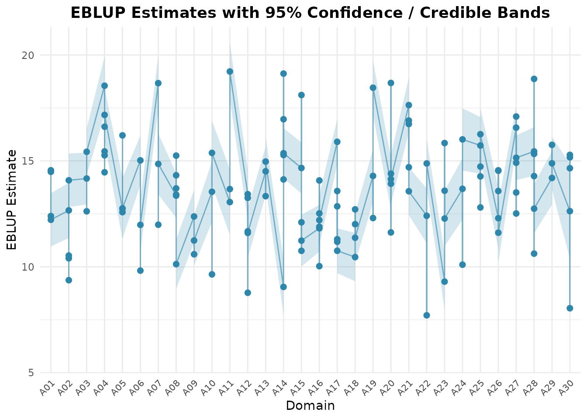

# Sub-Area Level Estimation with Two-Fold Models

## Overview

Surveys are often designed for large areas (provinces, regions) but the
estimates are needed for the sub-areas inside them (districts,
municipalities). The sub-areas of one area share the area’s
characteristics, so their estimates should borrow strength not only from
the regression on auxiliary variables, but also from the other sub-areas
of the same area.

The two-fold sub-area level model of Torabi and Rao (2014) does this
with two nested random effects. **fastsae** fits it in two ways:

| Function | Approach | Uncertainty | Area aggregates |
|:---|:---|:---|:---|
| [`eblup_twofold()`](https://ridsonap.github.io/fastsae/reference/eblup_twofold.md) | EBLUP, REML or ML | Analytical (Prasad-Rao type) or parametric bootstrap MSE | `df_area`, weighted by `weight` |
| [`hb_twofold()`](https://ridsonap.github.io/fastsae/reference/hb_twofold.md) | Hierarchical Bayes with INLA | Posterior SD and credible intervals | `df_area`, weighted by `weight` |

[`hb_twofold()`](https://ridsonap.github.io/fastsae/reference/hb_twofold.md)
also fits binomial and Poisson responses and a spatial (BYM2, Besag)
area effect.

------------------------------------------------------------------------

## Model

For sub-area $`j`$ ($`j = 1, \dots, N_i`$) of area $`i`$
($`i = 1, \dots, m`$), the direct estimator $`y_{ij}`$ with known
sampling variance $`\psi_{ij}`$ follows

``` math
y_{ij} = \theta_{ij} + e_{ij}, \qquad \theta_{ij} = x_{ij}^\top \beta + v_i + u_{ij},
```

with $`v_i \sim N(0, \sigma_v^2)`$ the area effect,
$`u_{ij} \sim N(0, \sigma_u^2)`$ the sub-area effect and
$`e_{ij} \sim N(0, \psi_{ij})`$ the sampling error, all independent.

Compared with the Fay-Herriot model, which treats every sub-area as
unrelated, the area effect $`v_i`$ is estimated from all the sampled
sub-areas of area $`i`$. This matters most for sub-areas that are not
sampled: they get $`x_{ij}^\top \hat\beta + \hat v_i`$ instead of the
synthetic $`x_{ij}^\top \hat\beta`$ alone. Only a sub-area of an area
without any sample is predicted synthetically.

The output follows the notation above: `random_effect_var` holds
`sigma2_v` (area) and `sigma2_u` (sub-area), and `df_eblup` (or `df_hb`)
holds `random_effect_area` and `random_effect_subarea`.

------------------------------------------------------------------------

## Example with simulated data

We simulate 30 areas with 3 to 6 sub-areas each, so that the true
sub-area means $`\theta_{ij}`$ are known. Fifteen sub-areas have no
sample (their direct estimate is `NA`), and all the sub-areas of area
`A30` are unsampled.

``` r

library(fastsae)

set.seed(2024)
m <- 30
dat <- do.call(rbind, lapply(seq_len(m), function(i) {
  ni <- sample(3:6, 1)
  data.frame(
    area = sprintf("A%02d", i),
    subarea = sprintf("A%02d-%d", i, seq_len(ni)),
    x1 = rnorm(ni, mean = 2),
    pop = sample(200:2000, ni)
  )
}))
v <- rnorm(m, sd = 1)
names(v) <- unique(dat$area)
dat$theta <- 10 + 2 * dat$x1 + v[dat$area] + rnorm(nrow(dat), sd = sqrt(0.5))
dat$vardir <- runif(nrow(dat), 0.5, 2)
dat$y <- dat$theta + rnorm(nrow(dat), sd = sqrt(dat$vardir))

# Unsampled sub-areas: 15 at random, plus every sub-area of A30
unsampled <- union(sample(which(dat$area != "A30"), 15), which(dat$area == "A30"))
dat$y[unsampled] <- NA

c(subareas = nrow(dat), sampled = sum(!is.na(dat$y)))
#> subareas  sampled 
#>      131      111
head(dat)
#>   area subarea        x1  pop    theta   vardir        y
#> 1  A01   A01-1 1.5347257 1857 13.78128 1.663801 12.20118
#> 2  A01   A01-2 2.5191534 1961 15.03099 1.105026 14.48113
#> 3  A01   A01-3 2.5284898 1222 14.79953 1.301555 15.01471
#> 4  A01   A01-4 1.4848072 1252 11.84648 1.406429 11.36094
#> 5  A02   A02-1 1.8729653 1255 13.61192 1.986447 12.02304
#> 6  A02   A02-2 0.7751246  924 12.23727 1.268523       NA
```

Each row is one sub-area. Unsampled sub-areas stay in the data with
`y = NA` and their covariates, so that they are predicted.

### Fitting the EBLUP

``` r

fit_tf <- eblup_twofold(
  y ~ x1,
  vardir = "vardir",
  domain = "area",
  subarea = "subarea",
  data = dat,
  weight = "pop",
  print_result = FALSE
)

fit_tf$random_effect_var
#>  sigma2_v  sigma2_u 
#> 1.1067031 0.1486881
fit_tf$estcoef
#>                 beta std.error stderr_beta   zvalue        pvalue
#> (Intercept) 9.605159 0.3223129   0.3223129 29.80073 3.822665e-195
#> x1          2.104314 0.1144109   0.1144109 18.39260  1.505751e-75
head(fit_tf$df_eblup)
#>   domain subarea        y    eblup   vardir random_effect_area
#> 1    A01   A01-1 12.20118 12.39678 1.663801         -0.4204473
#> 2    A01   A01-2 14.48113 14.48525 1.105026         -0.4204473
#> 3    A01   A01-3 15.01471 14.55766 1.301555         -0.4204473
#> 4    A01   A01-4 11.36094 12.21855 1.406429         -0.4204473
#> 5    A02   A02-1 12.02304 12.66335 1.986447         -0.8351927
#> 6    A02   A02-2       NA 10.40107 1.268523         -0.8351927
#>   random_effect_subarea       mse      rse
#> 1         -0.0174796591 0.4205889 5.231427
#> 2         -0.0005543296 0.3941804 4.334326
#> 3          0.0522123369 0.4063272 4.378712
#> 4         -0.0906664052 0.4122688 5.254976
#> 5         -0.0479275040 0.4428309 5.254973
#> 6          0.0000000000 0.4782345 6.648787
```

The default `mse_type = "analytical"` gives the Prasad-Rao type MSE of
the REML fit (for ML it adds the bias correction). Sub-area `A01-3` is
not sampled: it still gets the area effect of `A01`, while its sub-area
effect is 0.

`weight` (here the population of each sub-area) aggregates the sub-area
EBLUPs to area means,
$`\tilde\theta_i = \sum_j w_{ij}\tilde\theta_{ij} / \sum_j w_{ij}`$, in
`df_area`. Their MSE accounts for the errors the sub-areas of an area
share (the estimated area effect and $`\hat\beta`$), so it is larger
than $`\sum_j w_{ij}^2\,\mathrm{mse}_{ij}`$ would suggest.

``` r

head(fit_tf$df_area)
#>   domain eblup_area  mse_area rse_area n_subareas n_sampled
#> 1    A01   13.43189 0.2748473 3.903090          4         4
#> 2    A02   11.19056 0.3146821 5.012844          5         4
#> 3    A03   14.07817 0.2208185 3.337885          3         3
#> 4    A04   16.64890 0.3174408 3.384120          6         4
#> 5    A05   13.25981 0.4443843 5.027383          4         3
#> 6    A06   12.79993 0.2838182 4.162101          3         3
```

### How much does the area effect help?

Because the data are simulated, we can compare each estimator with the
true $`\theta_{ij}`$. The Fay-Herriot model, fitted with
[`eblup_fh()`](https://ridsonap.github.io/fastsae/reference/eblup_fh.md)
on the same rows, ignores the areas.

``` r

fit_fh <- eblup_fh(y ~ x1, vardir = "vardir", data = dat, print_result = FALSE)

sampled <- !is.na(dat$y)
in_sampled_area <- !sampled & dat$area != "A30"
emp_mse <- function(est, rows) mean((est[rows] - dat$theta[rows])^2)

data.frame(
  rows = c("sampled sub-areas", "unsampled sub-areas of sampled areas"),
  direct = c(emp_mse(dat$y, sampled), NA),
  fay_herriot = c(
    emp_mse(fit_fh$df_eblup$eblup, sampled),
    emp_mse(fit_fh$df_eblup$eblup, in_sampled_area)
  ),
  two_fold = c(
    emp_mse(fit_tf$df_eblup$eblup, sampled),
    emp_mse(fit_tf$df_eblup$eblup, in_sampled_area)
  )
)
#>                                   rows   direct fay_herriot  two_fold
#> 1                    sampled sub-areas 1.211463   0.5087563 0.5291281
#> 2 unsampled sub-areas of sampled areas       NA   1.5247133 0.7748664
```

Both models improve on the direct estimates of the sampled sub-areas,
and in this data set they are about equally accurate there: a sampled
sub-area has its own direct estimate, so the area effect adds little.
The difference is in the unsampled sub-areas of sampled areas. The
Fay-Herriot model can only give them the synthetic estimate, while the
two-fold model adds the estimated area effect and roughly halves the
error. This is one simulated data set, not a simulation study: the gain
depends on how large $`\sigma_v^2`$ is relative to $`\sigma_u^2`$.

### Bootstrap MSE

The parametric bootstrap refits the model on `B` data sets generated
from the fitted model and predicts with the same estimator as the point
estimate. `seed` makes it reproducible without changing the random
number stream of the session.

``` r

fit_boot <- eblup_twofold(
  y ~ x1,
  vardir = "vardir",
  domain = "area",
  subarea = "subarea",
  data = dat,
  mse_type = "bootstrap",
  B = 100,
  seed = 1,
  print_result = FALSE
)

summary(fit_boot$df_eblup$mse / fit_tf$df_eblup$mse)
#>    Min. 1st Qu.  Median    Mean 3rd Qu.    Max. 
#>  0.6322  0.8257  0.9056  0.9205  0.9971  1.4684
```

The two MSE estimators agree on average; with `B = 100` single bootstrap
values are still noisy. Use `mse_type = "none"` when only the point
estimates are needed.

### Diagnostics and plots

The usual tools of the package work on the result:

``` r

autoplot(fit_tf, type = "comparison")
```



``` r

diagnose(fit_tf)
#> ── fastsae Small Area Estimation Diagnostic Report ─────────────────────────────
#> Model: "TWOFOLD" | Domains: 131 (Sampled: 111, Unsampled: 20)
#> 
#> ── 1. Precision & Efficiency Gain ──
#> 
#> ✔ Domains with RSE < 25%: 100% (High precision)
#> ✔ Average RSE reduction: Direct "8.54%" -> SAE "4.97%" (Gain: 3.57%)
#> ✔ Variance reduction in 100% of areas (MSE ratio median: 3.2, max: 5.34)
#> 
#> ── 2. Brown et al. (2001) Diagnostics ──
#> 
#> ✔ Goodness-of-Fit Statistic W: W = 60.62 (df = 111), p-value = 1 [Consistent with direct estimates]
#> ℹ Bias regression (direct ~ model, descriptive): alpha = -0.7789 (SE 0.5383), beta = 1.0544 (SE 0.0388), R^2 = 0.872
#> A slope above 1 is expected for shrinkage estimators; see ?diagnose.
#> ────────────────────────────────────────────────────────────────────────────────
#> ✔ Final Assessment: PASS: Model estimates are consistent with the direct estimates (Brown W test) and reliable.
#> ────────────────────────────────────────────────────────────────────────────────
```

------------------------------------------------------------------------

## Hierarchical Bayes with `hb_twofold()`

[`hb_twofold()`](https://ridsonap.github.io/fastsae/reference/hb_twofold.md)
fits the same model with INLA. It needs the **INLA** package, which is
not on CRAN; see <https://www.r-inla.org/download/>. The chunks below
are only run when INLA is installed.

The argument `weight` (here the population of each sub-area) aggregates
the sub-area posteriors to area estimates,
$`\hat\theta_i = \sum_j w_{ij} \theta_{ij} / \sum_j w_{ij}`$, with their
posterior uncertainty in `df_area`.

``` r

fit_hb <- hb_twofold(
  y ~ x1,
  vardir = "vardir",
  domain = "area",
  subarea = "subarea",
  weight = "pop",
  data = dat,
  print_result = FALSE
)

fit_hb$random_effect_var
#>   sigma2_v   sigma2_u 
#> 0.98042752 0.04514054
head(fit_hb$df_hb)
#>   domain subarea        y       hb linear_pred   vardir        sd       mse
#> 1    A01   A01-1 12.20118 12.42216    12.42216 1.663801 0.5507614 0.3033381
#> 2    A01   A01-2 14.48113 14.50121    14.50121 1.105026 0.5402938 0.2919174
#> 3    A01   A01-3 15.01471 14.54443    14.54443 1.301555 0.5456819 0.2977687
#> 4    A01   A01-4 11.36094 12.28444    12.28444 1.406429 0.5495778 0.3020357
#> 5    A02   A02-1 12.02304 12.72627    12.72627 1.986447 0.5702496 0.3251847
#> 6    A02   A02-2       NA 10.43896    10.43896 1.268523 0.5975203 0.3570305
#>        rse ci_lower ci_upper random_effect_area random_effect_subarea
#> 1 4.433700 11.33418 13.50220         -0.4076506         -9.329018e-03
#> 2 3.725854 13.43691 15.56170         -0.4076506         -1.610113e-03
#> 3 3.751826 13.47666 15.62394         -0.4076506          2.312350e-02
#> 4 4.473770 11.18800 13.35101         -0.4076506         -4.243916e-02
#> 5 4.480885 11.59235 13.83691         -0.8011043         -2.417371e-02
#> 6 5.723944  9.25947 11.61621         -0.8011043         -1.080782e-11
head(fit_hb$df_area)
#>   domain  hb_area   sd_area  mse_area rse_area ci_lower_area ci_upper_area
#> 1    A01 13.45490 0.4908445 0.2409284 3.648072      12.53683      14.48164
#> 2    A02 11.25353 0.5329704 0.2840575 4.736029      10.25695      12.21224
#> 3    A03 14.05266 0.4416122 0.1950213 3.142553      13.17667      14.96141
#> 4    A04 16.55565 0.5186690 0.2690175 3.132883      15.43037      17.40842
#> 5    A05 13.31399 0.5457555 0.2978491 4.099113      12.29381      14.41104
#> 6    A06 12.79458 0.4726022 0.2233529 3.693768      11.74917      13.57948
#>   n_subareas
#> 1          4
#> 2          5
#> 3          3
#> 4          6
#> 5          4
#> 6          3
```

With the default vague priors the posterior means are very close to the
EBLUP:

``` r

cor(fit_tf$df_eblup$eblup, fit_hb$df_hb$hb)
#> [1] 0.9996075
compare_sae(fit_tf, fit_hb, names = c("EBLUP two-fold", "HB two-fold"))
#> 
#> ── Small Area Estimation Model Concordance & Comparison ────────────────────────
#> Model 1: EBLUP two-fold
#> Model 2: HB two-fold
#> Matched Domains: 131
#> ────────────────────────────────────────────────────────────────────────────────
#> 
#> Key Concordance & Efficiency Metrics:
#>                                                    Metric     Value
#>                                           Matched Domains       131
#>                                   Pearson Correlation (r)    0.9996
#>                                Spearman Correlation (rho)    0.9995
#>                            Mean Absolute Difference (MAE)    0.0526
#>                       Root Mean Squared Difference (RMSD)    0.0698
#>             Mean MSE Ratio (EBLUP two-fold / HB two-fold)    1.3631
#>           Median MSE Ratio (EBLUP two-fold / HB two-fold)    1.3586
#>       Domains where HB two-fold reports lower uncertainty 131 / 131
#>  % of domains where HB two-fold reports lower uncertainty    100.0%
#>                               Mean RSE % (EBLUP two-fold)     4.97%
#>                                  Mean RSE % (HB two-fold)     4.27%
#>                                 Average RSE Reduction (%)     0.69%
#> ℹ One model is Hierarchical Bayes: its posterior variance and the frequentist MSE of the other are not the same quantity, so a smaller value does not show a more accurate estimator.
```

[`compare_sae()`](https://ridsonap.github.io/fastsae/reference/compare_sae.md)
reports smaller posterior variances than EBLUP MSEs. The two are not the
same quantity, and here the posterior mean of $`\sigma_u^2`$ is also
smaller than the REML estimate (both are below the true value 0.5, which
is hard to separate from sampling variances of 0.5 to 2). A smaller
reported uncertainty is therefore not evidence of a more accurate
estimator. With simulated data, the error against the truth settles it;
here the two are practically equal:

``` r

c(
  eblup_two_fold = emp_mse(fit_tf$df_eblup$eblup, sampled | in_sampled_area),
  hb_two_fold = emp_mse(fit_hb$df_hb$hb, sampled | in_sampled_area)
)
#> eblup_two_fold    hb_two_fold 
#>      0.5583827      0.5692370
```

For counts or proportions, use `family = "poisson"` with `exposure` or
`family = "binomial"` with `trials`; with `spatial = "bym2"` and a
neighbourhood graph `W` between areas (for example from
[`create_weights()`](https://ridsonap.github.io/fastsae/reference/create_weights.md)),
the area effects are spatially correlated.

### MCMC with `engine = jax_engine()`

The same model can be sampled by MCMC (NumPyro’s No-U-Turn sampler on
JAX) instead of INLA. It needs Python with `jax` and `numpyro` (see
[`?setup_numpyro_env`](https://ridsonap.github.io/fastsae/reference/setup_numpyro_env.md)),
so this chunk is not run here. The result has the same structure, plus
the posterior draws in `draws` and the largest split R-hat in
`rhat_max`; the area aggregates in `df_area` come from the MCMC draws.

``` r

fit_jax <- hb_twofold(
  y ~ x1,
  vardir = "vardir",
  domain = "area",
  subarea = "subarea",
  weight = "pop",
  data = dat,
  engine = jax_engine(warmup = 1000, samples = 1000, chains = 4),
  print_result = FALSE
)
fit_jax$rhat_max
head(fit_jax$df_area)
```

The priors differ from those of INLA (half-normal standard deviations
instead of PC priors), so the estimates differ slightly; on simulated
data with 20 areas the area means of the two engines correlated above
0.999.

------------------------------------------------------------------------

## Practical notes

- Give one row per sub-area. The `domain` column identifies the area and
  is required.
- `vardir` must be finite and positive for every sampled sub-area;
  unsampled sub-areas can have `NA`. Covariates must be complete for all
  rows, sampled or not.
- At least two areas need sampled sub-areas, otherwise $`\sigma_v^2`$
  cannot be estimated.
- [`eblup_twofold()`](https://ridsonap.github.io/fastsae/reference/eblup_twofold.md)
  has `self_benchmark = TRUE` for estimates that add up to a known total
  (see
  [`?eblup_twofold`](https://ridsonap.github.io/fastsae/reference/eblup_twofold.md)).

## References

- Torabi, M., & Rao, J. N. K. (2014). On small area estimation under a
  sub-area level model. *Journal of Multivariate Analysis*, 127, 36–55.
- Rao, J. N. K., & Molina, I. (2015). *Small Area Estimation* (2nd ed.).
  John Wiley & Sons.
- Rue, H., Martino, S., & Chopin, N. (2009). Approximate Bayesian
  inference for latent Gaussian models by using integrated nested
  Laplace approximations. *Journal of the Royal Statistical Society:
  Series B*, 71(2), 319–392.
