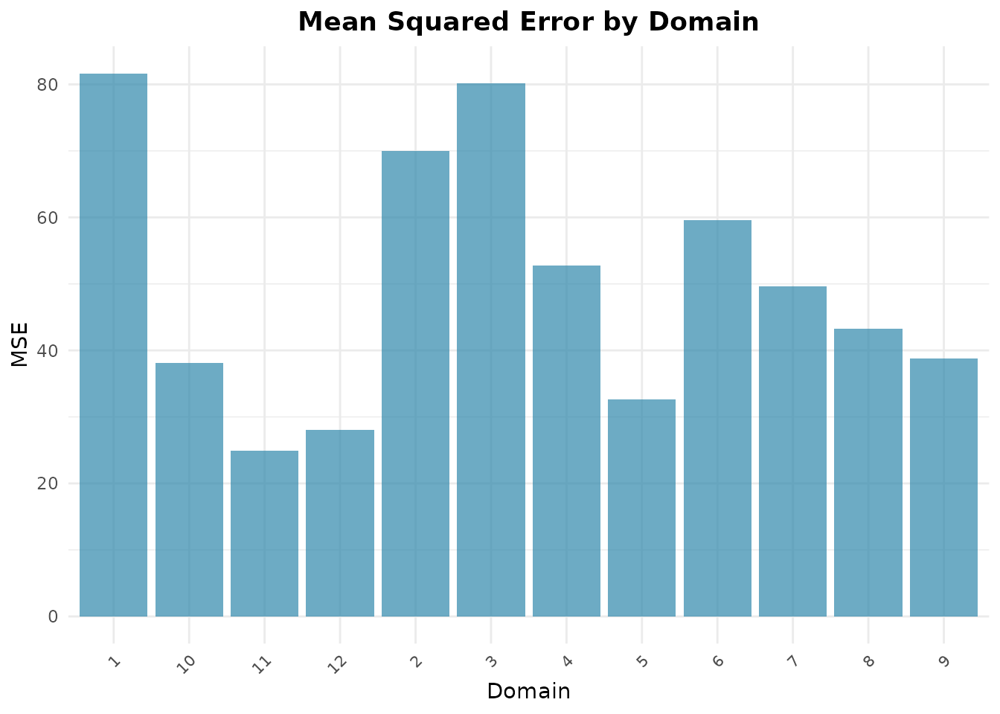
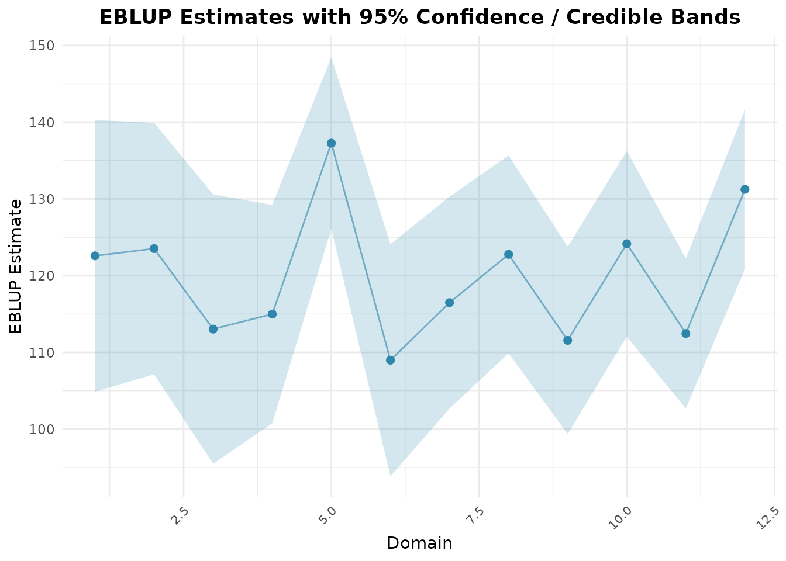

# Unit-Level Estimation with Battese-Harter-Fuller

## Overview

Unlike area-level models that aggregate data prior to modeling,
**unit-level models** operate directly on individual survey unit records
(e.g., households, farms, or persons) while linking them to population
auxiliary aggregates (e.g., census means or satellite imagery).

The **fastsae** package implements the nested error regression model of
Battese, Harter, and Fuller (1988) via
[`eblup_bhf()`](https://ridsonap.is-a.dev/fastsae/reference/eblup_bhf.md),
providing fast estimation and parallel parametric bootstrap MSE.
[`hb_unit()`](https://ridsonap.is-a.dev/fastsae/reference/hb_unit.md)
fits the same model as a hierarchical Bayes model with INLA (see the
last section).

------------------------------------------------------------------------

## Model Formulation

For individual unit $`j`$ ($`j = 1, \dots, n_d`$) in small area $`d`$
($`d = 1, \dots, D`$):

``` math
y_{dj} = x_{dj}^\top \beta + u_d + e_{dj}
```

where: - $`u_d \sim \text{i.i.d. } N(0, \sigma_u^2)`$ is the
area-specific random effect. -
$`e_{dj} \sim \text{i.i.d. } N(0, \sigma_e^2)`$ is the unit-level error
variance. - $`u_d`$ and $`e_{dj}`$ are mutually independent.

The small area population mean $`\bar{Y}_d`$ is estimated by:

``` math
\hat{\bar{Y}}_d^{\text{EBLUP}} = \bar{X}_d^\top \hat{\beta} + \gamma_d (\bar{y}_d - \bar{x}_d^\top \hat{\beta})
```

where: - $`\bar{X}_d`$ is the known population mean vector of auxiliary
variables for domain $`d`$. - $`\bar{y}_d`$ and $`\bar{x}_d`$ are the
sample means for domain $`d`$. -
$`\gamma_d = \frac{\sigma_u^2}{\sigma_u^2 + \sigma_e^2 / n_d}`$ is the
shrinkage ratio.

------------------------------------------------------------------------

## Step-by-Step Example

### 1. Data Preparation

We use the classic `cornsoybean` dataset, reporting corn crop hectares
per segment in 12 Iowa counties:

``` r

library(fastsae)
data("cornsoybean")
data("cornsoybeanmeans")

# Align column names for population auxiliary means
df_pop <- cornsoybeanmeans
names(df_pop)[names(df_pop) == "MeanCornPixPerSeg"] <- "CornPix"
names(df_pop)[names(df_pop) == "MeanSoyBeansPixPerSeg"] <- "SoyBeansPix"
names(df_pop)[names(df_pop) == "CountyIndex"] <- "County"

head(cornsoybean)
#>   County CornHec SoyBeansHec CornPix SoyBeansPix
#> 1      1  165.76        8.09     374          55
#> 2      2   96.32      106.03     209         218
#> 3      3   76.08      103.60     253         250
#> 4      4  185.35        6.47     432          96
#> 5      4  116.43       63.82     367         178
#> 6      5  162.08       43.50     361         137
head(df_pop)
#>   County CountyName SampSegments PopnSegments CornPix SoyBeansPix
#> 1      1 CerroGordo            1          545  295.29      189.70
#> 2      2   Hamilton            1          566  300.40      196.65
#> 3      3      Worth            1          394  289.60      205.28
#> 4      4   Humboldt            2          424  290.74      220.22
#> 5      5   Franklin            3          564  318.21      188.06
#> 6      6 Pocahontas            3          570  257.17      247.13
```

### 2. Fit BHF Model with Bootstrap MSE

We fit the model using
[`eblup_bhf()`](https://ridsonap.is-a.dev/fastsae/reference/eblup_bhf.md).
The domain-level Mean Squared Error (MSE) is estimated by parametric
bootstrap (`mse_type = "bootstrap"`, the default; `mse_type = "none"`
skips it):

``` r

fit_bhf <- eblup_bhf(
  formula = CornHec ~ CornPix + SoyBeansPix,
  unit_data = cornsoybean,
  Xpop = df_pop,
  domain_var = "County",
  popsize_var = "PopnSegments",
  method = "REML",
  mse_type = "bootstrap",
  B = 50,
  seed = 123,
  print_result = FALSE
)

summary(fit_bhf)
#> 
#> ── Summary of fastsae Fit ──────────────────────────────────────────────────────
#> Call :
#> eblup_bhf(formula = CornHec ~ CornPix + SoyBeansPix, unit_data = cornsoybean,
#> Xpop = df_pop, domain_var = "County", popsize_var = "PopnSegments", method =
#> "REML", B = 50, mse_type = "bootstrap", seed = 123, print_result = FALSE)
#> 
#> ✔ Convergence: Yes (in - iterations)
#> Model: Battese-Harter-Fuller (Unit-level)
#> 
#> Variance Components:
#> sigma2_u: 63.31489 
#> 
#> Coefficients:
#>                  beta std.error    zvalue pvalue
#> (Intercept) 17.963979 30.974505  0.579960 0.5619
#> CornPix      0.366335  0.064959  5.639511 0.0000
#> SoyBeansPix -0.030364  0.067576 -0.449327 0.6532
#> 
#> Goodness of Fit:
#> loglikelihood           AIC           BIC 
#>     -159.2759      328.5517      336.6063 
#> 
#> EBLUP Summary Statistics:
#>       mse             rse       
#>  Min.   :24.89   Min.   :4.039  
#>  1st Qu.:36.74   1st Qu.:4.838  
#>  Median :46.45   Median :5.816  
#>  Mean   :49.96   Mean   :5.839  
#>  3rd Qu.:62.20   3rd Qu.:6.849  
#>  Max.   :81.65   Max.   :7.921
```

### 3. Inspect Domain Estimates

The resulting `df_eblup` data frame contains the domain estimates along
with sample size, MSE, and Relative Standard Error (RSE):

``` r

head(fit_bhf$df_eblup)
#>   domain    eblup samp_size      mse      rse
#> 1      1 122.5825         1 81.64650 7.371235
#> 2      2 123.5274         1 69.94383 6.770354
#> 3      3 113.0343         1 80.17283 7.921429
#> 4      4 114.9901         2 52.75789 6.316599
#> 5      5 137.2660         3 32.60240 4.159698
#> 6      6 108.9807         3 59.61422 7.084763
```

### 4. Visualizing Results with `autoplot`

For unit-level models, domain uncertainty and model comparisons can be
displayed with
[`autoplot()`](https://ggplot2.tidyverse.org/reference/autoplot.html):

``` r

# Plot MSE across counties
autoplot(fit_bhf, type = "mse")
```



``` r


# Plot EBLUP estimates with confidence intervals
autoplot(fit_bhf, type = "comparison")
```



------------------------------------------------------------------------

## Hierarchical Bayes with `hb_unit()`

[`hb_unit()`](https://ridsonap.is-a.dev/fastsae/reference/hb_unit.md)
fits the nested error model with INLA and returns posterior means,
standard deviations and credible intervals of the county means. It needs
the **INLA** package, which is not on CRAN
(<https://www.r-inla.org/download/>); the chunks below are only run when
INLA is installed. The arguments are those of
[`eblup_bhf()`](https://ridsonap.is-a.dev/fastsae/reference/eblup_bhf.md):

``` r

fit_hbu <- hb_unit(
  CornHec ~ CornPix + SoyBeansPix,
  unit_data = cornsoybean,
  Xpop = df_pop,
  domain_var = "County",
  popsize_var = "PopnSegments",
  print_result = FALSE
)

head(fit_hbu$df_hb[, c("domain", "samp_size", "hb", "sd", "ci_lower", "ci_upper")])
#>   domain samp_size       hb       sd  ci_lower ci_upper
#> 1      1         1 122.7313 8.804362 105.47477 139.9879
#> 2      2         1 123.6795 8.656224 106.71329 140.6457
#> 3      3         1 112.3751 9.453466  93.84635 130.9039
#> 4      4         2 114.8302 7.949844  99.24851 130.4119
#> 5      5         3 136.6722 8.598466 119.81918 153.5252
#> 6      6         3 108.7452 7.372621  94.29483 123.1955
```

County by county, the posterior means are close to the EBLUP:

``` r

data.frame(
  County = fit_bhf$df_eblup$domain,
  n = fit_bhf$df_eblup$samp_size,
  eblup = round(fit_bhf$df_eblup$eblup, 1),
  hb = round(fit_hbu$df_hb$hb, 1),
  rmse_eblup = round(sqrt(fit_bhf$df_eblup$mse), 1),
  sd_hb = round(fit_hbu$df_hb$sd, 1)
)
#>    County n eblup    hb rmse_eblup sd_hb
#> 1       1 1 122.6 122.7        9.0   8.8
#> 2       2 1 123.5 123.7        8.4   8.7
#> 3       3 1 113.0 112.4        9.0   9.5
#> 4       4 2 115.0 114.8        7.3   7.9
#> 5       5 3 137.3 136.7        5.7   8.6
#> 6       6 3 109.0 108.7        7.7   7.4
#> 7       7 3 116.5 116.5        7.0   6.9
#> 8       8 3 122.8 122.6        6.6   6.9
#> 9       9 4 111.6 111.1        6.2   6.9
#> 10     10 5 124.2 124.4        6.2   6.0
#> 11     11 5 112.5 113.3        5.0   7.3
#> 12     12 6 131.3 131.3        5.3   5.7
```

The two sets of estimates differ by about 1 hectare at most (under 1% of
the county means). The bootstrap root MSE and the posterior SD are
different quantities; here the SDs are larger in 10 of the 12 counties
(by up to half in counties 5 and 11), and with `B = 50` the bootstrap
MSE is itself noisy.

The prior of $`\sigma_u`$ is half-normal with the scale of the unit
responses (see
[`vignette("hb-priors")`](https://ridsonap.is-a.dev/fastsae/articles/hb-priors.md)).
With 12 counties the posterior of $`\sigma_u^2`$ is still skewed: its
exact posterior mean is about 100 and its median 68, against a REML
estimate of 63, and INLA’s summary of it (`random_effect_var`, 115 on
these data) is not accurate. Do not compare it with the REML estimate of
[`eblup_bhf()`](https://ridsonap.is-a.dev/fastsae/reference/eblup_bhf.md).
The county estimates in `df_hb` are reliable:
[`hb_unit()`](https://ridsonap.is-a.dev/fastsae/reference/hb_unit.md)
fits in INLA’s `"classic"` mode, which on these data matches the exact
posterior (computed by numerical integration over the two variances)
within 0.06 posterior SD, with SDs within 2%.

### MCMC with `engine = jax_engine()`

`hb_unit(engine = jax_engine())` samples the same model with NumPyro’s
NUTS sampler instead of INLA (it needs Python with ‘jax’ and ‘numpyro’;
see
[`setup_numpyro_env()`](https://ridsonap.is-a.dev/fastsae/reference/setup_numpyro_env.md)),
and summarises the county means from the MCMC draws:

``` r

fit_hbu_jax <- hb_unit(
  CornHec ~ CornPix + SoyBeansPix,
  unit_data = cornsoybean,
  Xpop = df_pop,
  domain_var = "County",
  popsize_var = "PopnSegments",
  engine = jax_engine(chains = 4, samples = 2000),
  print_result = FALSE
)
fit_hbu_jax$rhat_max
```

It uses the same priors as the INLA engine. On these data its county
means were within 0.16 posterior SD of INLA’s and its SDs 0.98-1.06
times INLA’s (four chains of 2,000 draws, largest R-hat 1.002). The
differences are Monte Carlo error: against the exact posterior the JAX
means were within 0.14 SD.

### Counties without a sample

A domain that is in `Xpop` but has no rows in `unit_data` is predicted
from the regression and its population means, in both functions. For
example, without the sample of county 1:

``` r

cs_without_1 <- cornsoybean[cornsoybean$County != 1, ]
fit_hbu1 <- hb_unit(
  CornHec ~ CornPix + SoyBeansPix,
  unit_data = cs_without_1,
  Xpop = df_pop,
  domain_var = "County",
  popsize_var = "PopnSegments",
  print_result = FALSE
)
fit_hbu1$unsampled_domains
#> [1] 1
fit_hbu1$df_hb[fit_hbu1$df_hb$domain == 1, c("domain", "samp_size", "hb", "sd")]
#>   domain samp_size       hb       sd
#> 1      1         0 119.4547 10.52653
```

The population means in `Xpop` must be complete: a missing mean is an
error, since the prediction of that county would be wrong.
[`hb_unit()`](https://ridsonap.is-a.dev/fastsae/reference/hb_unit.md)
also fits binomial and Poisson responses (`family`) and a spatial county
effect (`spatial = "bym2"` or `"besag"` with a proximity matrix `W`).
For binomial and Poisson responses the county means are predicted at the
mean covariates, which is biased for a nonlinear link (by -8% and -16%
in a simulation; see
[`?hb_unit`](https://ridsonap.is-a.dev/fastsae/reference/hb_unit.md)),
and the function warns about it.

## References

- Battese, G. E., Harter, R. M., & Fuller, W. A. (1988). An
  error-components model for prediction of county crop areas using
  survey and satellite data. *Journal of the American Statistical
  Association*, 83(401), 28–36.
- Rao, J. N. K., & Molina, I. (2015). *Small Area Estimation* (2nd ed.).
  John Wiley & Sons.
- Rue, H., Martino, S., & Chopin, N. (2009). Approximate Bayesian
  inference for latent Gaussian models by using integrated nested
  Laplace approximations. *Journal of the Royal Statistical Society:
  Series B*, 71(2), 319–392.
